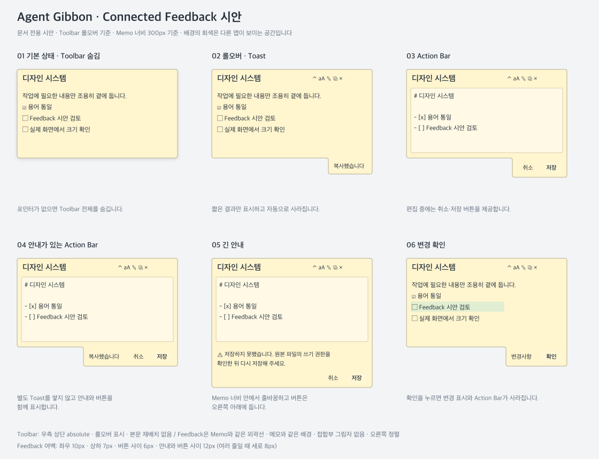
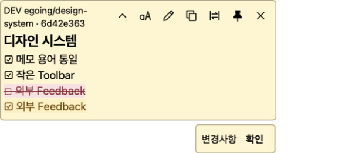
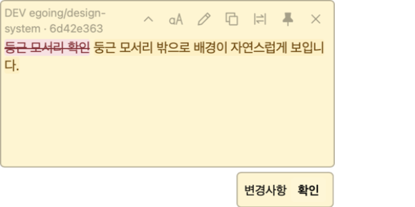
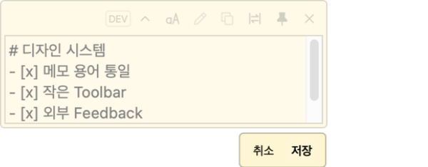
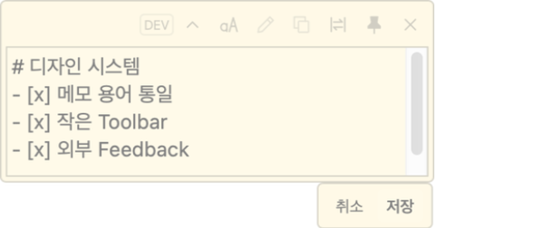
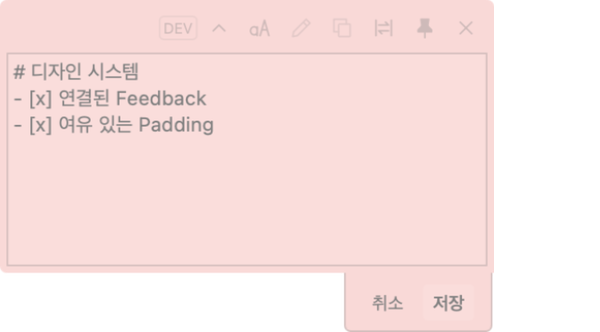
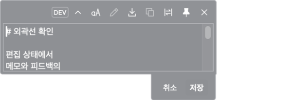
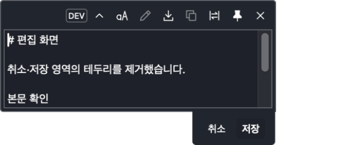
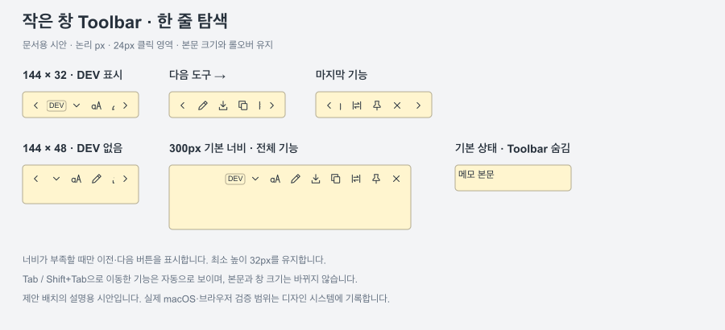

# Agent Gibbon Design System

앱의 용어, 구성요소, 크기와 동작을 일관되게 정의하여 UI 개발과 피드백의 공통 기준으로 사용한다. 설명은 한국어로, 공식 용어는 영어로 작성한다. 현재 UI는 한국어를 기본으로 하며 향후 영어를 주언어로 전환한다.

아래의 **확정**은 인터뷰에서 합의한 방향이며 구현 완료를 의미하지 않는다. **제안**은 화면에서 검토할 초기값이다.

## 문서 운영과 적용 상태

- 이 문서와 화면 시안은 프로젝트의 디자인 기준으로 채택되었다. 구체적인 Token 수치는 실제 앱에서 확인하며 조정할 제안값이다.
- 현재 적용 상태(2026-10-27): 앱의 용어·Toolbar·Tooltip·외부 Toast/Action Bar 반영 완료. macOS Apple Silicon 개발 앱에서 실제 저장·변경 확인·오류·접기·숨김·고정 동작을 검증했다. Windows·Intel 실행은 미검증이며 상세 범위는 아래 적용 기록을 따른다.
- 사람은 [README](../README.md)의 디자인 기준에서, 에이전트는 [프로젝트 지침](../AGENTS.md)에서 이 문서로 접근한다.
- 용어·구성요소·스타일·동작 기준이 바뀌면 같은 작업에서 관련 절과 시안을 갱신한다. 기준을 구현하면 적용 상태와 수행한 검증을 기록한다.
- 시안의 외형·배치 변경은 [SVG 원본](design/feedback-preview.svg)과 PNG에 함께 반영하고 렌더링 결과를 확인한다.
- 관련 작업 완료 안내에는 바뀐 내용과 이 문서의 열람 링크를 제공한다. 시안 변경 시 이미지도 함께 제시한다.

## 화면 시안

**최신 시안: Connected Feedback — 개발 앱 적용.** Memo 하단에서 Feedback이 하나의 표면으로 이어진다. 단순한 0px 간격 배치와 달리 접합부의 테두리·그림자·분리된 둥근 모서리를 없애고 외곽선을 하나로 연결한다.

아래는 Memo Window와 Feedback의 배치·크기·색상을 보여주는 **제안 시안**이다. 실제 앱 실행 화면이 아니며 Toolbar 아이콘은 위치 설명용이다. 회색 영역은 메모 뒤의 다른 앱이 보이는 공간을 뜻한다.

[확대 가능한 SVG 원본](design/feedback-preview.svg)

- **01 → 02:** 본문 크기는 그대로 두고, 하단 오른쪽 외곽이 늘어나 복사 완료 Toast를 담는다. 사라지면 원래 Memo 외곽으로 돌아간다.
- **03 → 04:** 편집 버튼이 필요한 동안에는 안내도 Action Bar 안에 표시한다. 별도 Toast를 쌓지 않는다.
- **05:** 긴 안내는 Memo 너비를 넘지 않고 줄바꿈하며, 취소·저장은 오른쪽 아래에 유지한다.
- **06:** 변경 확인 버튼은 이미 반영된 내용을 읽었음으로 처리한다.

그림은 300px 너비의 Memo를 기준으로 구성했다. 문서 뷰어의 축소·확대에 따라 화면에서 보이는 크기는 달라진다. 표시된 배경색은 색상 연동을 보여주는 예시이며 고정 기본색 제안은 아니다.

### macOS 개발 앱 실행 화면 — 연결형 시안 적용 전

2026-10-27 실행 화면. 위쪽 DEV 표시는 개발 인스턴스에만 나타난다. 아래 Action Bar는 메모 본문과 분리되어 있으며 일반 상태에는 스크롤바가 없다.

## Design Principles — 확정

- 기본은 조용한 보조 도구다. 사용자의 명시적 선택으로 메모별 강조를 제공한다. 개성 표현은 후순위다. 강조를 위한 별도 모드나 구체적 조작 방식은 아직 정하지 않았다.
- 동일한 역할은 같은 이름·모양·동작을 사용한다. 역할이 다른 버튼까지 같은 크기로 강제하지 않는다.
- 작은 UI를 유지한다. 시각적 크기와 클릭 영역을 구분하여 조작성을 확보한다.
- Memo 글자 크기를 바꿔도 Toolbar와 Feedback의 글자·버튼 크기는 유지한다.
- Memo Window의 본문 공간과 사용자 작업 포커스를 보존한다.

## Vocabulary

| 공식 용어 | 의미 | 상태 |
|---|---|---|
| Memo | 사용자가 다루는 콘텐츠 단위. 현재 한국어 UI에서는 ‘메모’ | 확정 |
| Memo Window | Memo를 표시하는 창. 위치·크기는 이 용어로 설명 | 확정 |
| Toolbar | 상단 기능 버튼 영역 | 확정 |
| Icon Button | 아이콘으로 기능을 표시하는 버튼 | 확정 |
| Tooltip | Icon Button의 기능 이름과 단축키 안내 | 확정 |
| Feedback | Toast 또는 Action Bar로 제공하는 안내·조작의 전체 개념 | 확정 |
| Toast | 버튼이 필요 없는 독립적인 안내 | 확정 |
| Action Bar | 현재 상태의 버튼과 필요한 안내를 함께 제공하는 영역 | 확정 |
| Primary Button | 주된 행동을 실행하는 버튼 | 확정 |
| Secondary Button | 취소 등 보조 행동을 실행하는 버튼 | 확정 |
| Memo Content | 본문 글·표·체크리스트·이미지 표시 영역 | 제안 |
| Editor | Markdown 원문 편집 영역 | 제안 |
| Change Highlight | 추가·수정·삭제를 보여주는 변경 표시 | 제안 |
| Acknowledge Button | 이미 반영된 변경을 읽었음을 알리는 확인 버튼 | 제안 |
| Capture Overlay | 영역을 선택하는 캡처 화면 | 제안 |

Feedback Bar는 논의 초기 이름이며 최종 구성요소 이름으로 사용하지 않는다. Editor Actions라는 별도 영역 대신 편집 버튼을 Action Bar에 배치한다. 내부 API·저장 키의 `note`까지 일괄 변경한다는 뜻은 아니다.

## Feedback — 확정

### 위치와 크기

- Memo Window 바깥 아래쪽에 오른쪽 정렬한다. 아래 공간이 부족하면 위쪽으로 전환한다.
- Toast와 Action Bar는 같은 자리를 공유한다. 두 영역을 동시에 위아래로 쌓지 않는다.
- 내용에 맞는 가변 너비를 사용하며 Memo Window 너비를 넘지 않는다.
- 한 줄을 기본으로 하되, 긴 문구는 줄바꿈하며 높이가 늘어난다. 안내를 한 줄 말줄임으로 강제하지 않는다.
- 긴 안내에서도 버튼은 오른쪽 아래에 유지한다. 버튼의 절대 화면 좌표까지 고정한다는 뜻은 아니다.
- 버튼이 필요 없으면 Toast만 표시한다. 빈 Action Bar 공간을 남기지 않는다.
- 표시·숨김으로 본문 공간을 줄이거나 Memo Window의 본문 크기를 바꾸지 않는다.

### 상태별 구성

| 상황 | 구성과 전환 |
|---|---|
| 복사 완료·단축키 등 단독 안내 | Toast를 잠시 표시 |
| 편집 중 | Action Bar에 취소·저장 버튼 표시 |
| 편집 중 일시적 안내 | Action Bar 버튼은 유지하고 안내 문구를 함께 표시 |
| 변경 확인 대기 | Action Bar에 변경 안내와 확인 버튼 표시 |
| 변경 확인 대기 중 일시적 안내 | 확인 버튼을 유지하며 문구를 잠시 교체한 뒤 변경 안내로 복귀 |
| 변경 확인 클릭 | 이미 반영된 변경을 읽었음으로 처리하고 Change Highlight 제거. 변경 적용 승인이 아님 |
| 저장 성공 | 편집 Action Bar를 해제하고 저장 완료 Toast 표시 |
| 저장 실패 | 취소·저장을 유지하며 오류 안내 표시 |

안내 지속 시간은 성격에 따라 달리한다. 단순 결과는 짧게, 사용법은 읽을 여유를 두고 표시한다. 확인 요청은 확인할 때까지 유지하며, 오류는 일시적 오류와 조치가 필요한 오류를 구분한다.

## Buttons and Tooltip — 확정

- Action Bar 버튼은 ‘취소’, ‘저장’, ‘확인’처럼 짧은 텍스트를 사용하고 중복 아이콘은 생략한다.
- Primary Button은 맨 오른쪽, Secondary Button은 그 왼쪽이다.
- 같은 Action Bar의 Primary와 Secondary는 같은 높이를 사용한다. Primary를 크게 만들지 않고 배경이나 글자 굵기로 차이를 준다.
- Toolbar Icon Button과 Action Bar 버튼의 높이는 역할에 맞게 별도로 정한다.
- Icon Button에 마우스를 올리면 Tooltip에 기능 이름과 현재 운영체제의 단축키를 표시한다. 복사는 macOS에서 ⌘C, Windows에서 Ctrl+C, 파일 저장은 각각 ⌘S와 Ctrl+S, 메모 숨기기는 Esc다. 편집 중 Esc는 편집을 취소한다.
- 포인터 접촉 제스처는 Tooltip에 넣지 않고 macOS에서 접기·펼치기 또는 이동 버튼을 실행한 뒤 Feedback으로 안내한다. 숨기기는 창이 즉시 사라지므로 실행 후 안내를 표시하지 않는다.

## Visual Style — 확정

- Memo Window와 Feedback은 살짝 둥근 사각형, 얇은 테두리, 아주 약한 그림자를 공유한다. 네이티브 창과 HTML 바탕은 투명하게 두고 둥근 Surface 안에만 배경을 칠한다. 모서리 바깥에 사각형 바탕이나 이중 경계가 남아서는 안 된다.
- Toast와 Action Bar는 해당 Memo의 배경색을 따르며 글자와 버튼은 읽기 쉬운 대비를 유지한다.
- Tooltip도 같은 색상·모서리·테두리 스타일을 사용한다.
- 복사 완료·단축키·변경 확인은 기본 스타일을 공유한다. 오류처럼 주의가 필요한 안내는 색상과 아이콘으로 구분한다.

## Design Tokens — 제안

단위는 CSS px를 기준으로 한 논리 크기다. 아래 값은 현재 작은 UI를 출발점으로 한 시안이며, 접근성 기준 충족이나 실제 클릭 편의성이 검증된 값은 아니다.

| Token | 제안값 | 목적과 현재 기준 |
|---|---|---|
| `font.content.default` | 12px / 1.4 | 현재 본문 기본값 유지. 14·16·18px 선택 유지 |
| `font.ui` | 11px / 1.4 | 현재 안내·텍스트 버튼 크기 유지. 본문 크기와 분리 |
| `font.weight.primary` | 600 | 버튼 크기를 늘리지 않고 주된 행동 구분 |
| `size.icon` | 14px | 현재 Toolbar 아이콘 크기 유지 |
| `size.toolbar.target` | 24 × 24px | 현재 19 × 19px보다 클릭 영역 확대. 아이콘은 그대로 |
| `size.action.height` | 22px | 작게 유지하면서 현재 19px 텍스트 버튼에 여유 추가 |
| `space.action.inline` | 6px | 텍스트 버튼 좌우 여백, 너비는 문구에 따라 결정 |
| `space.button.gap` | 4px | Action Bar 버튼 사이 간격 |
| `space.feedback.padding` | 세로 4px / 가로 6px | Toast와 Action Bar 공통 내부 여백 |
| `space.feedback.offset` | 0px | Memo Window와 Feedback 사이 간격 |
| `space.content.padding` | 3px | 현재 본문 여백 유지 |
| `radius.surface` | 4px | Memo Window·Feedback·Tooltip 공통 |
| `radius.button` | 3px | 현재 버튼 모서리 유지 |
| `border.width` | 1px | 얇은 경계 유지 |
| `shadow.surface` | 0 2px 6px, 검정 12% | 뒤쪽 화면과 약하게 구분. OS 그림자 중복 확인 필요 |
| `duration.result` | 2초 | 복사·저장 완료. 현재 복사 아이콘은 1.2초 |
| `duration.tip` | 6초 | 짧은 단축키 안내. 현재 워프 안내는 12초 |

Toast 한 줄 높이는 위 제안값에서 약 25px, Action Bar는 약 32px가 된다. 둘의 높이를 강제로 같게 맞추지 않는다. 긴 문구에서는 둘 다 늘어난다.

색상은 고정 팔레트보다 역할로 정의한다. `color.surface`는 Memo 배경, `color.text`는 대비를 고려한 전경, `color.border`는 경계, `color.action.primary`는 약한 강조, `color.error`는 오류 의미를 맡는다. 구체적 색상 계산과 투명도는 실화면 검토 후 확정한다.

## 적용 대상과 검토 항목

현재 소스 기준 개선 대상:

- 메뉴·Tooltip·오류 문구의 ‘노트’를 ‘메모’로 통일한다.
- 개별 구현된 변경 확인, 워프 안내, 오류 안내, 복사 결과와 편집 버튼을 Feedback 규칙으로 정리한다.
- 색상 외에도 크기·간격·모서리·폰트·지속 시간을 공통 Token으로 관리한다.
- Tooltip의 기능 이름·단축키 표기 순서를 통일한다.

구현한 경계 동작과 후속 검토 사항:

- Feedback은 Memo Window에 연결된 별도 네이티브 WebView 창이다. 표시할 때 포커스를 가져오지 않으며 이동·크기·고정·숨김을 동기화한다. 본문 측정에 Feedback을 포함하지 않는다.
- 접힌 Memo의 Action Bar는 숨기고 펼치면 복원한다. 접기 버튼으로 실행한 제스처 안내는 접힌 상태에서도 잠시 표시한다. 아래 공간이 없으면 위로 배치한다. 양쪽이 모두 부족하면 더 큰 빈 영역에서 세로 스크롤을 허용하며, 빈 영역조차 32px 미만이면 화면 하단 안에 배치한다(이 예외에서는 메모 일부와 겹칠 수 있음). 다른 Memo와의 겹침을 피하려고 기존 창을 이동시키지는 않는다.
- 긴 오류를 144px 너비 Memo에서 검증했다. 긴 문구는 줄바꿈하며 버튼은 오른쪽 아래에 배치한다. 영문 번역 문구의 최종 검수는 번역 도입 시 진행한다.
- 편집 중에는 취소·저장이 Action Bar를 차지하며, 미확인 변경은 취소 후 다시 표시한다. 저장 오류는 재시도 성공 또는 편집 취소까지 유지하고 일반 안내보다 우선한다. 그 밖의 오류와 단축키 안내는 6초, 복사·저장 완료는 2초 동안 표시한다. 예전 워프 안내의 닫기·다시 보지 않기 버튼은 제거하고 버튼 없는 Toast로 통일했다.
- Toolbar Tooltip은 포인터와 키보드 포커스로 표시한다. 버튼 포커스 테두리, 안내의 status/alert 의미와 기존 저장·취소 단축키를 제공한다. VoiceOver 낭독과 두 창 사이 키보드 탐색의 전체 접근성 검수는 후속 과제다.
- 새 클릭 영역으로 Toolbar가 차지하는 폭, 이미지 Memo의 원본 표시 영역, 창 가장자리 크기 조절과의 충돌을 확인한다.

## 근거

- 사용자 인터뷰에서 합의한 최신 결정. 이전의 고정 너비, Toast와 Action Bar 동시 적층, 별도 Editor Actions 제안은 대체되었다.
- [화면 구조](../ui/index.html), [현재 스타일](../ui/style.css), [안내 동작](../ui/app.js), [색상 계산](../ui/theme.mjs).
- 구현·검증 범위는 아래 적용 기록과 [검증 기록](verification.md)에 명시한다.

## 적용 기록 — 2026-10-27

- `ui/tokens.css`에서 UI 글자·아이콘·클릭 영역·버튼 높이·간격·모서리를 공유한다. 본문 12/14/16/18px 변경과 독립적으로 Toolbar 24px, Action Bar 버튼 22px, UI 11px을 적용했다. 수치의 제품 기준 확정 여부는 계속 실사용 피드백으로 판단한다.
- Feedback 구성은 `ui/feedback-state.mjs`, 표시는 `ui/feedback.html`·`feedback.js`·`feedback.css`, 네이티브 배치는 `src-tauri/src/feedback_window.rs`에서 관리한다. 이전 본문 내부 diff-actions, editor-actions, warp-tip, error 영역을 대체했다.
- Primary Button은 Memo 색상에서 대비를 유지하는 약한 배경과 600 굵기를 사용한다. 오류 색상은 배경과 4.5:1 이상 대비일 때만 사용하고, 부족하면 기본 전경색과 경고 아이콘으로 의미를 전달한다.
- 표면은 4px 모서리·1px 경계를 적용한다. 별도 창 바깥 그림자는 OS가 그리므로 `shadow.surface`의 정확한 수치와 동일하지 않으며, Tooltip에만 CSS 그림자 값을 직접 적용한다. 플랫폼별 그림자 강도는 후속 시각 검토 대상이다.
- 창 생성·표시 시 자동 포커스 이동 없이, 사용자가 버튼을 클릭했을 때만 조작한다. 늦게 도착한 확인 요청은 표시했던 revision과 대조해 새 변경을 지우지 않는다. 저장·취소는 이 확인용 검사로 차단하지 않으며 저장 충돌은 기존 원본/메모 revision 검사로 처리한다. 숨긴 메모는 Feedback 창 생성을 미루고 첫 표시 시 기존 앱 포커스를 복원한다. CLI `inspect.feedback_surface`로 실제 크기·위치·표시 상태·버튼 구성을 확인할 수 있다.
- 실제 검증에서 발견한 가로/세로 스크롤바 문제는 콘텐츠 측정 후 body 너비를 실제 Feedback 너비로 복원하여 해결했다. 일반 Toast/Action Bar에 스크롤바를 만들지 않으며, 화면의 남은 높이가 부족한 예외에서만 세로 스크롤을 허용한다.
- 검증: Rust 테스트, UI 상태·색상 테스트, Clippy, Rustfmt, JavaScript 구문 검사, 개발 빌드, `scripts/design-system-smoke.py`를 통한 실제 macOS CLI/Accessibility 검증. 설치 앱 교체와 릴리스 배포는 수행하지 않았다.
- 네이티브 부모/자식 창 구성은 [Tauri WebviewWindowBuilder 공식 문서](https://docs.rs/tauri/latest/tauri/webview/struct.WebviewWindowBuilder.html)를 참고했다.

### 둥근 모서리 보정

- `Memo Window`의 색상·테두리는 내부 `#memo-surface`에, Feedback의 색상·테두리는 `#feedback`에만 적용한다. `html`과 `body`에 불투명 배경을 칠하지 않는다. 별도 Surface는 body 배경이 HTML 캔버스 전체로 전파되는 문제도 방지한다.
- 네이티브 Memo Window와 Feedback 창에 `transparent`를 적용했다. macOS에서는 Tauri의 `macOSPrivateApi` 설정과 `macos-private-api` 기능이 필요하다. 이는 현재 직접 배포하는 DMG 경로에 적용하며, 향후 Mac App Store 배포를 검토할 경우 별도 구현 검토가 필요하다. [Tauri 공식 설정 문서](https://v2.tauri.app/reference/config/#macosprivateapi)
- macOS 개발 앱의 실제 RGBA 캡처에서 좌우 위 모서리의 알파가 0임을 확인했고, Action Bar의 둥근 경계도 시각적으로 확인했다. Rust 65개·UI 40개, Clippy, 개발 빌드 및 실앱 Feedback 회귀를 다시 통과했다. Windows·Intel 실화면은 미검증이다.

### 실화면 사용성 보정

- 개발 인스턴스는 Toolbar의 작은 `DEV` Badge로 표시한다. 전체 브랜치·인스턴스 정보는 Badge의 Tooltip·접근성 이름과 창 제목에 유지하며 본문 위에 별도 행을 만들지 않는다.
- 편집을 시작하면 첫 줄과 시작 위치를 보여 준다. 편집 중 갱신에는 사용자의 초안·커서를 초기화하지 않는다.
- 저장·취소 후 편집 버튼으로 복원하는 자동 포커스는 Tooltip을 띄우지 않는다. 실제 포인터 진입과 키보드 탐색 시 Tooltip을 표시한다.
- Action Bar의 동작은 소속 Memo Window만 수신한다. 대상 창으로 이벤트를 전송하고 수신 측에서도 owner를 검사한다. 다중 메모에서 저장·취소가 다른 초안에 전파되지 않아야 한다.

### Feedback 투명도와 연결 간격

- Feedback은 Memo Window와 간격 없이 맞닿는다. 아래 공간이 부족한 경우 위에서도 간격은 0px이다. 기존 오른쪽 정렬과 콘텐츠 너비 기준은 유지한다.
- macOS에서는 Memo와 Feedback의 네이티브 투명도를 함께 적용한다. 두 영역 중 어디에 포인터를 올려도 둘 다 선명해지며, 벗어나면 기존 메모의 투명도 규칙으로 함께 돌아간다. Windows는 기존 Memo의 불투명 동작을 유지한다.

- 투명도를 해제할 때는 즉시 불투명하게 표시한다. 포인터 이탈 등으로 투명해질 때는 2초 대기 후 600ms 동안 ease-in-out으로 전환한다. 전환 중 다시 접촉하면 즉시 선명해지고 다음 이탈부터 대기를 다시 센다. Memo와 Feedback은 같은 프레임의 값을 공유한다.

### Connected Feedback — 적용 기준

- 먼저 SVG·PNG로 검토한 뒤 사용자 승인으로 개발 앱에 적용했다. 별도 네이티브 창은 유지하되, 접합부는 하나의 연속된 표면으로 그린다.
- Memo와 Feedback은 동일한 배경을 공유하는 하나의 연속된 외곽으로 표현한다. 접합부에 수평 분리선이나 그림자를 그리지 않는다. 둥근 모서리는 합쳐진 표면의 외곽에만 적용한다.
- 짧은 Feedback은 하단 오른쪽으로 돌출되고, Memo 폭에 도달한 긴 Feedback은 하단 전체가 연장된다. 본문 높이·가변 너비·오른쪽 정렬·투명도 규칙은 유지한다.

### Connected Feedback 내부 여백 — 시안 제안값

- Feedback 내부 Padding은 좌우 **10px**, 상하 **7px**로 한다. 버튼 높이 22px는 유지하여 한 줄 Action Bar의 전체 높이는 36px이다. Toast는 16px 행 높이와 여백을 합쳐 30px이다.
- 버튼 사이 간격은 **6px**, 한 줄 안내와 버튼 그룹 사이는 **12px**로 정리한다. 내용보다 큰 빈 공간을 남기지 않고 전체 너비를 콘텐츠에 맞춘다.
- 여러 줄 안내 아래 버튼을 놓을 때는 **8px** 간격을 둔다. 긴 안내도 좌우 10px 여백을 유지한다.
- 이 값은 연결형 SVG·PNG와 개발 앱의 공유 Token에 적용했다.

### Connected Feedback 구현·검증

- 부모 Memo의 접합 구간 테두리를 열고 Feedback의 맞닿는 테두리·모서리를 제거한다. 위로 배치될 때는 반대로 적용하며, 전체 폭 안내에서는 해당 변 전체가 이어진다. 화면 경계 때문에 실제로 맞닿지 못하는 예외는 독립 표면으로 표시한다.
- 별도 네이티브 창의 그림자가 접합부에 비치지 않도록 연결 중 두 창의 네이티브 그림자를 끈다. Feedback이 사라지면 Memo의 원래 외곽과 그림자를 복원한다. 시안의 합쳐진 외곽 그림자는 현 구현에서 생략하며 접합 안쪽 모서리는 직각이다.
- 한 줄 Action Bar는 36px, 버튼 사이 6px, 문구와 버튼 사이 12px이며 여러 줄 안내는 8px 행 간격을 사용한다. Memo 본문 크기와 기존 투명도 전환은 유지한다.
- macOS 개발 앱에서 저장·취소·변경 확인, 144px 폭 오류 줄바꿈, 접기·숨김·고정과 외부 배치 회귀를 확인했다. Rust 66개·UI 42개, Clippy와 개발 빌드 통과. Windows·Intel 실화면은 미검증이다.

### 파일 저장과 복사 통합

- Toolbar의 파일 저장은 텍스트나 캡처 이미지를 별도 파일로 내보낸다. 편집 중 파일 저장은 현재 초안을 내보내며 Memo에 반영하지 않는다. ⌘S/Ctrl+S는 메모와 Feedback 모두에서 파일 저장 대화상자를 연다.
- 텍스트 복사는 최신 본문을 사용하고 이미지 메모는 원본 이미지를 복사한다. 복사·파일 저장의 결과와 오류는 공통 Feedback으로 표시하며 미확인 변경이나 편집 초안을 보존한다.

### 단축키·캡처 외곽 보정 (2026-10-27)

- 텍스트와 캡처 Memo는 같은 테두리·둥근 모서리를 적용한다. 연결된 Feedback은 부모와 같은 색상·1px 외곽을 사용하며 별도 창 그림자를 끈다. SVG의 숨김 속성을 직접 해제해 연결 중 Memo 외곽선도 표시한다.
- 플랫폼별 표기와 버튼 실행 안내를 구현했다. 실제 화면·플랫폼별 검증 범위는 작업 결과에서 별도로 기록한다.

2026-10-28 현재 워크트리의 macOS Apple Silicon 개발 앱에서 편집 Action Bar를 실제로 열어 Memo와 Feedback의 외곽선 연결을 확인했다. 아래 화면은 이 검증에서 생성한 테스트 메모다. 캡처 이미지 Memo와 Windows의 실제 화면은 이번 확인 범위에 포함되지 않는다.

### Feedback 테두리 제거 — 이전 기준 (2026-10-28, 아래 복원 기준으로 대체)

- 사용자 요청에 따라 취소·저장 영역을 포함한 Feedback의 외곽선 색을 제거한다. Toast와 Action Bar 모두 투명 테두리를 사용하며 크기·여백·배경·둥근 모서리는 유지한다.
- 이 기준은 위의 기존 Feedback 1px 색상 외곽선 기준보다 우선한다. 메모와 Editor의 테두리, 버튼의 키보드 포커스 표시는 유지한다.
- SVG·PNG 시안을 갱신했다. 이전 실제 화면 캡처는 테두리 제거 전 기록이다.

- 개발 빌드 통과 후 macOS Apple Silicon 개발 앱의 실제 편집 화면에서 Feedback 외곽선 제거를 확인했다. Memo 외곽선은 이전 SVG 표시 보정으로 복원된 것이며 이번 변경에서 추가하지 않았다.

### Toolbar 롤오버 — 확정 (2026-10-28)

- Toolbar 전체(DEV Badge 포함)는 기본 상태에서 보이지 않으며 클릭을 가로채지 않는다. 메모에 포인터를 올리면 표시하고 벗어나면 숨긴다. 키보드로 Toolbar 버튼을 탐색하는 동안에는 조작 가능하도록 표시한다. Editor의 입력 포커스만으로는 표시하지 않는다.
- 텍스트·이미지·편집 상태 모두 Memo Surface 우측 상단에 absolute로 겹쳐 표시한다. 본문에 별도 공간을 예약하거나 줄바꿈을 바꾸지 않으며, 표시 중 배경은 Memo 색상을 따른다. 좁은 창에서는 아래의 작은 창 Toolbar 기준에 따라 한 줄에서 이전·다음 도구를 탐색한다. 접힌 상태의 펼치기 버튼에도 같은 숨김 규칙을 적용한다.
- 기본 상태와 롤오버 상태를 SVG·PNG 시안에 반영했다. 이전 실화면 이미지는 변경 전 기록이다.
- 검증: UI 테스트 50개와 개발 빌드 통과. Headless Chromium에서 기본 숨김·클릭 비활성화·absolute 배치·포인터 표시·본문 크기 불변·Editor 포커스 시 숨김·Toolbar 키보드 포커스 시 표시를 확인했다. SVG를 PNG로 렌더링해 확인했다. macOS WebView의 실제 포인터 조작과 Windows 실화면은 미검증이다.

### Feedback 외곽선 복원 — 확정 (2026-10-28)

- 사용자 화면 피드백에 따라 Toast와 Action Bar의 바깥 테두리를 Memo와 같은 색상·1px 두께로 표시한다. 위의 투명 테두리 기준을 대체한다.
- 메모 아래에 붙을 때는 좌우·아래 외곽선을, 위에 붙을 때는 좌우·위 외곽선을 표시한다. 맞닿는 면에는 구분선을 추가하지 않으며 기존 배경·여백·둥근 모서리를 유지한다.
- SVG·PNG의 연결된 외곽선을 복원했다. 이전 테두리 제거 실화면은 과거 기록이다.
- 검증: 개발 빌드 통과, SVG→PNG 렌더링 및 외곽선 시각 확인 완료. 편집 중 메모가 없음을 CLI로 확인한 뒤 개발 앱을 재시작했다. 실제 WebView 외곽선·Windows 실화면은 미검증이다.

### Feedback 실제 외곽선 정렬 — 확정 (2026-10-28)

- 실제 macOS 캡처에서 Feedback의 오른쪽 테두리가 Memo보다 물리 2px(해당 Retina 화면에서 논리 1px) 안쪽인 것을 확인했다.
- 창 좌표에 임의의 +1px를 더하는 보정을 제거하고, Feedback 표면의 너비를 네이티브 창에 전달한 올림 너비와 동일하게 고정한다. `max-content`의 소수점 너비와 창 정수 너비 사이 빈 공간을 없애어 실제 테두리를 정렬한다.
- 메모와 Feedback의 오른쪽 경계를 맞추는 것이 기준이다. [정렬 시안 SVG](design/feedback-offset.svg) · [PNG](design/feedback-offset.png).
- 검증: UI 테스트 50개·개발 빌드 통과. Chromium에서 소수 너비 101.09375px를 네이티브 창에 전달하는 102px로 채우는 것을 확인했다. macOS Retina 개발 앱을 재시작한 뒤 실제 캡처의 Memo와 Feedback 오른쪽 테두리가 모두 x=606~607 물리 픽셀에 그려짐을 확인했다(캡처 내부 좌표). 수정 전에는 두 테두리에 물리 2px 차이가 있었다. 사용자도 실제 화면 정렬을 확인했다. Windows·Intel 실화면은 미검증이다.

### Toolbar 포커스 테두리 제거 (2026-10-28)

- Toolbar 버튼의 포커스 테두리를 제거한다. 편집 종료 후 연필로 돌아오는 포커스와 키보드 조작은 유지하며, focus-visible 배경 강조로 현재 버튼을 구분한다. Action Bar의 포커스 테두리는 유지한다.
- 시안 하단에 테두리 없는 연필 포커스 상태를 추가했다.
- 검증: UI 테스트 50개·개발 빌드 통과, SVG를 PNG로 렌더링해 확인했다. 실제 WebView에서 포커스 테두리 제거의 육안 확인은 미실행이다.

### 작은 창 Toolbar — 이슈 #14 (2026-10-30)

- 지원 하한 **144×32 논리 px**와 기존 롤오버·본문 크기 보존을 유지한다. Toolbar는 **한 줄**로 표시하며 창 높이를 늘리거나 본문 공간을 예약하지 않는다. 위 롤오버 절의 기존 줄바꿈 동작을 대체한다.
- 전체 기능이 들어가지 않는 너비에서만 24×24px의 **이전 도구·다음 도구** 버튼을 양끝에 표시한다. 가운데 기능을 가로로 넘겨 모든 버튼에 포인터로 접근한다. 끝에 도달한 탐색 버튼은 흐리게 표시하고 `aria-disabled`로 알리되 키보드 포커스는 유지한다.
- Tab·Shift+Tab으로 기능을 탐색하면 포커스된 버튼 전체를 보이게 한다. DEV Badge는 같은 줄에 포함한다. 접힌 상태에서는 기존 펼치기 버튼만 표시하며, 이미지 메모는 기존처럼 글자 크기·편집 버튼을 제외한다.
- 300px 기본 너비에서는 DEV Badge를 포함한 모든 기능이 들어가므로 이전·다음 버튼을 표시하지 않는다. 본문 글자 크기와 독립적인 24px 클릭 영역을 유지한다.
- [작은 창 시안 SVG](design/toolbar-compact.svg) · [PNG](design/toolbar-compact.png). 기존 Connected Feedback 시안은 그대로 유지하며 이 시안이 작은 창 Toolbar 배치 기준을 보충한다. 설명용 시안이며 실제 화면 캡처가 아니다.

- 검증: Chromium에서 144×32·144×48·300×80 각각 DEV Badge 유무, 포인터 페이지 전환으로 8개 기능 전체 노출, Tab·Shift+Tab 자동 노출, 기본 숨김·클릭 비활성화, 롤오버 전후 본문 크기 보존, 접힘·이미지 상태 배치를 통과했다. UI 테스트 50개와 개발 빌드를 통과했으며 SVG→PNG를 렌더링해 확인했다.
- macOS 개발 앱의 실제 검증 범위와 나머지 환경의 한계는 [검증 기록](verification.md#작은-창-toolbar--이슈-14-2026-10-30)에 기록한다.
