# Agent Gibbon Design System

### 자동 업데이트 설정 — #87 (2026-11-07)

- 설정 사이드바에 `자동 업데이트`를 추가한다. 같은 관리 창 안에서 현재·새 버전, 확인·다운로드·설치 대기·오류 상태와 `지금 확인`, `재시작하여 설치`를 표시한다. 상태 문자열은 텍스트로 표시하고 오류에는 alert, 일반 진행에는 status를 사용한다. 화면 전환은 기존 프라이버시 선택을 보존한다.
- 정식 macOS ARM64·Intel 및 Windows x64 빌드는 자동 확인·다운로드한다. 서명 검증을 마친 뒤 OS 입력이 5분 없고 모든 작업 보호 조건을 만족하면 설치·재시작한다. 이 임계값은 이번 구현 기본값이다. 재실행 시 이전 다운로드를 다시 검증하고 안전 조건을 만족하면 입력 대기 시간 없이 한 번 설치를 시도한다. 보류되면 이후 idle 조건을 적용한다. 사용자가 누른 설치도 작업 보호 조건을 생략하지 않는다.
- 살아 있거나 시작 중인 PTY, 편집·저장·내보내기, 캡처·창 전환, 응답하지 않는 창이 있으면 설치를 보류하고 이유를 표시한다. 숨긴 PTY도 포함한다. 창 상태를 안전하게 복원할 수 없는 터미널 Welcome 창이나 접힌 메모도 현재 구현에서는 보류한다. 해결 전 강제 종료 버튼을 제공하지 않는다.
- 업데이트 확인·다운로드는 새 창·포커스 이동·메모 재표시를 만들지 않는다. 설치 직전 모든 창에 확인을 요청하며 준비 중 새 입력/작업을 잠시 차단하고, 보류 시 해제한다. 위치·크기·고정·숨김 상태를 저장하고 재시작 시 포커스를 가져오지 않고 복원한다.
- 상태 갱신은 업데이트 설정이 보이는 동안만 수행한다. 버튼은 요청 중 중복 실행을 막고, 설치 버튼은 검증된 다운로드가 준비된 경우에만 활성화한다. debug·개발 인스턴스와 키가 없는 빌드는 비활성 사유를 표시하며 네트워크 확인·설치를 실행하지 않는다.
- [설정 시안 SVG](design/updater-settings.svg) · [PNG](design/updater-settings.png). 설명용 시안이며 실제 앱 검증과 구분한다. 구현·검증 범위는 [#87 기록](verification/issue87-auto-updater.md)을 따른다.
- 다운로드와 서명 검증이 끝난 뒤에는 새 버전과 현재 설치 보류 사유를 담은 비포커스 안내를 한 번 표시한다. 안내는 기존 창의 포커스·위치·크기와 숨김 상태를 바꾸지 않으며 숨긴 메모나 터미널을 다시 표시하지 않는다. `나중에`로 닫으면 같은 버전의 안내를 반복하지 않는다.
- 안내의 상태 영역에는 다운로드 완료와 서명 검증 완료를 텍스트로 표시하고, 자동 설치를 보류한 이유도 구체적으로 알린다. `나중에`와 `업데이트하고 재시작`을 제공한다. 사용자가 재시작 설치를 선택하면 5분 idle 대기만 생략한다. PTY, 편집·저장·내보내기, 캡처·창 전환, 응답하지 않는 창 등 작업 보호 검사는 그대로 수행하며, 안전하지 않으면 설치를 보류한다. 강제 종료 경로를 두지 않는다.
- [비포커스 업데이트 안내 시안 SVG](design/updater-ready-notice.svg) · [PNG](design/updater-ready-notice.png)는 설명용이다. SVG를 PNG로 렌더링해 배치·문구를 확인했으며, 실제 앱 GUI 동작은 검증하지 않았다.

### 변경 안내 Feedback 제거 — #65 (2026-11-07)

- 사용자 요청으로 변경만 알리는 `변경사항` 문구와 Feedback 표면을 표시하지 않는다. 본문의 diff·완료 강조와 읽은 뒤 포커스 이탈 시 정리는 유지한다. 편집 저장/취소, 복사 결과, 오류 등 다른 Feedback은 기존 기준을 따른다.
- 이 기준이 아래 과거 변경 안내 표기보다 우선한다. [Feedback SVG](design/feedback-preview.svg)·[PNG](design/feedback-preview.png)의 06 패널은 본문 강조만 표시한다.

### 읽은 뒤 포커스 이탈 시 정리 — #65 (2026-11-07)

- 이번 사용자 확정 정책이 아래 이전 자동 확인 기준보다 우선한다. 롤오버와 포커스 진입은 알림·강조를 지우지 않는다. 메모 또는 연결된 Feedback에 포커스가 있는 동안 화면에 표시한 revision을 기억하고 둘 모두에서 포커스가 떠날 때 그 버전의 diff·완료 강조를 함께 정리한다.
- 떠나는 순간 새 revision이 도착했다면 읽지 않은 변경으로 남긴다. 편집 중 포커스 이탈은 초안을 보존하며 확인하지 않는다. 포커스 없이 숨긴 창은 확인하지 않는다. 저장 실패는 표시와 기준을 보존한다.
- 외형·배치는 유지하고 시안의 동작 설명을 새 정책으로 갱신한다. 최신 검증은 [포커스 이탈 기록](verification/issue65-focus-departure.md)을 따른다.

### 노트 갱신 모드와 자동 확인 — #65 (2026-11-06)

- 사용자 확정: 확인 버튼을 없애고 해당 메모창을 읽은 뒤 포커스를 떠날 때 변경 알림과 누적 diff를 해제한다. 메모창은 유지한다. 포커스 중 새 revision은 표시를 유지하고 이탈할 때 확인한다. 편집 중에는 초안 보호를 위해 미루고, 숨김 상태에서는 실행하지 않는다. 접힌 메모는 확인 대상이며 연결된 Feedback만의 접촉은 대상이 아니다. revision 검사·저장 성공 후에만 해제하고 실패 시 비교 기준·표시를 유지한다.
- diff가 기본이며 replace는 새 diff·앞으로 올리기·불투명 알림을 만들지 않는다. 기존 미확인 diff는 보존한다. 혼합 갱신은 행 수와 위치가 유지되고 미확인 변경과 겹치지 않는 행만 조용히 기준에 반영한다. 겹치거나 구조가 바뀌면 요청 전체를 거절한다. 기존 diff가 있으면 그 표시를 우선하고, 읽은 뒤 포커스 이탈 시 diff·완료 강조를 함께 정리한다.
- replace의 기본 강조는 none, newly-completed는 이번 미완료→완료 항목의 기존 호박색 변경 강조를 사용한다. 고유한 체크 항목 행을 연결하고 중복·문구 변경은 추측하지 않는다. 다음 실제 본문 갱신 때 교체하며 메타데이터·동일 본문에는 유지한다. 읽은 뒤 포커스를 떠날 때 해제하고 재실행 때 복원하지 않는다. 원문·복사·내보내기는 변경하지 않는다.
- 아래 과거 검증 기록의 명시적 확인 버튼 동작은 이 기준으로 대체한다. [Feedback SVG](design/feedback-preview.svg)·[PNG](design/feedback-preview.png)의 06 패널을 버튼 없는 변경 안내로 갱신한다. [이번 검증 기록](verification/issue65-note-updates.md)에 실행 범위와 한계를 구분한다.

### 트레이 메뉴 명칭 정리 — 2026-11-07

- `숨김`의 오른쪽 열은 단축키만 표시한다. `사용 중`·`입력 감지 권한 필요`·`트레이로 실행` 상태 안내는 트레이에서 생략하며 실제 입력 소유권 처리·CLI 원시값·다른 화면 안내는 유지한다. 현재 SVG/PNG의 키만 표시하는 기준과 일치한다.
- 사용자 요청으로 트레이의 `전체 창 접어두기 / 복원` 항목 이름을 `숨김`으로 바꾸고 `열린 메모 앞으로` 항목과 전용 이벤트 처리를 제거한다. `숨김`은 기존 전체 창 접어두기/복원 토글이며 같은 단축키로 원래 창을 복원한다. 메뉴 이름은 상태에 따라 바꾸지 않는다.
- 다른 화면의 안내·실제 입력·CLI 계약은 유지한다. 오른쪽 단축키 열과 흐림 표시는 유지한다. [현재 시안](design/tray-memo-list.png) · [SVG](design/tray-memo-list.svg), [최신 검증 기록](verification/tray-keys-only-20261107.md).

### 트레이 단축키 축약 표시 — 2026-11-06

- macOS 트레이의 단축키 열만 기본 글자색의 55% 알파로 흐리게 표시한다. 기능명은 네이티브 기본 색상을 유지한다. Windows 글자색 처리는 미검증·미구현 범위다.
- 단축키는 오른쪽 공통 열에 정렬하고 기능명과의 `·` 구분자는 제거한다. macOS는 네이티브 attributed title의 오른쪽 탭 정렬, Windows는 네이티브 메뉴의 탭 구분 열을 사용한다.
- 사용자 확인 후 키캡 실험을 철회했다. 트레이는 박스·키별 배경·테두리 없이 네이티브 일반 텍스트로 표시한다. macOS 캡처는 `Ctrl ⇧ 1/2/3`, 전체 접어두기/복원은 `Ctrl Opt ⌘`다. Windows는 `Ctrl ⇧ 1/2/3`, `Ctrl Alt Win`이다.
- 트레이만 변경한다. 메모 툴팁·Toast·접어두기 말풍선·등록 문자열·입력 조합·CLI 원시값은 유지한다. 키캡용 attributed title 처리는 제거하고 기존 메모 가시성 서식만 유지한다.
- [현재 SVG](design/tray-memo-list.svg) · [PNG](design/tray-memo-list.png), [현재 표시 검증](verification/tray-muted-20261106.md).

### 전용 에이전트 기능 제거 — #76 후속 (2026-11-06)

- 사용자 요청으로 트레이의 `영역 에이전트 터미널` 생성 항목과 이전 에이전트 목록을 제거한다. 전용 영역 선택·`agent` CLI/IPC 액션·Codex 우선 자동 탐색/자동 실행·전용 창 lifecycle도 제거한다. 숨긴 전용 에이전트를 다시 실행하는 경로를 남기지 않는다.
- 기존 `kind=agent` 및 `agent-숫자` 메타데이터는 로드·관리·최근 개수에서 제외한다. 파일과 작업 폴더는 읽기만 하고 변경·삭제·일반 메모 전환하지 않는다. 이전 숫자 ID의 open/update/inspect/close도 거절하여 프로젝트의 `index.md` 덮어쓰기를 막는다. `agent-notes` 같은 일반 메모 이름은 계속 쓸 수 있다.
- 일반 터미널의 Welcome → 사용자 선택 → 실행, 명시적으로 선택한 추천 작업, 폴더·제목·PTY·숨김 복원은 유지한다. 메모 관리용 에이전트 스킬은 이 전용 창 기능과 별개이므로 유지한다. 설치 앱·다른 워크트리를 종료하거나 예전 에이전트 8개 삭제 작업을 실행하지 않는다.
- 현재 트레이는 메모·캡처·일반 터미널 세 유형을 합친 최근 30개다. Rust 150·UI 97·Rustfmt·Clippy·개발 빌드, macOS 실제 메뉴 제거·옛 파일 보존·일반 셸 실행/숨김 복원을 검증했다. Windows 실행·전체 플랫폼 CI는 미실행이다. 아래 과거 전용 에이전트 설명·시안·검증 기록은 이력이며 현재 지원 기능이 아니다. [현재 시안 SVG](design/tray-memo-list.svg) · [PNG](design/tray-memo-list.png), [제거 검증 기록](verification/remove-agent-20261106.md)을 따른다.

### 최근 트레이 목록·표시용 단축키 — #76 (2026-11-06)

- 이 절은 아래 과거 트레이의 ID·유형 접두사·정렬·개수 기준을 대체한다. 개발 인스턴스에서는 **브랜치명만 최상단**, **메모 관리가 바로 다음 줄**이다. 하위 메뉴는 만들지 않는다. 창 제목·CLI의 DEV 인스턴스 해시와 출처 정보는 보존한다. 설치 앱은 브랜치 줄이 없다.
- 메모·캡처·터미널을 합쳐 **최근 30개**를 표시한다. 넘으면 마지막에 `더보기(남은 개수)`를 표시하고 관리 창의 **모든 메모**를 연다(설정이 열려 있었어도 목록으로 전환). 0개는 목록 항목과 더보기를 생략하며 생성·관리 기능은 남긴다. 관리 창은 30개 제한을 적용하지 않는다.
- 최근 기준은 저장된 활동 시각(ms)의 내림차순이다. 메모·캡처는 `max(updated_at, 영역 생성 ID의 생성시각)`, 터미널은 `max(updated_at, path_updated, ID의 생성시각)`이다. 터미널 제목 변경 시 선택 필드 `updated_at`을 저장하며 구버전의 누락 값은 0으로 읽는다. `image-`·`text-`·`terminal-` nano초 생성 ID는 ms로 변환하고 해석 불가한 구형 ID는 0이다. 동률은 기존 이벤트 ID(`agent:…` / `note:…`)의 사전순으로 고정한다. 창 숨김·표시와 PTY 실행 여부는 최근 기준이 아니다. 메모의 명시적 `open`은 기존 모델대로 갱신 시각을 기록한다. 기존 저장 ID나 시각을 일괄 변경하지 않는다.
- 목록 제목은 내부 ID·유형 접두사를 덧붙이지 않는다. 정확히 일치하는 기존 `(ID)` 접미사·기존 유형 래퍼만 표시에서 제거하고 사용자 제목의 다른 괄호는 보존한다. 공백·ID뿐인 제목은 `메모` / `화면 캡처` / `터미널`로 표시한다. 제목은 Unicode 문자 기준 최대 30자다. 같은 표시 제목이어도 이벤트와 저장 ID는 독립적이다. 관리 목록에도 같은 표시 정리를 적용한다.
- 메모는 Tabler Outline **file-text**, 캡처는 **photo**, 터미널은 **terminal-2**를 사용한다(Tabler v3.35.0, 18×18 PNG, SVG·MIT 라이선스 보관). 실제 네이티브 창 가시성에 따라 아이콘은 보임 100% / 숨김 45%다. macOS 제목도 같은 알파를 적용하고 보임으로 돌아오면 네이티브 기본 제목색을 복원한다. 숨겨져도 항목은 선택 가능하며 PTY 실행 상태를 가시성으로 대신 쓰지 않는다. Windows 제목 알파·자동 테마 연동은 기존 미구현 범위로 남아 있으며 아이콘 알파와 선택 가능 규칙은 공통이다.
- 백그라운드 기존 메모 inspect/update는 메뉴를 교체하지 않는다. 트레이 포인터 진입 때 metadata를 다시 수집해 다음 열기에 본문 갱신의 최근 순서를 반영한다. AppNotes·Terminals 잠금을 해제한 뒤 네이티브 API를 호출한다. 실제 동작과 한계는 [#76 검증 기록](verification/tray-menu-polish-20261106.md)에 기록한다.
- 화면 단축키는 **Shift만 ⇧**, 나머지는 OS 키 이름과 공백을 쓴다. macOS `Control ⇧ 1`, `Control Option Command`, `Command S` / Windows `Ctrl ⇧ 1`, `Ctrl Alt Win`, `Ctrl S`. `+`, ⌘·⌥·⌃는 표시하지 않는다. 캡처 트레이·접어두기 트레이/말풍선·복사/저장 Tooltip에 적용하며 실제 등록·입력 조합과 CLI `stash.shortcut` 원시값은 유지한다.
- [트레이 시안 SVG](design/tray-memo-list.svg) · [PNG](design/tray-memo-list.png)는 설명용이며 실제 검증 캡처와 구분한다. 제거 전 트레이 검증 이력은 Rust 157·UI 96 및 macOS 네이티브 최근 목록/PTY 숨김 복원/관리 연결을 포함한다. 최신 구현·검증은 위 제거 절과 [제거 기록](verification/remove-agent-20261106.md)을 따른다. Windows 제목 알파는 미구현, 전체 플랫폼 CI·키보드만의 메뉴 열기는 미검증이다. 구체적인 출처와 한계는 [검증 기록](verification/tray-menu-polish-20261106.md)을 따른다.

### 관리 창 OTU 테마 — #77 (2026-11-06)

- **확정·구현:** All Memos / Settings / 첫 실행 동의 / 로컬 문서에 관리 창 전용 역할 토큰을 적용한다. 색상은 OTU의 `app/globals.css` 앞쪽 팔레트, `docs/core-ui/theme.md`, `app/RootLayoutProvider.tsx`와 사용자 검정·회색 참고 화면에서 확인했다. 원본 저장소는 변경하지 않는다. 터미널 팔레트는 별도이며, 메모와 Feedback은 아래 컬러 모드 기준을 따른다.

| 테마 | 배경·기본 표면 | 본문·아이콘 | 구분선 | 선택·hover 표면 | 문서 modal |
|---|---|---|---|---|---|
| 흰색 | #f8f8f8 | #2d2d2d | #d6d6d6 | #ffffff | #ffffff |
| 회색 | #dfe2dd | #2c2f7e | #a0a3bc | #cdd0d3 | #ffffff |
| 검정 | #262627 | #dfe2dd | #444444 | #393938 | #191919 |

- Settings 사이드바에 `테마`를 추가한다. native radio로 흰색·회색·검정·시스템을 선택하면 즉시 적용·자동 저장하며, 이미 시스템이 표시 중인 같은 색을 클릭해도 명시 선택으로 저장한다. `시스템` 라디오는 명시 선택을 제거하며 별도 시스템 버튼을 두지 않는다. 저장 전에는 시스템 light→회색 / dark→검정을 실시간 추적하고 저장 후에는 선택을 유지한다. 기존 프라이버시 명시 저장·즉시 철회 경로와 분리한다.
- 관리 창의 첫 paint 전에 전용 localStorage key `agent-gibbon.manager-theme`를 읽는다. 잘못된 값과 읽기 실패는 시스템을 따른다. 쓰기 실패는 이전 선택을 유지하고 상태 문구로 알린다. 다른 관리 문서의 storage 변경도 반영한다. 테마 변경은 메모 DOM을 다시 만들거나 네트워크 호출·동의 기록을 생성하지 않는다. 고정된 테마 이름만 로컬 IPC로 전달해 macOS 관리 창의 네이티브 배경도 함께 바꾼다.
- OTU 흰색의 흐린 보조색 #b0b0b0는 일반 본문에 사용하지 않는다. 보조 글자·비활성 글자·오류·성공·focus ring·조작 테두리에 별도 대비 토큰을 둔다. 구분선은 원본 색을 유지하고 버튼·선택 경계는 더 명확한 조작 테두리를 사용한다. radio의 checked와 문구, 스킬의 On/Off와 상태 점을 함께 제공하며 색만으로 상태를 전달하지 않는다. keyboard focus를 표시하고 기존 설정/메모 선택·초안을 유지한다.
- **초기 적용·검증:** UI 상태 회귀와 세 테마×두 크기(944×480 / 600×360)×다섯 화면 Chromium 검증, 대비 계산, macOS ARM64 실제 앱의 테마 선택·저장·노트 상태 보존을 확인했다. 재실행·CLI 출처·최종 검사와 미검증 범위는 [#77 검증 기록](verification/issue77-themes.md)에 구분한다. Windows·Intel·release 설치 검증은 포함하지 않는다.
- **메모 창 디자인 — 최신 사용자 요청으로 확정·구현:** Settings → 테마에서 관리 창의 흰색/회색/검정과 별도로 메모 창 디자인 흰색/회색/검정/컬러/시스템를 선택한다. **메모 기본값은 회색**이며 관리 창의 선택과 연동하지 않는다. 메모의 시스템을 선택한 경우에만 OS 주간은 회색, 야간은 검정을 따른다. 고정 디자인은 OS와도 연동하지 않는다. 앞선 On/Off·관리 창 연동안을 이 네 가지 독립 선택으로 대체한다. 관리 창 자체의 미지정 OS 추적은 유지한다.
- 메모의 흰색/회색/검정은 위 OTU 역할 세트를 Memo Surface·본문·테두리·Toolbar·Editor·연결된 Feedback에 적용한다. 컬러는 기존 메모별 자동 팔레트·CLI `--color` 값과 대비 계산을 사용한다. 디자인 전환은 저장 색상을 덮어쓰지 않으며, 다른 디자인에서 지정한 CLI 색상도 보관해 컬러 선택 시 표시한다. 캡처 이미지 픽셀과 터미널 팔레트는 변경하지 않는다. Toolbar 키보드 초점에는 전경색 2px 내부 외곽선을 표시한다.
- 메모 디자인은 별도 로컬 key `agent-gibbon.memo-design`에 저장한다. 없는/잘못된/읽기 불가 값은 회색으로 시작하고 쓰기 실패는 이전 선택을 유지한다. 미배포 중간 On/Off key는 사용하지 않는다. native radio의 그룹 이름·흰색/회색/검정/컬러/시스템 레이블·checked·키보드 초점을 제공하며, 관리 창 테마와 별도 그룹으로 표시한다.
- 메모와 Feedback은 공통 설정 읽기·역할 매핑을 사용한다. 관리 창이 닫혀 있어도 저장한 메모 디자인을 사용하며 note revision이 같아도 CSS 변수만 바꾼다. 외형 변경만으로 저장·fit·이동·포커스·숨김 명령을 실행하거나 Editor 초안/Feedback 버튼 DOM을 다시 만들지 않는다. [독립 디자인 검증 기록](verification/issue77-memo-design.md)에 실행 범위와 한계를 남긴다.
- 두 선택 그룹 모두 `시스템`을 DOM·화면·키보드 순서의 마지막에 둔다. 메모의 컬러는 시스템 앞이다. 시스템은 남은 가로 공간의 오른쪽에 정렬하고 세로 구분선 없이 16px 안쪽 여백으로 고정 선택과 구분한다. 좁은 창에서 줄바꿈되면 마지막 줄의 오른쪽 정렬을 유지한다.
- 메모 선택 아래에는 `오늘 할 일`과 `작업 메모`의 고정 예시 두 개를 둔다. 실제 메모를 조회·생성하지 않고 동일한 역할 매핑으로 즉시 갱신한다. 컬러에서는 노랑/파랑, 시스템에서는 현재 OS 색상을 표시한다. 사용자가 제거한 메모 하단 설명·기존 시스템 버튼·터미널 팔레트 안내 문구는 표시하지 않는다.
- **최종 적용·검증:** UI 109개·Rust 155개·Clippy·개발 빌드, 실제 자산의 메모 5종×관리 창 4종 및 두 샘플·시스템 주간/야간 브라우저 검증을 통과했다. 이후 사용자 요청 재실행(2026-11-07)에서 macOS 관리 창의 두 시스템 오른쪽 정렬·두 샘플·설정 유지와 창 상태 복원을 실제 확인했다. OS 낮/밤과 최소 크기는 브라우저 검증이며 Windows/Intel/전체 CI와 구분한다. [최종 검증 범위](verification/issue77-memo-design.md)를 따른다.
- [세 테마/독립 메모 디자인 시안](design/manager-themes.svg)·[PNG](design/manager-themes.png)을 최신 기준으로 갱신한다. 기존 Connected Feedback 노란색 시안은 메모 디자인 컬러의 예시이며 회색 기본값과 구분한다.
- **제목 표시줄 후속 조정:** macOS는 네이티브 제목줄을 투명하게 하고 관리 창 배경과 같은 색으로 채운다. 중복되는 긴 제목은 시각적으로 숨기되 네이티브 창 제목/인스턴스 식별 정보는 유지한다. 기본 닫기·최소화·확대 버튼과 제목줄의 이동 기능을 유지한다. 앱 전체 appearance나 메모/Feedback/터미널 창의 색상에는 적용하지 않는다. 동의 전에도 manager 창의 세 고정 색상 적용만 허용하며 동의 경계와 전송 차단은 유지한다. 다른 플랫폼의 제목줄 구현은 변경하지 않는다.
- [제목줄 시안 SVG](design/manager-titlebar-themes.svg) · [PNG](design/manager-titlebar-themes.png)에 후속 외형을 제시한다. 네이티브 검증 범위는 [후속 검증 기록](verification/issue77-titlebar.md)에 구분한다.
- [세 테마 시안 SVG](design/manager-themes.svg) · [PNG](design/manager-themes.png)를 새 기준으로 사용한다. 아래 기존 메모/이미지/터미널/설정/동의 SVG·PNG도 흰색 기준으로 갱신했다. 시안의 크기·콘텐츠는 설명용이며 실제 앱 캡처와 구분한다.

### Trace 연결 계측 — #64 (2026-11-06)

- 기존 메모 표시·저장·콘텐츠 측정·fit·숨김과 포커스 보존 기준에 로컬 선택형 단계 기록을 적용한다. 두 rAF는 프레임 준비로 표시하며 페인트/GPU 완료로 표시하지 않는다. UI 외형·배치·문구·설정 선택은 바꾸지 않아 연결된 SVG/PNG는 유지한다.
- WebView의 집계와 개별 snapshot Rust span을 구분하고 원문·ID·명령 전송 범위를 넓히지 않는다. 구현과 실제 출처 확인·GUI·프로파일 검증 및 미검증 범위는 [#64 검증 기록](verification/issue64-trace-continuity-20261106.md)을 따른다.

### Windows 네이티브 동작 선별 통합 (2026-11-06)

- 기존 창 반투명도, 포커스 보존, 수동 크기와 이미지 비율 유지, 포인터 접촉 기준을 Windows 네이티브 경로에 적용한다. 자동 배치 제외와 전체 접어두기는 최신 main의 기준을 유지한다. 예전 세 보조키+포인터 개별 숨김 동작은 복원하지 않는다.
- 외형·배치 시안과 SVG/PNG는 변경하지 않는다. 캡처의 실제 client 영역 보정은 기존 선택 영역을 정확히 구현하기 위한 수정이다. [실행 결과와 미검증 범위](verification/windows-selective-20261106.md)를 구분해 기록한다.
### 스킬 관리 — #67 (2026-11-06)

- 기존 설정 사이드바의 `스킬`에 메모 관리와 작업 진행 표시를 제공한다. 기존 사용 스킬은 워크플로우 중립성을 유지하고, 진행 체크리스트 지침은 사용자가 켠 별도 스킬에 둔다. 실제 기능이 없는 화면 그리기·클라우드 모니터링 예시는 배포하지 않는다. 두 항목 모두 초기 Off다.
- 한 화면의 네이티브 `details/summary` 아코디언으로 표시하고 펼친 영역에는 설명과 On/Off 스위치만 둔다. 제목 앞의 점은 On일 때 녹색 채움·약한 녹색 배경, Off일 때 회색 빈 점이다. 접어도 활성 표시와 접근성 On/Off 텍스트를 유지한다. 화면에 ‘빌트인 스킬’·개수·설치 안내·예시 안내를 표시하지 않는다.
- 스위치는 `role=switch`, `aria-checked`, 보이는 On/Off, 스킬 이름을 제공한다. Tab·Enter·Space를 지원하고 아코디언·스위치의 키보드 초점을 표시한다. 변경 처리 중 `aria-disabled`·`aria-busy`와 재진입 차단을 적용해 중복 저장을 막되 기존 초점을 유지한다. 성공 응답 전에는 On/Off·녹색 상태를 낙관적으로 바꾸지 않는다. 실패 시 기존 상태와 오류 Feedback을 제공한다.
- On 전환은 감지한 Codex·Claude Code의 사용자 스킬 폴더에 앱 배포본을 즉시 덮어쓰며 에이전트 작업을 실행하지 않는다. 앱 버전·포함 스킬 내용의 revision이 달라지면 On 항목만 교체한다. 일반 실행마다 수정된 설치본을 무조건 덮어쓰지 않는다. Off는 앱의 설치 기록·소유 표식이 있는 설치본만 제거하며 다른 스킬을 정리하지 않는다. 상세 설치 목록·대상 선택·저장 버튼은 만들지 않는다.
- 스킬 설정은 Rust 로컬 파일로 저장한다. 전역 설치 상태는 같은 사용자 앱 인스턴스들이 파일 잠금으로 직렬화한다. 교체 도중 오류 시 이전 설치본으로 돌아가며, 중단된 작업은 기록으로 복구한다. 임시 배포본과 백업은 에이전트의 스킬 탐색 폴더 밖에 둔다. 선택은 업데이트 뒤에도 유지하고 실패한 업데이트는 다음 실행·설정 진입 때 재시도한다.
- 프라이버시 저장·즉시 철회·문서 열람과 첫 실행 경계는 유지한다. 약관 확인이 필요한 실행에서는 확인 전 스킬 명령과 자동 설치를 실행하지 않는다. debug 개발 인스턴스의 기본 생략은 아래 개발 약관 기준을 함께 적용한다. 설치 모듈은 네트워크·npx·에이전트 실행을 사용하지 않는다.
- 화면은 아래 [설정 시안](design/manager-settings-wireframe.svg)·[PNG](design/manager-settings-wireframe.png)와 실제 구현 캡처를 따른다. 구체적 설치 경로·업데이트 감지·검증과 미실행 범위는 [#67 기록](verification/issue67-skills.md)을 따른다.

### 설정 사이드바 — #67 진입점 (2026-11-06)

- 관리 창 상단의 `모든 메모 / 설정`을 유지하고 설정 안에 왼쪽 탐색·오른쪽 본문을 둔다. 메뉴는 기존 동의 기능의 `Privacy & Diagnostics`와 `스킬`이다. 처음에는 프라이버시를 표시하고, 관리 창을 열어 둔 동안 마지막으로 선택한 설정 항목을 유지한다.
- 선택 메뉴는 회색 배경·테두리와 `aria-current="page"`, 키보드 초점은 별도 외곽선으로 표시한다. 기본 버튼의 Tab·Enter·Space 조작을 사용한다. 메뉴와 본문은 각각 스크롤하며, 본문이 길어도 사이드바를 밀어내지 않는다.
- 메뉴 전환은 패널을 다시 만들지 않아 프라이버시의 미저장 선택을 유지한다. 기존 명시적 저장·즉시 철회·로컬 약관 열람 및 첫 실행 동의 경계를 유지한다. 모든 메모의 선택도 유지한다.
- 사이드바 진입점은 #69/PR #70으로 main에 먼저 병합했다. 이후 스킬 패널의 구현·검증은 위의 **스킬 관리 — #67** 기준을 따른다.
- 구현 수치: 기본 사이드바 220px, 680px 이하에서 164px, 본문 여백 20px/28px(좁을 때 16px). 실제 최소 창 600×360에서 스크롤 접근성을 확인한다. 기존 메모 창의 위치·포커스·숨김 동작은 변경하지 않는다.
- [설정 시안 SVG](design/manager-settings-wireframe.svg)·[PNG](design/manager-settings-wireframe.png)를 갱신했다. 시안은 설명용이며 실행 결과와 구분한다. 검증과 미실행 범위는 [작업 기록](verification/settings-sidebar-20261106.md)을 따른다.

### Windows 반복 행 조사 계측 — #66 (2026-11-06)

- 메모 상태 조회의 Notes 잠금을 네이티브 창 조회 전에 해제하고 별도 선택형 로컬 단계 기록을 추가했다. 외형·배치·포커스·숨김에 관한 기존 기준과 SVG/PNG는 유지한다.
- 초기 Windows 개발 빌드·자동 검사와 진단 CLI/창 응답 점검 이후, 사용자 캡처 드래그로 멈춘 실제 프로세스의 스택을 확보했다. 최신 원인·회귀 범위는 [현재 실행 출처와 한계](verification/issue66-windows-hang.md)를 따른다.
- 후속 computer-use 조사에서 동일 PID·HWND의 동의 전 관리 창을 특정하고 약관/개인정보 문서 열기·닫기를 6회 반복해 상태 전환과 CLI 응답을 확인했다. 이 범위에서 hang은 관측하지 않았으며 영역 터미널 등 동의 이후 경로는 사용자 수락 대기다. 시안·상호작용 기준은 변경하지 않았다.
- 이후 실제 캡처 생성 중 트레이 갱신의 Notes 잠금과 UI snapshot 사이의 교착을 확인했다. 메뉴 메타데이터/handle을 먼저 복사하고 네이티브 API 전에 잠금을 해제한다. 수정본에서 computer-use 캡처 드래그 5회(최대 표시 6창), pin·닫기와 CLI/네이티브 응답을 확인했다. Rust 114개·Clippy·Windows 개발 빌드 통과. 사용자 원래 캡처 창의 위치·크기를 복원했으며 장시간·다른 플랫폼 회귀는 별도다. 외형·메뉴 표기·아이콘 기준과 SVG/PNG는 변경하지 않았다.

앱의 용어, 구성요소, 크기와 동작을 일관되게 정의하여 UI 개발과 피드백의 공통 기준으로 사용한다. 설명은 한국어로, 공식 용어는 영어로 작성한다. 현재 UI는 한국어를 기본으로 하며 향후 영어를 주언어로 전환한다.

### 편집 시작 시 Feedback 표시 보정 (2026-10-30)

- 편집 시작 시 창 이동 없이 Action Bar를 표시한다. 숨겨진 Feedback WebView의 타이머를 기다리지 않고, 상태 전달 직후 메인 스레드에서 기존 네이티브 배치·표시 처리를 실행한다. 이후 콘텐츠 측정으로 정확한 크기를 맞춘다.
- 기존 접힘·숨김·최소화 검사와 포커스 보존 규칙을 적용한다. 외형·배치 기준은 변경하지 않아 시안은 유지한다.
- 검증 결과는 [검증 기록](verification.md#편집-시작-feedback-표시-2026-10-30)에 기록한다.

### 첫 실행 약관·선택적 진단 동의 (2026-11-06)

- 사용자 요청으로 **동의 전 모든 진단 전송 차단**, 필수 약관과 선택적 전송의 분리, 처음에는 모두 체크 해제, 거부해도 기능 사용 가능을 적용한다. 운영 이름·새 레이블은 영어를 사용하며 법률 문서 초안은 한국어로 제공한다.
- 별도 메모나 새 네이티브 창 대신 기존 Manager Window에 첫 실행 페이지를 표시한다. 현재 약관이 수락되지 않으면 일반 기능 진입을 막고, Exit 또는 창 닫기는 앱을 종료한다. 설정에서 약관·개인정보 안내를 다시 읽고 전송 동의를 철회한다.
- 운영 정보에 미확정 항목이 있는 초안 빌드에서는 전송 체크박스를 비활성화하고 이유를 표시한다. 약관만 수락해 전송 없이 사용할 수 있다. 읽기 문서는 앱에 포함하고 외부 링크 이동·외부 문서 로드를 하지 않는다.
- 동의 체크박스는 각 설명 카드 안의 하단에 배치한다. 약관과 진단 모두 제목 → 설명 → 문서 열람 → 동의 순서를 유지하고, 구분선으로 선택 영역을 표시한다. 진단의 미확정 안내는 같은 카드 안의 체크박스 바로 위에 두고, 이미 정해진 항목까지 미정으로 표시하지 않는다. 첫 실행 동의 화면에서는 All Memos·Settings 탐색을 숨기고 약관 수락 뒤 표시한다. [배치 검증 기록](verification/privacy-grouping-20261106.md)에 실제 화면과 한계를 남긴다.
- 화면 구성은 [와이어프레임 SVG](design/privacy-onboarding.svg)와 [PNG](design/privacy-onboarding.png)에 제시한다. 프레임 크기는 제안값이며 실제 앱은 기존 관리 창 크기에서 스크롤한다. 기존 메모의 외형·위치·숨김 기준은 바꾸지 않는다.
- 필수 약관을 체크하기 전 Continue는 비활성화한다. 전송 선택과 묶어 체크하거나 전체 동의를 기본값으로 제공하지 않는다. 저장 실패는 성공으로 표시하지 않는다. 동의·철회·재시작·손상 파일 검증 결과는 [검증 기록](verification/privacy-consent-20261106.md)에 구분해 남긴다. macOS/Windows 개발 빌드와 자동 검사는 통과했으며 실제 네이티브 동의 조작·Windows 프리징 재현은 미검증이다.

### 선택적 진단 동의 활성화 (2026-11-06)

- 사용자 승인으로 진단 원본 최대 30일, 백업 생성 후 30/90일, 오류 누적 통계의 별도 보유를 고지하고 첫 실행과 Settings의 진단 동의 체크박스를 선택 가능하게 한다. 최초에는 해제이며 약관 동의가 선택 동의를 대신하지 않는다. 미완성 운영 정보에서 비활성화하는 방어 조건은 유지한다.
- 진단 카드에서 전송 대상 Sentry·미국 아이오와·원본 30일과 상세 Privacy Notice를 표시한다. 켜기는 명시적으로 저장하고 끄기는 즉시 철회한다. 문서 해시 변경으로 과거 동의는 자동 승계하지 않는다. Release Health 세션 수집은 SDK와 전송 필터에서 차단한다.
- [동의 시안 SVG](design/privacy-onboarding.svg)·[PNG](design/privacy-onboarding.png)를 선택 가능·미체크 상태로 갱신한다. 정책과 검증 결과는 [활성화 기록](verification/privacy-choice-enabled-20261106.md)에 구분한다.

- 동의 기록과 설정 반영은 [실제 저장·재실행 검증](verification/privacy-persistence-20261106.md)에서 macOS 테스트 인스턴스의 native UI·파일·앱 상태를 대조했다. 테스트 약관·로컬 수신기를 사용했으며 실제 사용자 동의·공식 Sentry 수신·Windows 검증과 구분한다.

### 개발 인스턴스 약관 확인 생략 (2026-11-06)

- 사용자 요청으로 debug 개발 인스턴스는 첫 실행 약관 페이지를 기본 생략하고 일반 기능에 진입한다. 설치 앱·기본 인스턴스·release 빌드에는 적용하지 않는다. 사용자가 약관 검증을 요청한 실행에서는 `AGENT_GIBBON_REQUIRE_TERMS=1`로 기존 절차를 적용하며 현재 정책의 수락 기록은 유지한다.
- 생략은 약관 수락이나 진단 동의가 아니다. 실제 약관 체크·전송 선택은 그대로 분리하며, 생략된 화면의 체크박스를 자동 체크하거나 동의 기록을 저장하지 않는다. 최초 진단 전송 저장을 선택하면 기존 약관·선택 동의 화면을 명시적으로 거친다.
- 화면의 외형·배치는 변경하지 않아 기존 [동의 시안](design/privacy-onboarding.svg)·[PNG](design/privacy-onboarding.png)를 유지한다. 기본 진입 경로와 동의 경계의 구현·검증 범위는 [개발 약관 검증 기록](verification/dev-terms-skip-20261106.md)을 따른다.

### Windows 영역 선택 완료 전환 보정 (2026-11-06)

- Capture Overlay에서 선택을 마친 뒤 새 창으로 전환하는 기존 동작을적용하되, Windows의 WebView2 콜백에서 동기 창 생성으로 교착하지 않도록 실행 경로를 분리하고 기존 Overlay의 실제 종료를 기다린다. 터미널은 선택한 물리 desktop 원점을 논리 좌표로 재해석하지 않으며, 과거에 저장된 논리 좌표도 구분해 복원한다. 외형·배치·포커스 기준과 시안은 유지한다.
- Windows 수정 빌드·단위 검사·Clippy와 재실행 응답을 확인했다. 초기 비동기 수정만으로 재발을 막지 못한 경위, 최종 위치·반복 생성의 사용자 확인 여부와 프리징 스택 근거는 [검증 기록](verification/windows-freeze-20261106.md)을 따른다.

아래의 **확정**은 인터뷰에서 합의한 방향이며 구현 완료를 의미하지 않는다. **제안**은 화면에서 검토할 초기값이다.

## 문서 운영과 적용 상태

- 이 문서와 화면 시안은 프로젝트의 디자인 기준으로 채택되었다. 구체적인 Token 수치는 실제 앱에서 확인하며 조정할 제안값이다.
- 현재 적용 상태(2026-10-27): 앱의 용어·Toolbar·Tooltip·외부 Toast/Action Bar 반영 완료. macOS Apple Silicon 개발 앱에서 실제 저장·변경 확인·오류·접기·숨김·고정 동작을 검증했다. Windows·Intel 실행은 미검증이며 상세 범위는 아래 적용 기록을 따른다.
- 사람은 [README](../README.md)의 디자인 기준에서, 에이전트는 [프로젝트 지침](../AGENTS.md)에서 이 문서로 접근한다.
- 용어·구성요소·스타일·동작 기준이 바뀌면 같은 작업에서 관련 절과 시안을 갱신한다. 기준을 구현하면 적용 상태와 수행한 검증을 기록한다.
- 시안의 외형·배치 변경은 [SVG 원본](design/feedback-preview.svg)과 PNG에 함께 반영하고 렌더링 결과를 확인한다.
- 관련 작업 완료 안내에는 바뀐 내용과 이 문서의 열람 링크를 제공한다. 시안 변경 시 이미지도 함께 제시한다.

## 화면 시안

**최신 시안: Connected Feedback — 개발 앱 적용.** Memo 하단에서 Feedback이 하나의 표면으로 이어진다. 단순한 0px 간격 배치와 달리 접합부의 테두리·그림자·분리된 둥근 모서리를 없애고 외곽선을 하나로 연결한다.

아래는 Memo Window와 Feedback의 배치·크기·색상을 보여주는 **제안 시안**이다. 실제 앱 실행 화면이 아니며 Toolbar 아이콘은 위치 설명용이다. 회색 영역은 메모 뒤의 다른 앱이 보이는 공간을 뜻한다.

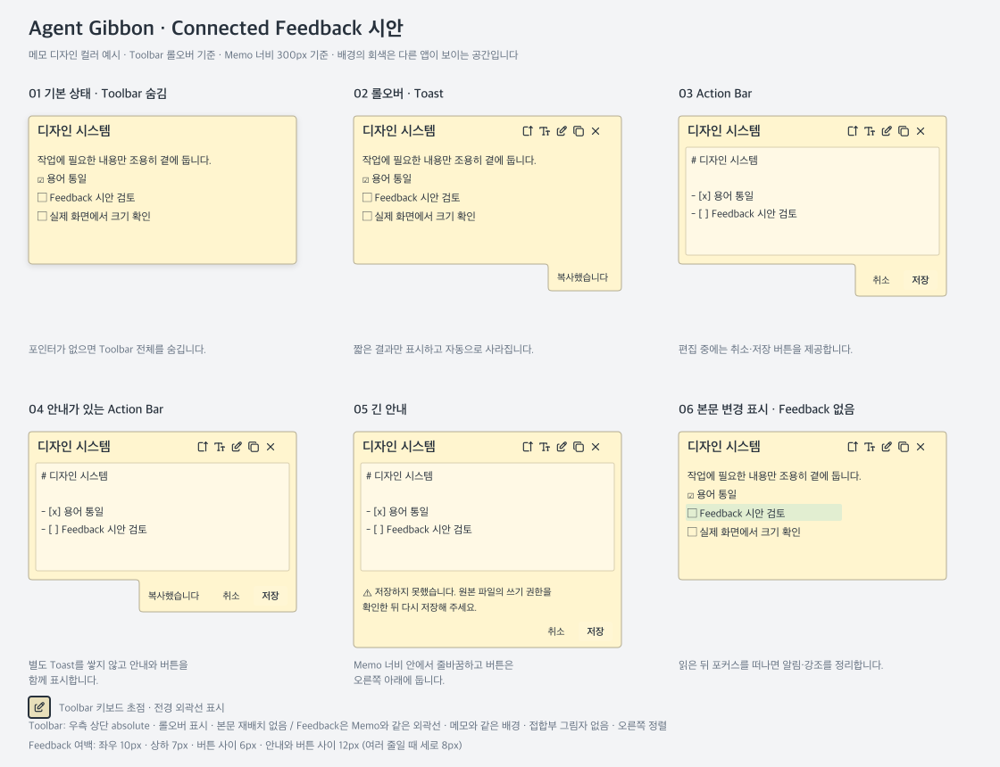

[확대 가능한 SVG 원본](design/feedback-preview.svg)

- **01 → 02:** 본문 크기는 그대로 두고, 하단 오른쪽 외곽이 늘어나 복사 완료 Toast를 담는다. 사라지면 원래 Memo 외곽으로 돌아간다.
- **03 → 04:** 편집 버튼이 필요한 동안에는 안내도 Action Bar 안에 표시한다. 별도 Toast를 쌓지 않는다.
- **05:** 긴 안내는 Memo 너비를 넘지 않고 줄바꿈하며, 취소·저장은 오른쪽 아래에 유지한다.
- **06:** 버튼 없는 변경 알림이며 메모의 읽은 뒤 포커스를 떠날 때 읽음 처리한다.

그림은 300px 너비의 Memo를 기준으로 구성했다. 문서 뷰어의 축소·확대에 따라 화면에서 보이는 크기는 달라진다. 표시된 배경색은 색상 연동을 보여주는 예시이며 고정 기본색 제안은 아니다.

### macOS 개발 앱 실행 화면 — 연결형 시안 적용 전

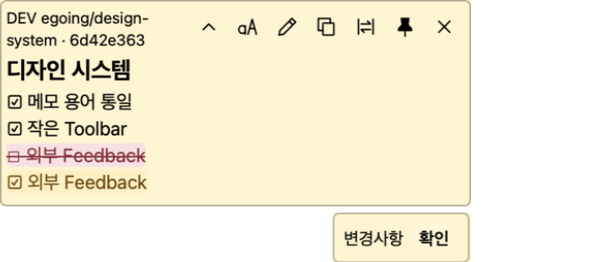

2026-10-27 실행 화면. 위쪽 DEV 표시는 개발 인스턴스에만 나타난다. 아래 Action Bar는 메모 본문과 분리되어 있으며 일반 상태에는 스크롤바가 없다.

## Design Principles — 확정

- 기본은 조용한 보조 도구다. 사용자의 명시적 선택으로 메모별 강조를 제공한다. 개성 표현은 후순위다. 강조를 위한 별도 모드나 구체적 조작 방식은 아직 정하지 않았다.
- 동일한 역할은 같은 이름·모양·동작을 사용한다. 역할이 다른 버튼까지 같은 크기로 강제하지 않는다.
- 작은 UI를 유지한다. 시각적 크기와 클릭 영역을 구분하여 조작성을 확보한다.
- Memo 글자 크기를 바꿔도 Toolbar와 Feedback의 글자·버튼 크기는 유지한다.
- Memo Window의 본문 공간과 사용자 작업 포커스를 보존한다.

## Vocabulary

| 공식 용어 | 의미 | 상태 |
|---|---|---|
| Memo | 사용자가 다루는 콘텐츠 단위. 현재 한국어 UI에서는 ‘메모’ | 확정 |
| Memo List | Tray Menu 안의 메모 목록 | 확정 |
| Memo List Item | 개별 메모 메뉴 항목 | 확정 |
| Tray Menu | 시스템 트레이 메뉴 | 확정 |
| Memo Window | Memo를 표시하는 창. 위치·크기는 이 용어로 설명 | 확정 |
| Toolbar | 상단 기능 버튼 영역 | 확정 |
| Icon Button | 아이콘으로 기능을 표시하는 버튼 | 확정 |
| Tooltip | Icon Button의 기능 이름과 단축키 안내 | 확정 |
| Feedback | Toast 또는 Action Bar로 제공하는 안내·조작의 전체 개념 | 확정 |
| Toast | 버튼이 필요 없는 독립적인 안내 | 확정 |
| Action Bar | 현재 상태의 버튼과 필요한 안내를 함께 제공하는 영역 | 확정 |
| Primary Button | 주된 행동을 실행하는 버튼 | 확정 |
| Secondary Button | 취소 등 보조 행동을 실행하는 버튼 | 확정 |
| Memo Content | 본문 글·표·체크리스트·이미지 표시 영역 | 제안 |
| Editor | Markdown 원문 편집 영역 | 제안 |
| Change Highlight | 추가·수정·삭제를 보여주는 변경 표시 | 제안 |
| Automatic Acknowledgement | 메모 읽은 뒤 포커스를 떠날 때 변경 알림을 해제 | 확정 (#65) |
| Capture Overlay | 영역을 선택하는 캡처 화면 | 제안 |

### 관리 UI 용어 — 확정 (2026-11-04)

이번 대화의 관리 UI를 다음 이름으로 구분한다. **용어 확정은 구현 완료나 와이어프레임의 세부 동작 승인을 뜻하지 않는다.** 한국어 사용자 화면에서는 ‘노트’ 대신 기존 기준인 ‘메모’를 사용한다.

| 공식 용어 | 한국어 이름 | 의미와 범위 |
|---|---|---|
| Desktop App | 데스크톱 앱 | Tauri와 Rust, WebView UI를 포함한 Agent Gibbon 전체. 관리 창만을 가리키지 않는다. |
| Manager Window | 관리 창 | 모든 메모의 목록·상세보기와 설정을 제공하는 일반 앱 창. 사용자 진입점 이름은 ‘메모 관리’. |
| Memo Window | 메모 창 | 개별 메모를 화면 위에 띄우는 기존 플로팅 창. 설명이 필요할 때 ‘플로팅 메모 창’으로 풀어 쓴다. |
| Manager Navigation | 관리 탐색 | 관리 창에서 ‘모든 메모’와 ‘설정’ 페이지를 전환하는 공통 탐색 영역. |
| All Memos Page | 모든 메모 페이지 | 메모 목록·상세·정보를 함께 제공하는 관리 페이지. |
| Memo List Panel | 메모 목록 패널 | 관리 창 안에서 메모를 검색·선택하는 영역. 기존 Tray Menu의 Memo List와 구분한다. |
| Memo Detail Panel | 메모 상세 패널 | 선택한 메모를 미리보거나 편집하는 영역. 별도의 Memo Window가 아니다. |
| Memo Info Panel | 메모 정보 패널 | 선택한 메모의 유형·표시 상태·수정 시각·연결 파일 등을 보여 주는 영역. 앱 전체 설정과 구분한다. |
| Settings Page | 설정 페이지 | 관리 창 안에서 앱 설정을 제공하는 페이지. 별도 네이티브 창을 뜻하지 않는다. |
| Preview | 미리보기 | 텍스트의 렌더링 결과 또는 캡처 이미지를 읽는 상세 패널의 상태. |
| Editor | 원문 편집 영역 | 텍스트 메모의 Markdown 초안을 편집하는 영역. 기존 Editor와 같은 역할이다. |

- **Window(창)**는 운영체제가 관리하는 창, **Page(페이지)**는 창 안에서 전환하는 화면, **Panel(패널)**은 페이지 안의 구획이다. 이 세 단위를 혼용하지 않는다.
- ‘메모 선택’은 관리 창의 상세 대상을 바꾸는 행위, ‘화면에 띄우기’는 플로팅 메모 창을 표시하는 행위다. ‘열기’만으로 두 행동을 함께 표현하지 않는다.
- **선택 상태**는 목록에서 고른 메모, **표시 상태**는 플로팅 메모 창의 표시 중/숨김을 뜻한다. 관리 창에서 내용을 보고 있어도 플로팅 창은 숨김 상태일 수 있다.

### 관리 UI 구현 방향 — 채택, 최소 구현 (2026-11-04)

현재 범위는 **Tauri + Rust + Vanilla UI**로 진행한다. Tauri를 React와 대체 관계로 표현하지 않는다. React는 필요할 경우 WebView 내부 UI에 도입할 수 있는 별도의 선택이다.

| 용어 | 이 프로젝트에서의 의미 |
|---|---|
| Tauri App Shell | 창·운영체제 연동과 Rust 백엔드를 연결하는 데스크톱 앱 기반. |
| WebView UI | 시스템 WebView 안에서 HTML·CSS·JavaScript로 렌더링하는 화면. |
| Vanilla UI | React 같은 UI 프레임워크 없이 HTML·CSS·JavaScript 모듈로 구현하는 방식. 모든 보조 라이브러리를 금지한다는 뜻은 아니다. |
| Fixed Panel Layout | 패널의 역할과 배치 순서를 정해 둔 구성. 기본 배치는 CSS Grid로 구현하며 ‘고정’은 픽셀 크기 고정을 뜻하지 않는다. 좁은 창의 접기·화면 전환을 허용한다. |
| Docking Layout | 사용자가 탭·패널을 끌어 재배치·분할·분리하는 구성. 현재 구현 범위에 포함하지 않으며 Dockview를 도입하지 않는다. |
| Shared UI State | 현재 페이지·검색·필터·선택 메모·편집 초안을 모듈 간 공유하는 관리 UI 상태. 저장된 메모 원본과 창의 실제 상태는 Rust 측 데이터와 구분한다. |
| Design Tokens | 색상·간격·크기 등 공통 시각 값을 정의하는 규칙. UI 프레임워크와 독립적이며 기존 디자인 시스템을 따른다. |

목록·상세·정보·설정을 JavaScript 모듈로 분리하고 공통 상태와 렌더링 책임을 명시한다. 기존 메모 창의 포커스·위치·숨김 보존 규칙을 유지한다. 별도 웹 서버를 추가하지 않는다. HyperFrames는 화면 구성의 참고 자료이며 React·Tailwind·Base UI·Dockview의 일괄 도입을 뜻하지 않는다.

이번 변경은 용어와 구현 방향 문서화다. 관리 창의 구체적인 크기·설정 항목·전환 동작은 아래 와이어프레임 절의 **제안** 상태를 유지한다. 외형·배치는 바꾸지 않아 기존 SVG·PNG를 유지했다. 문서의 용어 일관성과 `git diff --check`를 확인했으며 앱 빌드·실행 검증은 수행하지 않았다.

Feedback Bar는 논의 초기 이름이며 최종 구성요소 이름으로 사용하지 않는다. Editor Actions라는 별도 영역 대신 편집 버튼을 Action Bar에 배치한다. 내부 API·저장 키의 `note`까지 일괄 변경한다는 뜻은 아니다.

## Feedback — 확정

### 위치와 크기

- Memo Window 바깥 아래쪽에 오른쪽 정렬한다. 아래 공간이 부족하면 위쪽으로 전환한다.
- Toast와 Action Bar는 같은 자리를 공유한다. 두 영역을 동시에 위아래로 쌓지 않는다.
- 내용에 맞는 가변 너비를 사용하며 Memo Window 너비를 넘지 않는다.
- 한 줄을 기본으로 하되, 긴 문구는 줄바꿈하며 높이가 늘어난다. 안내를 한 줄 말줄임으로 강제하지 않는다.
- 긴 안내에서도 버튼은 오른쪽 아래에 유지한다. 버튼의 절대 화면 좌표까지 고정한다는 뜻은 아니다.
- 버튼이 필요 없으면 Toast만 표시한다. 빈 Action Bar 공간을 남기지 않는다.
- 표시·숨김으로 본문 공간을 줄이거나 Memo Window의 본문 크기를 바꾸지 않는다.

### 상태별 구성

| 상황 | 구성과 전환 |
|---|---|
| 복사 완료·단축키 등 단독 안내 | Toast를 잠시 표시 |
| 편집 중 | Action Bar에 취소·저장 버튼 표시 |
| 편집 중 일시적 안내 | Action Bar 버튼은 유지하고 안내 문구를 함께 표시 |
| 변경 확인 대기 | 버튼 없는 변경 안내, 메모 읽은 뒤 포커스를 떠날 때 해제 |
| 변경 확인 대기 중 일시적 안내 | 문구를 잠시 교체하고 자동 확인 전이면 변경 안내로 복귀 |
| 변경 확인 클릭 | 이미 반영된 변경을 읽었음으로 처리하고 Change Highlight 제거. 변경 적용 승인이 아님 |
| 저장 성공 | 편집 Action Bar를 해제하고 저장 완료 Toast 표시 |
| 저장 실패 | 취소·저장을 유지하며 오류 안내 표시 |

안내 지속 시간은 성격에 따라 달리한다. 단순 결과는 짧게, 사용법은 읽을 여유를 두고 표시한다. 확인 요청은 확인할 때까지 유지하며, 오류는 일시적 오류와 조치가 필요한 오류를 구분한다.

## Buttons and Tooltip — 확정

- Action Bar 버튼은 ‘취소’, ‘저장’, ‘확인’처럼 짧은 텍스트를 사용하고 중복 아이콘은 생략한다.
- Primary Button은 맨 오른쪽, Secondary Button은 그 왼쪽이다.
- 같은 Action Bar의 Primary와 Secondary는 같은 높이를 사용한다. Primary를 크게 만들지 않고 배경이나 글자 굵기로 차이를 준다.
- Toolbar Icon Button과 Action Bar 버튼의 높이는 역할에 맞게 별도로 정한다.
- Icon Button에 마우스를 올리면 Tooltip에 기능 이름과 현재 운영체제의 단축키를 표시한다. 복사는 macOS에서 Command C, Windows에서 Ctrl C, 파일 저장은 각각 Command S와 Ctrl S, 메모 숨기기는 Esc다. 편집 중 Esc는 편집을 취소한다.
- 포인터 접촉 제스처는 Tooltip에 넣지 않고 macOS에서 접기·펼치기 또는 이동 버튼을 실행한 뒤 Feedback으로 안내한다. 숨기기는 창이 즉시 사라지므로 실행 후 안내를 표시하지 않는다.

## Visual Style — 확정

- Memo Window와 Feedback은 살짝 둥근 사각형, 얇은 테두리, 아주 약한 그림자를 공유한다. 네이티브 창과 HTML 바탕은 투명하게 두고 둥근 Surface 안에만 배경을 칠한다. 모서리 바깥에 사각형 바탕이나 이중 경계가 남아서는 안 된다.
- Toast와 Action Bar는 해당 Memo의 배경색을 따르며 글자와 버튼은 읽기 쉬운 대비를 유지한다.
- Tooltip도 같은 색상·모서리·테두리 스타일을 사용한다.
- 복사 완료·단축키·변경 확인은 기본 스타일을 공유한다. 오류처럼 주의가 필요한 안내는 색상과 아이콘으로 구분한다.

## Design Tokens — 제안

단위는 CSS px를 기준으로 한 논리 크기다. 아래 값은 현재 작은 UI를 출발점으로 한 시안이며, 접근성 기준 충족이나 실제 클릭 편의성이 검증된 값은 아니다.

| Token | 제안값 | 목적과 현재 기준 |
|---|---|---|
| `font.content.default` | 12px / 1.4 | 현재 본문 기본값 유지. 14·16·18px 선택 유지 |
| `font.ui` | 11px / 1.4 | 현재 안내·텍스트 버튼 크기 유지. 본문 크기와 분리 |
| `font.weight.primary` | 600 | 버튼 크기를 늘리지 않고 주된 행동 구분 |
| `size.icon` | 14px | 현재 Toolbar 아이콘 크기 유지 |
| `size.toolbar.target` | 24 × 24px | 현재 19 × 19px보다 클릭 영역 확대. 아이콘은 그대로 |
| `size.action.height` | 22px | 작게 유지하면서 현재 19px 텍스트 버튼에 여유 추가 |
| `space.action.inline` | 6px | 텍스트 버튼 좌우 여백, 너비는 문구에 따라 결정 |
| `space.button.gap` | 4px | Action Bar 버튼 사이 간격 |
| `space.feedback.padding` | 세로 4px / 가로 6px | Toast와 Action Bar 공통 내부 여백 |
| `space.feedback.offset` | 0px | Memo Window와 Feedback 사이 간격 |
| `space.content.padding` | 3px | 현재 본문 여백 유지 |
| `radius.surface` | 4px | Memo Window·Feedback·Tooltip 공통 |
| `radius.button` | 3px | 현재 버튼 모서리 유지 |
| `border.width` | 1px | 얇은 경계 유지 |
| `shadow.surface` | 0 2px 6px, 검정 12% | 뒤쪽 화면과 약하게 구분. OS 그림자 중복 확인 필요 |
| `duration.result` | 2초 | 복사·저장 완료. 현재 복사 아이콘은 1.2초 |
| `duration.tip` | 6초 | 짧은 단축키 안내. 현재 워프 안내는 12초 |

Toast 한 줄 높이는 위 제안값에서 약 25px, Action Bar는 약 32px가 된다. 둘의 높이를 강제로 같게 맞추지 않는다. 긴 문구에서는 둘 다 늘어난다.

색상은 고정 팔레트보다 역할로 정의한다. `color.surface`는 Memo 배경, `color.text`는 대비를 고려한 전경, `color.border`는 경계, `color.action.primary`는 약한 강조, `color.error`는 오류 의미를 맡는다. 구체적 색상 계산과 투명도는 실화면 검토 후 확정한다.

## 적용 대상과 검토 항목

현재 소스 기준 개선 대상:

- 메뉴·Tooltip·오류 문구의 ‘노트’를 ‘메모’로 통일한다.
- 개별 구현된 변경 확인, 워프 안내, 오류 안내, 복사 결과와 편집 버튼을 Feedback 규칙으로 정리한다.
- 색상 외에도 크기·간격·모서리·폰트·지속 시간을 공통 Token으로 관리한다.
- Tooltip의 기능 이름·단축키 표기 순서를 통일한다.

구현한 경계 동작과 후속 검토 사항:

- Feedback은 Memo Window에 연결된 별도 네이티브 WebView 창이다. 표시할 때 포커스를 가져오지 않으며 이동·크기·고정·숨김을 동기화한다. 본문 측정에 Feedback을 포함하지 않는다.
- 접힌 Memo의 Action Bar는 숨기고 펼치면 복원한다. 접기 버튼으로 실행한 제스처 안내는 접힌 상태에서도 잠시 표시한다. 아래 공간이 없으면 위로 배치한다. 양쪽이 모두 부족하면 더 큰 빈 영역에서 세로 스크롤을 허용하며, 빈 영역조차 32px 미만이면 화면 하단 안에 배치한다(이 예외에서는 메모 일부와 겹칠 수 있음). 다른 Memo와의 겹침을 피하려고 기존 창을 이동시키지는 않는다.
- 긴 오류를 144px 너비 Memo에서 검증했다. 긴 문구는 줄바꿈하며 버튼은 오른쪽 아래에 배치한다. 영문 번역 문구의 최종 검수는 번역 도입 시 진행한다.
- 편집 중에는 취소·저장이 Action Bar를 차지하며, 미확인 변경은 취소 후 다시 표시한다. 저장 오류는 재시도 성공 또는 편집 취소까지 유지하고 일반 안내보다 우선한다. 그 밖의 오류와 단축키 안내는 6초, 복사·저장 완료는 2초 동안 표시한다. 예전 워프 안내의 닫기·다시 보지 않기 버튼은 제거하고 버튼 없는 Toast로 통일했다.
- Toolbar Tooltip은 포인터와 키보드 포커스로 표시한다. 버튼 포커스 테두리, 안내의 status/alert 의미와 기존 저장·취소 단축키를 제공한다. VoiceOver 낭독과 두 창 사이 키보드 탐색의 전체 접근성 검수는 후속 과제다.
- 새 클릭 영역으로 Toolbar가 차지하는 폭, 이미지 Memo의 원본 표시 영역, 창 가장자리 크기 조절과의 충돌을 확인한다.

## 근거

- 사용자 인터뷰에서 합의한 최신 결정. 이전의 고정 너비, Toast와 Action Bar 동시 적층, 별도 Editor Actions 제안은 대체되었다.
- [화면 구조](../ui/index.html), [현재 스타일](../ui/style.css), [안내 동작](../ui/app.js), [색상 계산](../ui/theme.mjs).
- 구현·검증 범위는 아래 적용 기록과 [검증 기록](verification.md)에 명시한다.

## 적용 기록 — 2026-10-27

- `ui/tokens.css`에서 UI 글자·아이콘·클릭 영역·버튼 높이·간격·모서리를 공유한다. 본문 12/14/16/18px 변경과 독립적으로 Toolbar 24px, Action Bar 버튼 22px, UI 11px을 적용했다. 수치의 제품 기준 확정 여부는 계속 실사용 피드백으로 판단한다.
- Feedback 구성은 `ui/feedback-state.mjs`, 표시는 `ui/feedback.html`·`feedback.js`·`feedback.css`, 네이티브 배치는 `src-tauri/src/feedback_window.rs`에서 관리한다. 이전 본문 내부 diff-actions, editor-actions, warp-tip, error 영역을 대체했다.
- Primary Button은 Memo 색상에서 대비를 유지하는 약한 배경과 600 굵기를 사용한다. 오류 색상은 배경과 4.5:1 이상 대비일 때만 사용하고, 부족하면 기본 전경색과 경고 아이콘으로 의미를 전달한다.
- 표면은 4px 모서리·1px 경계를 적용한다. 별도 창 바깥 그림자는 OS가 그리므로 `shadow.surface`의 정확한 수치와 동일하지 않으며, Tooltip에만 CSS 그림자 값을 직접 적용한다. 플랫폼별 그림자 강도는 후속 시각 검토 대상이다.
- 창 생성·표시 시 자동 포커스 이동 없이, 사용자가 버튼을 클릭했을 때만 조작한다. 늦게 도착한 확인 요청은 표시했던 revision과 대조해 새 변경을 지우지 않는다. 저장·취소는 이 확인용 검사로 차단하지 않으며 저장 충돌은 기존 원본/메모 revision 검사로 처리한다. 숨긴 메모는 Feedback 창 생성을 미루고 첫 표시 시 기존 앱 포커스를 복원한다. CLI `inspect.feedback_surface`로 실제 크기·위치·표시 상태·버튼 구성을 확인할 수 있다.
- 실제 검증에서 발견한 가로/세로 스크롤바 문제는 콘텐츠 측정 후 body 너비를 실제 Feedback 너비로 복원하여 해결했다. 일반 Toast/Action Bar에 스크롤바를 만들지 않으며, 화면의 남은 높이가 부족한 예외에서만 세로 스크롤을 허용한다.
- 검증: Rust 테스트, UI 상태·색상 테스트, Clippy, Rustfmt, JavaScript 구문 검사, 개발 빌드, `scripts/design-system-smoke.py`를 통한 실제 macOS CLI/Accessibility 검증. 설치 앱 교체와 릴리스 배포는 수행하지 않았다.
- 네이티브 부모/자식 창 구성은 [Tauri WebviewWindowBuilder 공식 문서](https://docs.rs/tauri/latest/tauri/webview/struct.WebviewWindowBuilder.html)를 참고했다.

### 둥근 모서리 보정

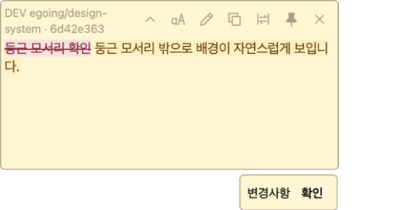

- `Memo Window`의 색상·테두리는 내부 `#memo-surface`에, Feedback의 색상·테두리는 `#feedback`에만 적용한다. `html`과 `body`에 불투명 배경을 칠하지 않는다. 별도 Surface는 body 배경이 HTML 캔버스 전체로 전파되는 문제도 방지한다.
- 네이티브 Memo Window와 Feedback 창에 `transparent`를 적용했다. macOS에서는 Tauri의 `macOSPrivateApi` 설정과 `macos-private-api` 기능이 필요하다. 이는 현재 직접 배포하는 DMG 경로에 적용하며, 향후 Mac App Store 배포를 검토할 경우 별도 구현 검토가 필요하다. [Tauri 공식 설정 문서](https://v2.tauri.app/reference/config/#macosprivateapi)
- macOS 개발 앱의 실제 RGBA 캡처에서 좌우 위 모서리의 알파가 0임을 확인했고, Action Bar의 둥근 경계도 시각적으로 확인했다. Rust 65개·UI 40개, Clippy, 개발 빌드 및 실앱 Feedback 회귀를 다시 통과했다. Windows·Intel 실화면은 미검증이다.

### 실화면 사용성 보정

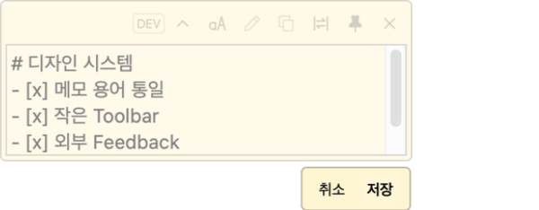

- 개발 인스턴스는 Toolbar의 작은 `DEV` Badge로 표시한다. 전체 브랜치·인스턴스 정보는 Badge의 Tooltip·접근성 이름과 창 제목에 유지하며 본문 위에 별도 행을 만들지 않는다.
- 편집을 시작하면 첫 줄과 시작 위치를 보여 준다. 편집 중 갱신에는 사용자의 초안·커서를 초기화하지 않는다.
- 저장·취소 후 편집 버튼으로 복원하는 자동 포커스는 Tooltip을 띄우지 않는다. 실제 포인터 진입과 키보드 탐색 시 Tooltip을 표시한다.
- Action Bar의 동작은 소속 Memo Window만 수신한다. 대상 창으로 이벤트를 전송하고 수신 측에서도 owner를 검사한다. 다중 메모에서 저장·취소가 다른 초안에 전파되지 않아야 한다.

### Feedback 투명도와 연결 간격

- Feedback은 Memo Window와 간격 없이 맞닿는다. 아래 공간이 부족한 경우 위에서도 간격은 0px이다. 기존 오른쪽 정렬과 콘텐츠 너비 기준은 유지한다.
- macOS에서는 Memo와 Feedback의 네이티브 투명도를 함께 적용한다. 두 영역 중 어디에 포인터를 올려도 둘 다 선명해지며, 벗어나면 기존 메모의 투명도 규칙으로 함께 돌아간다. Windows는 기존 Memo의 불투명 동작을 유지한다.

- 투명도를 해제할 때는 즉시 불투명하게 표시한다. 포인터 이탈 등으로 투명해질 때는 2초 대기 후 600ms 동안 ease-in-out으로 전환한다. 전환 중 다시 접촉하면 즉시 선명해지고 다음 이탈부터 대기를 다시 센다. Memo와 Feedback은 같은 프레임의 값을 공유한다.

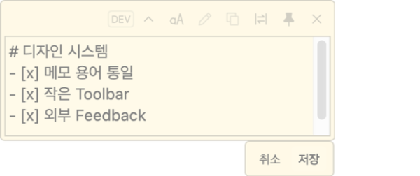

### Connected Feedback — 적용 기준

- 먼저 SVG·PNG로 검토한 뒤 사용자 승인으로 개발 앱에 적용했다. 별도 네이티브 창은 유지하되, 접합부는 하나의 연속된 표면으로 그린다.
- Memo와 Feedback은 동일한 배경을 공유하는 하나의 연속된 외곽으로 표현한다. 접합부에 수평 분리선이나 그림자를 그리지 않는다. 둥근 모서리는 합쳐진 표면의 외곽에만 적용한다.
- 짧은 Feedback은 하단 오른쪽으로 돌출되고, Memo 폭에 도달한 긴 Feedback은 하단 전체가 연장된다. 본문 높이·가변 너비·오른쪽 정렬·투명도 규칙은 유지한다.

### Connected Feedback 내부 여백 — 시안 제안값

- Feedback 내부 Padding은 좌우 **10px**, 상하 **7px**로 한다. 버튼 높이 22px는 유지하여 한 줄 Action Bar의 전체 높이는 36px이다. Toast는 16px 행 높이와 여백을 합쳐 30px이다.
- 버튼 사이 간격은 **6px**, 한 줄 안내와 버튼 그룹 사이는 **12px**로 정리한다. 내용보다 큰 빈 공간을 남기지 않고 전체 너비를 콘텐츠에 맞춘다.
- 여러 줄 안내 아래 버튼을 놓을 때는 **8px** 간격을 둔다. 긴 안내도 좌우 10px 여백을 유지한다.
- 이 값은 연결형 SVG·PNG와 개발 앱의 공유 Token에 적용했다.

### Connected Feedback 구현·검증

- 부모 Memo의 접합 구간 테두리를 열고 Feedback의 맞닿는 테두리·모서리를 제거한다. 위로 배치될 때는 반대로 적용하며, 전체 폭 안내에서는 해당 변 전체가 이어진다. 화면 경계 때문에 실제로 맞닿지 못하는 예외는 독립 표면으로 표시한다.
- 별도 네이티브 창의 그림자가 접합부에 비치지 않도록 연결 중 두 창의 네이티브 그림자를 끈다. Feedback이 사라지면 Memo의 원래 외곽과 그림자를 복원한다. 시안의 합쳐진 외곽 그림자는 현 구현에서 생략하며 접합 안쪽 모서리는 직각이다.
- 한 줄 Action Bar는 36px, 버튼 사이 6px, 문구와 버튼 사이 12px이며 여러 줄 안내는 8px 행 간격을 사용한다. Memo 본문 크기와 기존 투명도 전환은 유지한다.
- macOS 개발 앱에서 저장·취소·변경 확인, 144px 폭 오류 줄바꿈, 접기·숨김·고정과 외부 배치 회귀를 확인했다. Rust 66개·UI 42개, Clippy와 개발 빌드 통과. Windows·Intel 실화면은 미검증이다.

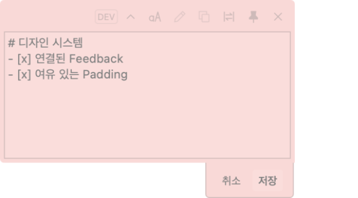

### 파일 저장과 복사 통합

- Toolbar의 파일 저장은 텍스트나 캡처 이미지를 별도 파일로 내보낸다. 편집 중 파일 저장은 현재 초안을 내보내며 Memo에 반영하지 않는다. ⌘S/Ctrl+S는 메모와 Feedback 모두에서 파일 저장 대화상자를 연다.
- 텍스트 복사는 최신 본문을 사용하고 이미지 메모는 원본 이미지를 복사한다. 복사·파일 저장의 결과와 오류는 공통 Feedback으로 표시하며 미확인 변경이나 편집 초안을 보존한다.

### 단축키·캡처 외곽 보정 (2026-10-27)

- 텍스트와 캡처 Memo는 같은 테두리·둥근 모서리를 적용한다. 연결된 Feedback은 부모와 같은 색상·1px 외곽을 사용하며 별도 창 그림자를 끈다. SVG의 숨김 속성을 직접 해제해 연결 중 Memo 외곽선도 표시한다.
- 플랫폼별 표기와 버튼 실행 안내를 구현했다. 실제 화면·플랫폼별 검증 범위는 작업 결과에서 별도로 기록한다.

2026-10-28 현재 워크트리의 macOS Apple Silicon 개발 앱에서 편집 Action Bar를 실제로 열어 Memo와 Feedback의 외곽선 연결을 확인했다. 아래 화면은 이 검증에서 생성한 테스트 메모다. 캡처 이미지 Memo와 Windows의 실제 화면은 이번 확인 범위에 포함되지 않는다.

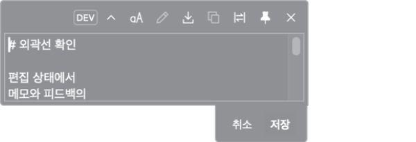

### Feedback 테두리 제거 — 이전 기준 (2026-10-28, 아래 복원 기준으로 대체)

- 사용자 요청에 따라 취소·저장 영역을 포함한 Feedback의 외곽선 색을 제거한다. Toast와 Action Bar 모두 투명 테두리를 사용하며 크기·여백·배경·둥근 모서리는 유지한다.
- 이 기준은 위의 기존 Feedback 1px 색상 외곽선 기준보다 우선한다. 메모와 Editor의 테두리, 버튼의 키보드 포커스 표시는 유지한다.
- SVG·PNG 시안을 갱신했다. 이전 실제 화면 캡처는 테두리 제거 전 기록이다.

- 개발 빌드 통과 후 macOS Apple Silicon 개발 앱의 실제 편집 화면에서 Feedback 외곽선 제거를 확인했다. Memo 외곽선은 이전 SVG 표시 보정으로 복원된 것이며 이번 변경에서 추가하지 않았다.

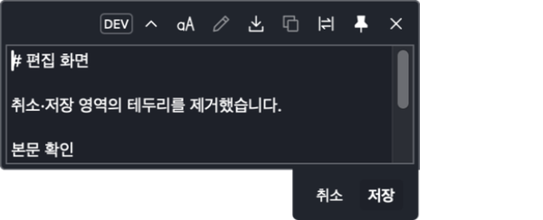

### Toolbar 롤오버 — 확정 (2026-10-28)

- #56 적용(2026-11-05): 포인터 상태의 송신·수신을 해당 Memo Window로 제한해 다른 창의 Toolbar가 순간 표시되지 않도록 보정했다. 기존 외형·배치·키보드 표시 기준과 시안을 유지한다. macOS ARM64 실제 전후 영상에서 동시 표시가 421프레임 중 42개에서 0개로 줄었으며 텍스트·편집·접힘·숨김 보존을 확인했다. 이미지·키보드는 Chromium 검사이며 Windows·Intel은 미검증이다. [출처·영상·검증 한계](verification/issue56-toolbar/README.md).
- Toolbar 전체(DEV Badge 포함)는 기본 상태에서 보이지 않으며 클릭을 가로채지 않는다. 메모에 포인터를 올리면 표시하고 벗어나면 숨긴다. 키보드로 Toolbar 버튼을 탐색하는 동안에는 조작 가능하도록 표시한다. Editor의 입력 포커스만으로는 표시하지 않는다.
- 텍스트·이미지·편집 상태 모두 Memo Surface 우측 상단에 absolute로 겹쳐 표시한다. 본문에 별도 공간을 예약하거나 줄바꿈을 바꾸지 않으며, 표시 중 배경은 Memo 색상을 따른다. 좁은 창에서는 아래의 작은 창 Toolbar 기준에 따라 한 줄에서 이전·다음 도구를 탐색한다. 접힌 상태의 펼치기 버튼에도 같은 숨김 규칙을 적용한다.
- 기본 상태와 롤오버 상태를 SVG·PNG 시안에 반영했다. 이전 실화면 이미지는 변경 전 기록이다.
- 검증: UI 테스트 50개와 개발 빌드 통과. Headless Chromium에서 기본 숨김·클릭 비활성화·absolute 배치·포인터 표시·본문 크기 불변·Editor 포커스 시 숨김·Toolbar 키보드 포커스 시 표시를 확인했다. SVG를 PNG로 렌더링해 확인했다. macOS WebView의 실제 포인터 조작과 Windows 실화면은 미검증이다.

### Feedback 외곽선 복원 — 확정 (2026-10-28)

- 사용자 화면 피드백에 따라 Toast와 Action Bar의 바깥 테두리를 Memo와 같은 색상·1px 두께로 표시한다. 위의 투명 테두리 기준을 대체한다.
- 메모 아래에 붙을 때는 좌우·아래 외곽선을, 위에 붙을 때는 좌우·위 외곽선을 표시한다. 맞닿는 면에는 구분선을 추가하지 않으며 기존 배경·여백·둥근 모서리를 유지한다.
- SVG·PNG의 연결된 외곽선을 복원했다. 이전 테두리 제거 실화면은 과거 기록이다.
- 검증: 개발 빌드 통과, SVG→PNG 렌더링 및 외곽선 시각 확인 완료. 편집 중 메모가 없음을 CLI로 확인한 뒤 개발 앱을 재시작했다. 실제 WebView 외곽선·Windows 실화면은 미검증이다.

### Feedback 실제 외곽선 정렬 — 확정 (2026-10-28)

- 실제 macOS 캡처에서 Feedback의 오른쪽 테두리가 Memo보다 물리 2px(해당 Retina 화면에서 논리 1px) 안쪽인 것을 확인했다.
- 창 좌표에 임의의 +1px를 더하는 보정을 제거하고, Feedback 표면의 너비를 네이티브 창에 전달한 올림 너비와 동일하게 고정한다. `max-content`의 소수점 너비와 창 정수 너비 사이 빈 공간을 없애어 실제 테두리를 정렬한다.
- 메모와 Feedback의 오른쪽 경계를 맞추는 것이 기준이다. [정렬 시안 SVG](design/feedback-offset.svg) · [PNG](design/feedback-offset.png).
- 검증: UI 테스트 50개·개발 빌드 통과. Chromium에서 소수 너비 101.09375px를 네이티브 창에 전달하는 102px로 채우는 것을 확인했다. macOS Retina 개발 앱을 재시작한 뒤 실제 캡처의 Memo와 Feedback 오른쪽 테두리가 모두 x=606~607 물리 픽셀에 그려짐을 확인했다(캡처 내부 좌표). 수정 전에는 두 테두리에 물리 2px 차이가 있었다. 사용자도 실제 화면 정렬을 확인했다. Windows·Intel 실화면은 미검증이다.

### Toolbar 포커스 테두리 제거 (2026-10-28)

- Toolbar 버튼의 포커스 테두리를 제거한다. 편집 종료 후 연필로 돌아오는 포커스와 키보드 조작은 유지하며, focus-visible 배경 강조로 현재 버튼을 구분한다. Action Bar의 포커스 테두리는 유지한다.
- 시안 하단에 테두리 없는 연필 포커스 상태를 추가했다.
- 검증: UI 테스트 50개·개발 빌드 통과, SVG를 PNG로 렌더링해 확인했다. 실제 WebView에서 포커스 테두리 제거의 육안 확인은 미실행이다.

### 작은 창 Toolbar — 이슈 #14 (2026-10-30)

- 지원 하한 **144×32 논리 px**와 기존 롤오버·본문 크기 보존을 유지한다. Toolbar는 **한 줄**로 표시하며 창 높이를 늘리거나 본문 공간을 예약하지 않는다. 위 롤오버 절의 기존 줄바꿈 동작을 대체한다.
- 전체 기능이 들어가지 않는 너비에서만 24×24px의 **이전 도구·다음 도구** 버튼을 양끝에 표시한다. 가운데 기능을 가로로 넘겨 모든 버튼에 포인터로 접근한다. 끝에 도달한 탐색 버튼은 흐리게 표시하고 `aria-disabled`로 알리되 키보드 포커스는 유지한다.
- Tab·Shift+Tab으로 기능을 탐색하면 포커스된 버튼 전체를 보이게 한다. DEV Badge는 같은 줄에 포함한다. 접힌 상태에서는 기존 펼치기 버튼만 표시하며, 이미지 메모는 기존처럼 글자 크기·편집 버튼을 제외한다.
- 300px 기본 너비에서는 DEV Badge를 포함한 모든 기능이 들어가므로 이전·다음 버튼을 표시하지 않는다. 본문 글자 크기와 독립적인 24px 클릭 영역을 유지한다.
- [작은 창 시안 SVG](design/toolbar-compact.svg) · [PNG](design/toolbar-compact.png). 기존 Connected Feedback 시안은 그대로 유지하며 이 시안이 작은 창 Toolbar 배치 기준을 보충한다. 설명용 시안이며 실제 화면 캡처가 아니다.

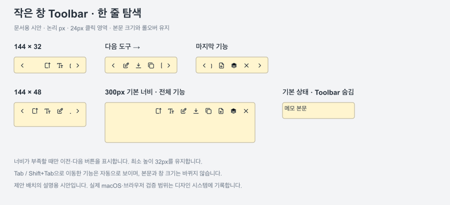

- 검증: Chromium에서 144×32·144×48·300×80 각각 DEV Badge 유무, 포인터 페이지 전환으로 8개 기능 전체 노출, Tab·Shift+Tab 자동 노출, 기본 숨김·클릭 비활성화, 롤오버 전후 본문 크기 보존, 접힘·이미지 상태 배치를 통과했다. UI 테스트 50개와 개발 빌드를 통과했으며 SVG→PNG를 렌더링해 확인했다.
- macOS 개발 앱의 실제 검증 범위와 나머지 환경의 한계는 [검증 기록](verification.md#작은-창-toolbar--이슈-14-2026-10-30)에 기록한다.

## Tray Menu의 Memo List — 2026-10-30

- 항목 앞에 `[텍스트]` 또는 `[이미지]`를 표시한다. 기존 제목 30자 제한, ID, 정렬, 체크 표시와 선택 동작은 유지한다. 체크는 열린 상태만 뜻한다.
- 저장된 capture 콘텐츠가 있으면 이미지, 없으면 텍스트다. 제목이나 Markdown 문법으로 추정하지 않는다.
- 색상이나 이모지 해석 없이 유형을 읽을 수 있다.
- [시안 SVG](design/tray-memo-list.svg) · [PNG](design/tray-memo-list.png). OS별 외형은 네이티브 메뉴를 따른다.
- 검증: Rust 테스트 69개, 개발 빌드, Rustfmt 및 diff 검사 통과. SVG→PNG 렌더링 육안 확인 완료. 개발 CLI 도움말 실행 성공. 실제 트레이 메뉴 GUI와 Windows·Intel 실행은 미검증이다.

## Official Icon Library — 확정 (2026-10-30)

- 공식 아이콘 라이브러리는 [Tabler Icons](https://tabler.io/icons)다. 신규·교체 아이콘은 Outline 스타일, 24×24 viewBox와 stroke 2를 기본으로 한다. 기존 Toolbar 아이콘의 전체 전환은 이번 적용 범위에 포함하지 않는다.
- Memo List의 텍스트는 **file-text**, 이미지는 **photo**를 사용한다. 원본은 Tabler Icons v3.35.0이며 `src-tauri/icons/tabler`에 SVG와 MIT 라이선스를 보관한다. 네이티브 메뉴용 PNG는 원본 SVG에서 18×18로 렌더링한다.
- 아이콘 메뉴 항목으로 변경하며 열린 메모는 제목 앞의 `✓` 문자로 표시한다. 네이티브 체크 항목을 사용한다는 이전 기준을 대체한다. `[텍스트]`·`[이미지]` 유형명도 유지해 아이콘만 해석할 필요가 없도록 한다.
- 원본 데이터 판별, 정렬, 개별 복원 동작은 유지한다. 기존 목록 시안을 Tabler 아이콘으로 갱신한다.
- 검증: Rust 테스트 69개·개발 빌드 통과, SVG/PNG 시안 렌더링 확인. 개발 앱을 재시작하고 CLI instance 일치·메모 숨김 유지 확인. 실제 메뉴 아이콘의 다크 모드 대비와 Windows 화면은 미검증이다.

## Memo List 간결한 상태 표시 — 2026-11-04

- 이전 접두사·체크·도움말 기준을 대체한다. `[이미지]`, `[텍스트]`, `✓` 및 `✓ 열린 메모` 도움말을 제거한다.
- macOS에서는 Tabler 아이콘을 네이티브 템플릿 이미지로 설정해 메뉴 글자색과 선택 상태를 따른다. 열린 메모 아이콘은 100%, 닫힌 메모 아이콘은 45% 불투명도로 표시한다. 항목은 닫혀 있어도 클릭할 수 있다. 제목 글자도 아이콘과 같은 불투명도(열림 100%, 닫힘 45%)로 동기화한다.
- Windows의 자동 색상 연동은 아직 구현하지 않았다.
- 2026-11-04 후속 보정: 열린 항목은 attributed title을 해제해 네이티브 기본 글자색으로 복원한다. 닫힌 항목만 45% 알파 서식을 적용하며, 메인 스레드에서 적용 직전에 실제 창 가시성을 다시 읽는다. 개발 빌드·Rust 테스트 69개 통과, 실제 메뉴 육안 검증은 미완료다.

## Manager Window — 최소 구현 와이어프레임 (2026-11-04)

**상태: 최소 범위 구현, 실제 관리 창 GUI 검증은 미완료.** 사용자의 최소 구현 요청에 따라 기존의 상세한 관리 화면 시안을 대체한다. 용어와 Tauri + Rust + Vanilla UI 방향은 유지하며, 회색 선택 표시와 선만으로 화면 구조를 표현한다. 화면의 메모는 예시 데이터다.

### 최소 범위

- 관리 창 상단에 `모든 메모`와 `설정`을 둔다.
- 모든 메모 페이지는 **왼쪽 Memo List Panel / 오른쪽 Memo Detail Panel**의 두 영역으로 구성한다. HyperFrames에서 참고한 목록·미리보기 구조만 남긴다.
- 숨긴 메모를 포함한 저장 메모의 본문 첫 텍스트를 목록 제목으로 표시한다. Markdown 제목·목록·강조 기호를 제거하고 첫 텍스트 블록을 사용한다. 이미지나 빈 본문은 메타데이터 제목, 없으면 메모 ID로 대체한다. 목록을 선택하면 오른쪽에서 내용을 읽는다. 텍스트 메모는 본문만 표시하고 첫 텍스트를 별도 상세 제목으로 추가하지 않는다. 이미지·터미널은 상세 제목을 유지한다.
- 텍스트는 Markdown 미리보기, 캡처 메모는 이미지 미리보기로 표시한다. 두 화면은 같은 상세 패널의 콘텐츠 유형 차이이며 별도의 페이지가 아니다. 목록과 긴 본문은 각각 스크롤한다. 이미지는 패널 너비에 맞춘다.
- 최초에는 `메모를 선택하세요`, 저장 메모가 없으면 `아직 메모가 없습니다`를 표시한다. 읽기 실패 시 오류와 `다시 시도`를 제공한다.
- 선택 강조는 조회 대상을 뜻한다. 조회만으로 플로팅 메모의 표시·숨김·위치·포커스를 변경하지 않는다.
- 초기 구현은 빈 설정 페이지였으며, 현재 설정의 구성·동작은 위의 **설정 사이드바**와 **첫 실행 약관·선택적 진단 동의** 기준으로 대체한다.
- 설정에서 돌아오면 같은 관리 창에서 선택한 메모를 유지한다. 관리 창을 닫아도 플로팅 메모와 앱 실행은 유지한다. Tray Menu의 `메모 관리`를 진입점으로 제안한다.
- 키보드 Tab으로 탐색·목록 항목에 접근하고 Enter로 선택할 수 있게 하며 포커스를 표시한다. 패널의 역할·순서는 고정하고 자유로운 드래그 재배치는 제공하지 않는다.

### 메모 공통 화면 표시 도구 — #68 (2026-11-06)

- 텍스트·캡처 이미지·범용 터미널 모두 선택한 상세 패널 맨 위에 실제 창 상태에 따라 바뀌는 표시/숨김 버튼 하나를 제공한다. 버튼 옆의 `표시 중`·`숨김` 중복 문구는 사용자 요청으로 제거한다. 이미지·터미널은 **공통 도구 → 상세 제목 → 본문**, 텍스트는 **공통 도구 → 원본 Markdown 본문** 순서다. 텍스트에 별도 제목을 추가하지 않는 기존 기준을 유지한다.
- 목록 선택은 미리보기만 바꾸며 명시적인 버튼 클릭으로만 선택한 메모를 표시하거나 숨긴다. 숨김이면 `화면에 띄우기`, 표시 중이면 `화면에서 숨기기`로 바뀐다. 숨기기는 메모 삭제·창 종료·PTY 종료가 아니며 내용을 유지한다. 기존 열기 경로의 숨김 복원·이미 표시된 창 처리·포커스·위치 규칙을 따른다. 사라진 선택 항목을 빈 메모로 새로 만들지 않는다.
- 관리 목록 조회 시 실제 네이티브 창의 visible·minimized 상태를 읽으며, 창이 없거나 최소화됐으면 숨김으로 표시한다. 2초 주기 조회·창 포커스·새로고침으로 외부 CLI/툴바의 표시 변경을 반영한다. 표시 상태만 바뀌면 상세 DOM을 재생성하지 않아 버튼 포커스를 유지한다.
- 실행 중 버튼을 비활성화해 중복 요청을 막는다. 화면에 보인 행동을 명시적인 목표 상태로 요청해, 조회 직후 외부 상태가 달라져도 반대 토글을 잘못 실행하지 않는다. 요청 전의 늦은 조회 응답은 완료 상태를 덮어쓰지 않는다. 실패는 공통 도구 안의 alert로 알리고 같은 버튼으로 재시도한다. 다른 메모로 선택을 옮긴 뒤 도착한 실패는 새 상세 화면에 표시하지 않는다.
- 선택 전·빈 목록·Settings에는 이 도구를 표시하지 않는다. 범용 터미널의 `목록에서 삭제`는 유형별 본문 동작으로 유지한다.
- 아래 텍스트·이미지 시안을 갱신하고 [터미널 시안 SVG](design/manager-terminal-wireframe.svg) · [PNG](design/manager-terminal-wireframe.png)를 추가했다. Settings 시안은 변경하지 않는다. 시안은 구조 설명용이며 기존 표시 도구의 실행 결과는 [#68 검증 기록](verification/issue68-manager-show.md), 토글 후속 변경은 [토글 검증 기록](verification/issue68-manager-toggle.md), 중복 문구 제거는 [후속 기록](verification/issue68-manager-label.md)에 구분한다.
- 이전 표시 전용 도구는 macOS ARM64 실제 개발 앱의 네 유형 복원·반복 표시를 확인했다. 이미지 숨김 복원은 기존 자동 배치가 적용된다. 이 실행 결과를 최신 토글의 검증으로 대신하지 않는다.
- 최신 토글 적용·검증: Rust 129개·UI 87개·Clippy·Rustfmt·개발 빌드와 두 화면 크기 Chromium 12개 조합의 표시↔숨김·외부 상태 갱신·버튼 포커스 보존·오류 재시도를 확인했다. 사용자 승인 재시작 후 최신 macOS ARM64 앱에서 네 유형의 실제 표시↔숨김·외부 CLI 상태 갱신·세션 보존·Settings 제외와 표시 상태/창 위치 복원을 확인했다. 가려진 관리 창의 정기 갱신 검사는 실패했고 표시된 창에서 약 2초 주기로 확인했으며, 이 차이는 토글 검증 기록에 남긴다. 최소화 복원·실제 오류 강제 재현·Windows·Intel은 미검증이다.

- 중복 상태 문구 제거·최신 main 통합 후속: Rust 129개·UI 88개·Clippy·개발 빌드·Chromium 12개 조합과 최신 macOS native 적용을 확인했다. [최종 통합 기록](verification/issue68-delivery.md)에 출처와 범위를 구분한다. 기존 모니터 복원 정책을 유지한다.
- 관리 창에서 메모를 명시적으로 표시할 때는 앱 시작 때 남은 이전 앱 포커스 복원 기록을 선택한 메모에 한해 버린다. 관리 창이 이전 앱 뒤로 가려지지 않게 하며, 도중 사용자가 다른 앱으로 옮긴 경우의 포커스 보존은 유지한다. 외형·배치는 바꾸지 않았다.

### 이번 범위에서 제외

검색·필터·정렬 UI, 새 메모 생성, 원문 편집, 복사·내보내기, 메모 정보 패널, 이미지 확대 조작, 사용자 패널 재배치, 좁은 창의 별도 단일 패널 탐색은 후속 검토로 미룬다. 이는 관리 창의 범위이며 기존 플로팅 메모·CLI 기능을 제거한다는 뜻이 아니다. 앞서 정의한 Memo Info Panel·Editor 등 용어는 유지하되 이번 관리 창에 모두 구현하지 않는다.

제안 창 크기는 944×480이며 최소 지원 크기는 구현 시 내용과 키보드 접근을 확인해 결정한다. 앱의 기본 색상·아이콘·장식 디자인은 이번 시안에서 정하지 않는다.

### 시안

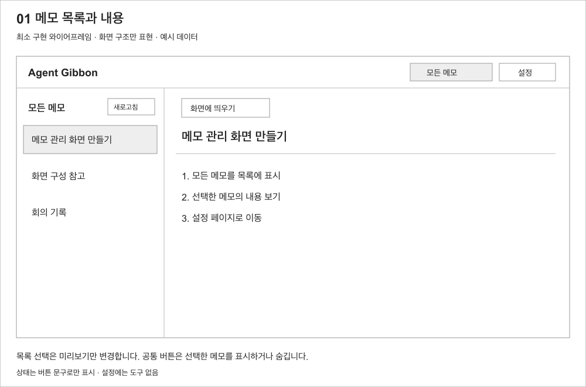

[텍스트 시안 SVG](design/manager-notes-wireframe.svg)

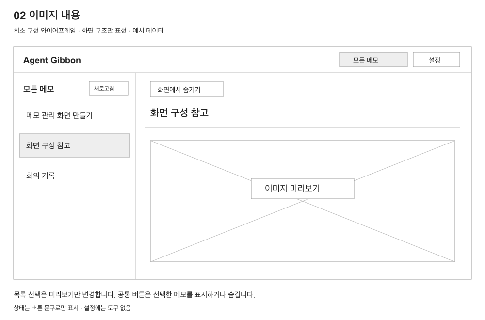

[이미지 시안 SVG](design/manager-image-wireframe.svg)

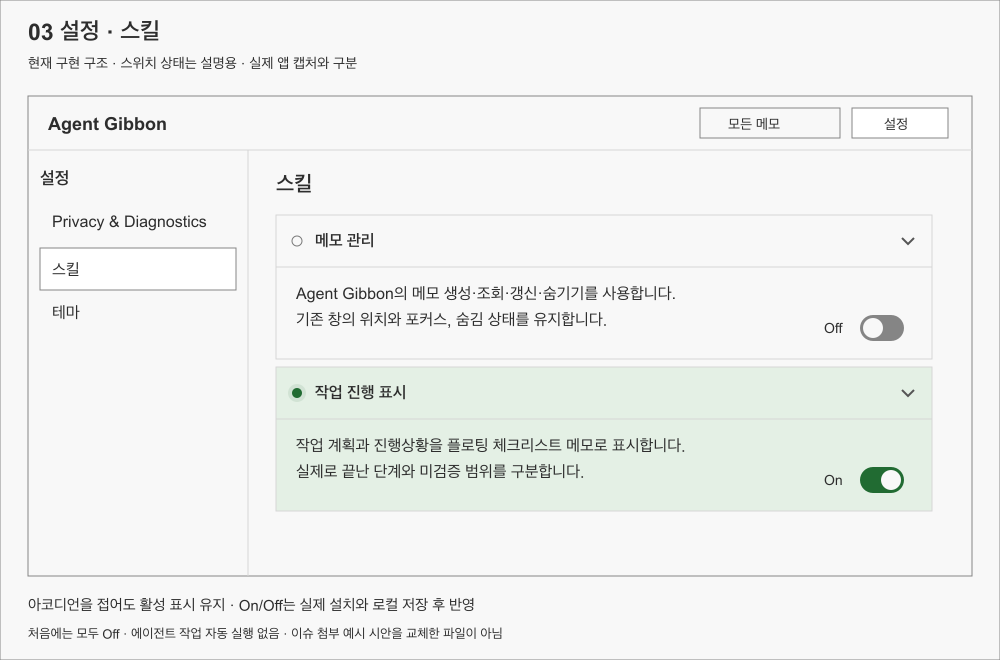

[설정 시안 SVG](design/manager-settings-wireframe.svg)

### 검증 범위

SVG 3개와 PNG 3개를 함께 갱신했다. PNG 렌더링과 배치 육안 확인, `git diff --check`를 수행했다. 앱 코드·빌드·실제 GUI·접근성 검증은 이번 작업에 포함하지 않는다. 현재 워크트리에 개발 바이너리가 없어 진행 메모를 생성하지 않았다.

### 관리 창 최소 구현 — 2026-11-04

- Tray Menu의 `메모 관리`에서 944×480 일반 창을 열고, 재진입 시 기존 창을 복원한다. 최소 크기는 600×360으로 설정했다. 닫기는 관리 창을 숨기며 메모·앱은 유지한다.
- 바닐라 HTML/CSS/JavaScript로 목록·Markdown 상세·이미지 상세·빈 설정 페이지를 구현했다. Rust의 정리된 HTML과 저장된 캡처만 읽는다. 화면에 보이는 동안 2초 간격 및 창 포커스 시 최신 목록을 조회한다.
- 관리 창에서만 사용할 수 있는 읽기 전용 명령을 추가했다. 메모별 창 이벤트 처리와 `열린 메모 앞으로`에서 관리 창을 제외했다. 기존 메모 표시·숨김 조작은 제공하지 않는다.
- 기존 SVG/PNG의 화면 구성은 유지한다. 최소 크기는 구현값이며 좁은 창의 실제 사용성 검증은 남아 있다.
- 검증: Rust 69개, UI 51개(관리 화면 선택·설정 복귀·빈 목록 검사 포함), 개발 빌드, JavaScript 구문 검사와 Rustfmt 통과. 실제 개발 CLI에서 instance 일치와 숨김 갱신 시 위치·숨김 유지 확인. 관리 창 자체의 네이티브 GUI·이미지 표시·Windows 실행은 미검증이다.

- 후속 정적 검사: `npm run check`(Clippy, 경고 오류 처리) 통과.

### 관리 창 제목·불투명 및 기본 사용성 (2026-11-04)

- 목록 제목은 본문의 첫 텍스트를 사용한다. 텍스트 상세는 별도 헤더 없이 원본 Markdown 본문만 표시한다(2026-11-06 중복 제목 제거). 원본 제목·본문은 변경하지 않는다. 긴 목록 제목은 한 줄 말줄임과 기본 Tooltip으로 제공한다.
- 관리 창은 항상 불투명하다. macOS 마우스 감지 루프의 접기·롤오버 처리에서 제외하고 투명도 명령에서도 네이티브 alpha 1을 보장한다. 기존 플로팅 메모의 투명도는 유지한다.
- 목록 머리에 `새로고침`을 추가했다. 이미지 로딩 실패에도 오류와 재시도를 제공한다. 읽기 전용 범위는 유지한다.
- 시안 SVG·PNG를 갱신했다. Rust 70개·UI 51개, 개발 빌드·Clippy 통과. 실행 중인 이전 빌드 PID 52970의 관리 창(ID 29645) alpha 0.5를 실제 창 목록에서 확인했다. 사용자가 만든 메모가 표시 중이므로 자동 재시작하지 않았다. 수정 빌드의 실제 GUI 검증은 재시작 후 필요하다.

- 재실행 검증: 사용자 요청으로 기존 개발 PID 52970만 종료하고 같은 워크트리 개발 CLI로 재실행했다. inspect instance `dev-982ea77b921faa21fd43bf4d` 확인. 새 PID 62385, 관리 창 ID 29698의 native alpha 1 확인. 접근성 트리에서 본문 첫 텍스트 기반 목록 제목과 선택한 상세 헤더, 새로고침 버튼을 확인했다. 이미지·Windows 검증은 미실행이다.

후속 작업은 [상위 이슈 #26](https://github.com/egoing/agent-gibbon/issues/26)과 연결된 서브 이슈 #27–#32에서 추적한다. 한글 입력과 터미널 막대 제보의 발생 위치는 미확정이며 이번 관리 창 구현에서 해결된 것으로 보고하지 않는다.

### 텍스트 상세의 중복 제목 제거 (2026-11-06)

- 사용자 확인에 따라 텍스트 메모는 별도 상세 제목을 만들지 않고 Markdown 본문을 그대로 표시한다. 제목이 없는 본문에도 목록의 첫 텍스트를 추가하지 않는다. 이미지·터미널의 제목과 목록 제목 추출 규칙은 유지한다.
- [텍스트 시안 SVG](design/manager-notes-wireframe.svg)와 [PNG](design/manager-notes-wireframe.png)를 같은 기준으로 갱신한다. 원문·저장 데이터·플로팅 메모의 상태는 변경하지 않는다.
- 구현·검증 범위는 [작업 검증 기록](verification/manager-duplicate-title-20261106.md)을 따른다.

## 메모 자동 배치 — 확정 (2026-11-04)

이 절은 이전 무작위 세로 배치와 단일 창 자동 맞춤 기준을 대체한다. 기존 0px 슬롯 실험은 과거 기록이며 아래 구현의 검증 근거로 사용하지 않는다.

- 일반 메모의 새 생성·숨김 복원 때 보이는 자동 배치 대상 전체를 계산한다. 이미 보이는 메모의 내용 갱신·다시 열기는 전체 정렬을 촉발하지 않는다. 영역 지정 이미지·텍스트 생성은 재배치를 촉발하지 않는다.
- 화면 작업 영역의 **오른쪽 하단부터 위로** 쌓고, 공간이 차면 **왼쪽 열**로 이어진다(2026-11-06 변경). 각 열의 오른쪽 경계와 아래쪽 경계부터 채운다. 가로·세로 창 사이 및 작업 영역 가장자리 여백은 **0px**이다. 메뉴 막대·Dock은 OS 작업 영역으로 제외한다. 현재 화면부터 다른 화면 순으로 확인한다.
- 기본 너비는 **300 논리 px**이다. 높이 하한은 **48px**, 상한은 **실제 콘텐츠 높이와 420px 중 작은 값**(짧은 콘텐츠는 48px)이다. 300px 너비에서 현재 글자 크기로 측정하며 변경 강조·편집 도구는 콘텐츠 높이에 포함하지 않는다. 공간에 맞춰 이 범위 안에서 높이를 나누되 콘텐츠보다 크게 늘리지 않는다. 화면이 작은 경우 작업 영역이 우선하며 텍스트 창의 네이티브 하한 144×32px보다 작은 화면은 건너뛴다.
- 콘텐츠가 짧으면 열 위가 비어도 48px 또는 콘텐츠 높이를 유지한다. 메모 사이에는 간격을 넣지 않는다. 다음 메모의 최소 높이보다 작은 잔여 공간, 장애물 주변의 조각난 공간, 이미지의 고정 비율 때문에 생기는 빈 공간은 허용한다. 초과 본문은 스크롤하며 글자를 줄이거나 늘리지 않는다.
- 이미지 대상은 가로 300px·높이 420px 안에서 원본 비율을 유지한다. 접힌 메모는 12px 높이를 유지한다. 이미지/접힌 창은 고정 높이로 계산한다. 최대치보다 작은 원본 이미지를 화면을 채우는 목적으로 늘리지 않는다.
- 메모별 **자동 배치 제외 boolean**과 창별 **현재 열기 순서**를 창 생명주기 동안 유지한다. 열기 순서는 현재 순서만 메모리에 보관하며 앱 재시작 후에는 새 열기 요청 순서로 정한다. 작업 이력·사용자 상태 백업·복원·Undo/Redo·이력 저장은 없다. 콘텐츠 측정값과 진행 중 전환의 목적지는 실행용 상태이며 사용자 작업 이력이 아니다.

| 실제 작업 | 해당 메모의 제외 여부 | 재배치 시점 |
|---|---|---|
| 본문 직접 드래그, 가장자리 리사이즈, 워프, 접기·펼치기, 영역 지정 생성 | 제외 | 다른 메모를 열어도 위치·크기 보존 |
| 편집 시작·입력·저장·취소, 글자 크기, 복사, 내보내기, 변경 확인, 핀, 스크롤·도구 탐색 | 포함 | 다음 일반 생성·숨김 복원 |
| 명시적 열기·숨기기·메뉴 복원, 내용·제목·상태·색상 CLI 갱신 | 포함 | 숨김 복원/새 열기만 전체 재계산 |
| 자동 배치·전환 프레임·내용 측정·폴링·hover·포커스 변화 | 변화 없음 | 촉발하지 않음 |

- 제외된 보이는 창의 실제 위치·크기를 장애물로 사용한다. 다른 인스턴스나 다른 앱의 창을 이동하지 않는다. 숨긴 창은 계산에서 제외한다.
- **열기 순서 정책(#34, 2026-11-05):** 일반 새 열기는 ID와 무관하게 기존 자동 배치 대상의 마지막에 추가한다. 오른쪽 하단→위→왼쪽 열의 진행 방향에서 기존 대상의 상대 순서를 유지한다. CLI·메뉴·Dock의 숨김 복원도 현재 마지막에 추가한다. 이미 보이는 창이나 콘텐츠 측정을 기다리는 같은 창의 반복 열기는 순서를 바꾸지 않는다. 비동기 측정 완료 순서가 아닌 요청 순서로 예약하며 빠른 연속 열기에도 이를 유지한다. 내용 갱신이나 자동 배치 제외·재포함은 기존 순서를 바꾸지 않고, 숨김 후 명시적으로 다시 열면 마지막에 합류한다. 이는 순서 기준의 변경이며 콘텐츠 크기에 따른 기존 재계산·전환 정책은 유지한다.
- 전체 창 접어두기가 활성화된 동안에는 아래 접어두기 정책의 원위치 복원·전체 재배치 보류를 우선한다. 이 일반 열기 순서 변경으로 접어두기 스냅샷을 재정렬하지 않는다.
- 콘텐츠만 갱신하면 현재 창의 위치·크기는 유지하고 다음 배치의 콘텐츠 상한만 갱신한다. 새 일반 열기는 측정 revision을 확인한 뒤 수행한다. 일반 열기 대기 중 숨기면 대기 요청을 취소한다.
- 기존 대상들은 **420ms ease-out**으로 위치·크기가 전환된다. 연속 열기는 현재 프레임에서 새 목적지로 이어지며 오래된 전환은 무효화한다. 사용자 직접 조작은 해당 창의 전환을 취소한다. 전환 중 경로는 잠시 겹칠 수 있지만 최종 배치는 장애물·다른 목적지와 겹치지 않는다.
- CLI 새 열기의 커서 옆 최소 1초 대기·12px 안전거리를 유지한다. 다른 열기가 발생하면 이전 대기 창도 새 전체 전환에 참여한다. 메뉴/Dock 복원은 커서 대기 없이 표시한다. 창을 자동으로 활성화하지 않고 핀·글자 크기를 유지한다.
- 모든 화면이 최소 높이에서도 부족하면 기존 창들은 유지하고 새 창만 화면 안 최소 겹침 위치로 표시한다. 겹침 면적이 같으면 오른쪽 하단 후보를 우선한다. 이때는 겹침이 불가피하다. 공간이 없는 상황에서 제외된 창을 이동하거나 콘텐츠·이미지를 왜곡하지 않는다.
- macOS는 정수 논리 픽셀에서 계산한 뒤 물리 좌표로 변환하여 Retina 반올림에 따른 접합부 겹침을 방지한다. 워프 가장자리도 0px이다.

- **오른쪽 하단 시작 적용(2026-11-06):** 오른쪽 상단의 주요 작업 영역을 덜 가리도록 시작점을 오른쪽 하단으로 옮기고 세로 진행 방향을 위로 변경했다. 열기 순서·높이 상한·수동 배치 제외·전환 규칙은 유지한다. 구현·현재 실행 검증과 환경별 한계는 [검증 기록](verification/bottom-right-placement-20261106.md)을 따른다.

[배치 시안 SVG](design/placement-zero-gap.svg) · [PNG](design/placement-zero-gap.png). 설명용 시안이며 실제 앱 캡처가 아니다.

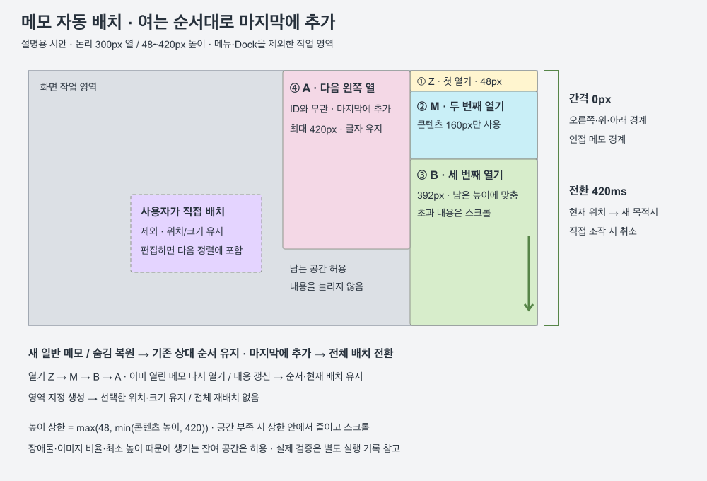

구현·검증 범위는 [검증 기록](verification.md#메모-자동-배치와-전환-2026-11-04)에 기록한다.

- 적용·검증: Rust 69개·UI 52개, Clippy·Rustfmt·개발 빌드 통과. macOS Retina에서 일반 열기·실제 드래그/리사이즈/편집·영역 지정·트레이 복원·전환 중간 프레임을 검증했다. [실제 일반 메모 8개 배치 화면](design/auto-layout-live-macos.png). Windows·Intel·복수 모니터 실환경은 미검증이다.

- #34 적용·검증: 최신 main 통합 후 Rust 80개·UI 53개, Clippy·Rustfmt·개발 빌드 및 macOS 실제 7개 검사 통과. [2026-11-05 검증 기록](verification.md#새-창-열기-순서-34--2026-11-05)에 출처·전후 캡처·환경별 한계와 최초 스트레스 실패의 후속 #43을 기록했다. 위 2026-11-04 기록은 당시 빌드에 대한 결과다.
- #43 구현 보정: macOS에서 위치·크기 쓰기의 native 반영 전에 전환을 취소하거나, 늦은 프레임 응답을 버려 중간에서 멈추지 않도록 보완했다. 기존 시각 기준과 시안은 유지한다. Rust 84개·UI 53개, 개발 빌드·Clippy·Rustfmt 및 실제 12창 재포함/연속 열기의 7검사·45개 목적지 대조·613프레임 반영 게이트 통과. [인과·전후 검증과 제한](verification.md#다중-창-전환-중단-43--2026-11-05)에 기록하며 대량 재시작 지연은 후속 #44로 분리한다.

## 영역 에이전트 터미널 MVP — 과거 구현, 2026-11-06 제거

- macOS에서 Ctrl+Shift+3 또는 Tray Menu의 ‘영역 에이전트 터미널’로 기존 Capture Overlay를 사용한다. 선택한 위치와 크기에 Terminal Window를 만든다.
- Toolbar는 별도 이동 영역이며 본문 드래그는 터미널 텍스트 선택이다. 오른쪽 아래 핸들로 크기를 조절한다. 닫기 버튼은 숨기기이며 PTY와 스크롤백을 유지한다. Escape와 Ctrl+C는 CLI로 전달한다.
- 설치된 Codex를 우선 실행하고 없으면 Claude Code를 실행한다. 에이전트·모델·폴더 설정 화면은 없다. 설치 누락·시작 오류는 창 안에 표시한다. 로그인·신뢰·권한 확인은 CLI가 담당한다.
- Terminal Window는 기본 어두운 표면, 28px 이동 막대, 13px 고정폭 본문, 기존 24px 버튼·4px 모서리를 사용한다. 영역이 작으면 내용이 잘릴 수 있으며 사용자가 크기를 늘릴 수 있다.
- 재시작 후 폴더와 창 위치·크기는 남고 창은 숨김 상태로 복원된다. 열 때 새 CLI 세션을 시작한다. 과거 프로세스·대화 세션 복원은 제외한다.
- 구현 및 실환경 검증 범위는 [검증 기록](verification.md)의 에이전트 터미널 절을 따른다. Windows 터미널은 지원하지 않는다.

[터미널 SVG 시안](design/agent-terminal.svg) · [렌더링 PNG](design/agent-terminal.png) · [macOS 실제 실행](design/agent-terminal-macos.png). 시안은 배치 설명용이며 실제 CLI 화면은 설치 버전에 따라 다르다.

### CLI 탐색과 시작 실패 — #17, 2026-11-05

- 기존 ‘설치된 에이전트를 찾고 있습니다…’ 상태와 설치 누락·오류의 창 안 안내를 유지한다. 현재 PATH의 Codex를 먼저 선택하고, 없으면 로그인 셸 → 대화형 로그인 셸을 필요한 만큼만 실행한다. Claude fallback은 Codex 탐색을 마친 뒤 선택한다.
- 성공 결과는 앱 수명 동안 공유하고 실행 파일 변경·삭제·실패 시 무효화한다. 같은 창의 시작 중/시작됨 요청은 중복으로 거부한다. 셸 단계 3초·전체 탐색 4초 제한과 한 번의 spawn 실패 재탐색을 적용하며, 비정상 종료된 CLI를 자동 재시작하지 않는다.
- 레이아웃·색·아이콘·포커스 기준은 변경하지 않아 SVG/PNG 시안을 변경하지 않았다. 잠금 해제된 macOS ARM64에서 계측 없는 최종 앱의 READY/ECHO 표시·네이티브 키·resize·동일 PTY의 숨김 복원을 확인했다. 2.2초 탐색 중에도 기존 터미널의 입력·resize와 조회가 완료됐다. [최종 앱 출처·화면·겹친 시간 구간과 한계](verification/terminal-discovery-unlocked-20261105/README.md)를 따르며, Windows·Intel·실제 모델 CLI 인증·전체 한글 IME는 미검증이다. [#51](https://github.com/egoing/agent-gibbon/issues/51)은 원본 앱에서도 표시 문제가 재현되지 않은 환경 검증이며, 잘못된 interpreter의 PTY 오류 [#50](https://github.com/egoing/agent-gibbon/issues/50)은 별도 미해결 범위로 유지한다.

### 터미널 스타일·IME 보완

- 터미널 WebView에만 동적 CSS를 허용하여 xterm의 고정폭 글꼴·셀 배치·조합 표시 스타일이 적용되도록 한다. 스크립트 정책과 메모 WebView 정책은 유지한다.
- 본문 클릭으로 xterm 입력란에 포커스를 주며 IME 조합 중에는 커스텀 단축키 처리를 건너뛴다. 시작·숨김 복원만으로 사용자 포커스를 가져오지 않는다.
- 개발 빌드·Clippy·JS 구문 검사 통과. 현재 실행 세션 보존을 위해 재시작하지 않았으므로 네이티브 한글 IME 해결 여부와 변경된 실제 외형은 미검증이다. 시안은 의도한 고정폭 터미널 기준을 유지한다.

수정본 재시작 후 실제 창에서 고정폭 글꼴·색상·입력 영역 강조를 확인하고 [실행 화면](design/agent-terminal-macos.png)을 갱신했다. 한글 IME 조합 검증은 남아 있다.

### 통합 트레이 목록 및 입력 모드 보정

- 에이전트 터미널 항목을 생성 명령 영역에서 제거하고 일반 메모·캡처와 같은 Memo List 구분선 안에 배치한다. 개별 선택은 기존 세션 복원 동작을 유지한다. [트레이 시안](design/tray-memo-list.svg)과 PNG를 갱신·렌더 확인했다.
- xterm의 강제 screenReaderMode=true를 기본값 false로 변경했다. WebView 합성 insertText 입력은 기존 설정에서 누락, 기본 모드에서 전달됨을 확인했다. 네이티브 IME와 스크린리더 접근성 검증은 별도 필요하다.

### 공통 패널·Toolbar 적용

사용자 합의에 따라 Terminal Window도 텍스트·이미지 Memo의 `memo-surface`, 공통 style.css, Toolbar 아이콘·24px 버튼·넘침 페이지 이동(toolbar.js), 사방 크기 조절 핸들을 공유한다. 글자 크기, 선택 텍스트 복사, 상단 고정, 숨기기를 제공한다. Markdown 편집·파일 내보내기·접기·워프는 이번 터미널 Toolbar에서 생략했다. 터미널 본문은 텍스트 선택을 유지하며 상단 제목 영역으로 이동한다. Escape는 CLI로 전달하므로 숨기기 단축키로 안내하지 않는다. 시안 SVG/PNG를 갱신했다. 실제 앱 적용 및 네이티브 IME 검증은 재시작 후 필요하다.

한글 fallback은 네이티브 composition 이벤트가 없는 WebKit 입력 경로에서 provisional textarea 값을 로컬 조합 표시로 유지한다. 공백·구두점·제어키·포커스 이탈로 확정하며 Escape/Ctrl+C는 임시 조합을 취소한다. 정상 composition 이벤트는 xterm에 맡긴다. 실제 입력기 검증 전까지 해결 완료로 기록하지 않는다.

## 전체 창 접어두기 / 복원 — 2026-11-04

사용자 요청을 구현한 동작 기준이며, 아래 수치는 기존 전환·Feedback Token을 바탕으로 한 초기 기본값이다.

- **Ctrl+Alt+Cmd(macOS) / Ctrl+Alt+Win(Windows)** 세 보조키를 단독으로 눌렀다가 모두 놓으면 전환한다. 일반 키·Shift·클릭·휠이 섞인 조합은 취소해 다른 단축키에 간섭하지 않는다. 입력 이벤트를 차단/변경하지 않는다. 길게 누르거나 일부 키만 놓고 다시 눌러도 한 번만 실행한다. 기존 세 보조키+포인터 접촉의 개별 숨김은 이 전체 전환으로 대체한다. Tray Menu와 안내는 같은 실제 키를 표시한다.
- 실행 순간 보이는 Memo(텍스트·캡처 이미지·접힌 메모), Capture Overlay를 스냅샷으로 보관한다. 연결된 Feedback은 부모와 함께 숨기고 복원 후 현재 상태에 맞게 다시 배치한다. 원래 숨김/최소화 상태의 창과 OS 파일 대화상자는 대상에 넣지 않는다.
- **420ms cubic ease-out**으로 커서 화면 작업 영역의 오른쪽 하단을 향해 이동·축소하고 기존 불투명도의 10%까지 흐려진 뒤 숨긴다. 네이티브 최소 크기와 이미지 비율 제약을 유지한다. 프로세스·WebView를 종료/재생성하지 않아 작업과 Editor 초안은 유지된다.
- **Stash Indicator**는 눈을 두 손으로 가린 긴팔원숭이 SVG(40px, 불투명도 85%)를 사용한다. 마스코트의 자리는 오른쪽 4px에 고정하며 말풍선과 별도 영역으로 배치한다. 기존 4px 모서리·1px 경계·11px UI 글자를 공유한다. 작업 영역에서 12px 안쪽에 두며 네이티브 창 전체는 클릭 통과·비활성화 상태다. 보이지 않는 안내 영역도 클릭을 가로채지 않는다.
- 아이콘 중심 **56 논리 px** 안으로 접근하면 오른쪽 아래↔위로 420ms smoothstep ease-in-out으로 이동한다. **96px 밖으로 나간 뒤 재진입**, **최소 2초 쿨다운**을 요구한다. 이동 후 실제 단축키와 ‘다시 누르면 창 복원’을 **6초** 표시하고, 그동안 추가 회피를 보류하여 읽을 시간을 보장한다. 최초 창 접어두기 완료 직후에도 말풍선을 최대 6초 표시하되, 첫 56px 접근은 이 초기 안내를 중단하고 즉시 한 번 회피한다. 이동 후 안내는 6초 동안 보호하며 이때의 이탈·재진입은 예약하지 않는다. 안내 종료 후 96px 밖 이탈·재진입이 있어야 다시 회피한다. 회피 이동 중에는 말풍선을 숨기며, 마지막 이동 프레임 다음 틱부터 6초를 계산한다. 말풍선은 아이콘 왼쪽에 꼬리를 두고 실제 단축키와 복원 안내를 두 줄로 표시한다.
- 같은 단축키는 이번 스냅샷에 남아 있는 창만 **현재 아이콘 위치에서 420ms cubic ease-out**으로 커지고 선명해지며 원래 위치·크기·접힘 상태로 복원한다. 복원에는 자동 배치를 실행하지 않으며 현재 다른 앱 포커스를 유지한다. 원래 화면이 사라졌으면 남은 화면 작업 영역 안으로 위치·크기를 제한한다. 아이콘 화면이 사라져도 남은 화면으로 이동한다.
- 빠른 재토글은 현재 위치·크기·불투명도를 시작점으로 반대 방향의 420ms 전환을 시작한다. 원래 복원 대상은 유지하고 오래된 프레임은 다음 전환에 적용하지 않는다. 창별 개별 `close`는 복원 예약에서 제거하고 숨기며, 명시적 `open`은 예약에서 제거하고 복원한다. 접어둔 동안 새 `open`은 독립적으로 표시하되 기존 창을 재배치하지 않는다. `update`는 숨김과 초안을 유지한다. 전체 복원 직후에도 원래 자동 배치 제외 설정을 보존하며, 명시적인 콘텐츠 작업에 따른 제외 변경은 기존 규칙을 따른다.
- 이 스냅샷은 실행 중 한 번의 가시성 전환에만 사용하는 임시 상태다. 자동 배치의 작업 이력/Undo 기능을 추가하지 않는다. 앱 종료 시에는 기존 종료 정책을 따르며 미저장 초안의 영속 저장을 보장하지 않는다.

[동작 시안 SVG](design/window-stash.svg) · [PNG](design/window-stash.png). 설명용 시안이며 아래 실제 검증과 구분한다.

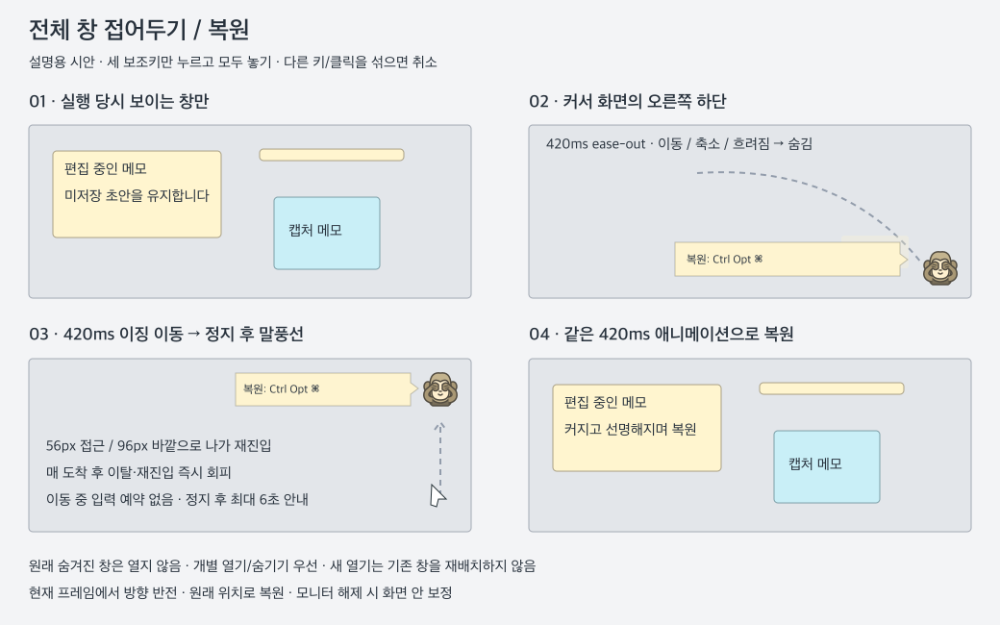

구현·실행 근거와 환경별 한계는 [검증 기록](verification.md#전체-창-접어두기복원-2026-11-04)에 기록한다.

- 적용·검증: Rust 71개·UI 52개, Rustfmt·Clippy·개발 빌드 통과. macOS ARM64의 실제 화면 3개에서 단축키, 전환, 회피/안내, 원위치·접힘·초안 복원, CLI 경합, 트레이 및 캡처 창 복원을 확인했다. SVG/PNG와 실제 아이콘 캡처를 시각 확인했다. 캡처 자동 드래그 생성의 반복 안정성, 물리 모니터 해제·혼합 DPI·Windows·Intel은 완료로 간주하지 않으며 상세 한계는 위 검증 기록에 남겼다.

### 단축키 충돌 방지와 양방향 전환 — 후속 적용

- 보조키 단독 조합은 OS의 일반 전역 단축키 등록 API로 독점할 수 없어 macOS 이벤트 관찰/Windows 이벤트 훅과 상태 확인을 함께 사용한다. 정상 키 입력 내용은 저장하지 않고 혼합 입력 여부만 일시적으로 기록한다. 이벤트는 원래 대상 앱으로 그대로 전달한다. 단, 아래 전체 메모 투명도 조절 조건에 맞는 세로 휠은 소비한다.
- 안전한 입력 관찰 권한 또는 훅 설치가 실패하면 세 키 자동 토글을 끄고 트레이만 제공한다. 같은 사용자의 이 기능을 지원하는 Agent Gibbon 인스턴스 간에는 파일 잠금으로 하나만 보조키 입력을 담당한다. 다른 앱이 **동일한 세 보조키 단독 해제**를 자체 감지하는 경우까지 시스템 차원에서 중복 실행을 막을 수 있는 것은 아니다.
- 접어두기와 복원 모두 420ms를 사용한다. 복원 중에는 일반 메모 배치·접촉 동작·Feedback 재표시를 억제하고 마지막 프레임 뒤 연결형 Feedback을 배치한다. 캡처 선택 화면은 마지막에 앞으로 표시한다.
- 검증 범위는 [후속 검증 기록](verification.md#복원-애니메이션과-보조키-단독-충돌-방지-2026-11-04)에 기록한다. 이전 Ctrl+Shift+3/즉시 복원 설명과 실행 기록은 이전 구현에 대한 기록이다.

### 긴팔원숭이 말풍선과 회피 이동 — 후속 적용

- 위 고정 마스코트 영역·꼬리가 있는 말풍선·정지 후 표시·420ms 이징 이동을 적용했다. 숨김과 복원용 420ms cubic ease-out은 유지한다. 관련 검증과 아이콘 누락 원인 조사 한계는 [검증 기록](verification.md#긴팔원숭이-말풍선과-회피-이동-2026-11-04)을 따른다.

### 메모 관리·터미널 기능과 병합

- 전체 창 전환이 관리 창의 항상 불투명 규칙보다 우선한다. 전환 중 터미널 위치를 저장하지 않으며, 관리 창·터미널의 개별 열기/숨기기는 전체 복원 예약에서 제외한다. 기존 트레이 기능과 전역 단축키를 함께 유지한다. 병합본의 네이티브 GUI 재검증은 후속 검증 범위다.

### 최초 접근 즉시 회피 — 이슈 #36 (2026-11-05)

- 초기 안내와 회피 후 안내를 구분한다. 초기 안내 중 첫 접근에는 즉시 반응하고, 회피 후에는 기존 6초 읽기 시간을 보장한다. 보호 시간 중 접근·이탈은 다음 이동을 예약하지 않는다. 56px/96px, 2초 쿨다운, 420ms 이징, 이동 중 안내 숨김·최종 이동 다음 틱 표시와 비활성화·클릭 통과를 유지한다.
- [수정 전후 실제 포인터 검증](verification.md#최초-접근-즉시-회피--이슈-36-2026-11-05)의 적용·한계를 따른다.

- PR47 main `b931ac2` 통합: 최초 접근과 #34/#43 배치 기준을 모두 보존했다. Rust84/UI53 등 필수 검사는 통과했으나 통합 앱 open 비가시로 최초 접근 GUI는 미검증이며 [통합 검증 기록](verification/issue36-first-approach.md#main-b931ac2-통합-확인-2026-11-05)을 따른다. 시각 기준·시안은 추가 변경하지 않았다.

- #49 환경 검증: 절전 중 활성 화면 0개로 막혔던 PR47 통합 실제 검증을 화면 깨우기 후 원본 코드로 완료했다. 신규·반복·숨김/저장 복원과 #36 최초접근 스모크·캡처를 확인했다. 기준·시안 변경은 없으며 [출처·한계](verification/issue49-environment.md)를 따른다.

## Terminal Welcome — #57 (2026-11-05)

이번 절은 범용 터미널의 확정 동작이다. 전용 에이전트는 2026-11-06 제거했다. 일반 터미널의 Ctrl+Shift+3만 **영역 터미널**에 재배정한다. 기존 에이전트 시안은 과거 구현 기록으로만 보관한다.

- **Terminal Window / 터미널 창**은 선택한 영역에 나타나는 범용 셸 창이다. **Welcome / 시작 화면**에서 최근 작업 폴더와 설치된 Claude Code·Codex·git log·htop, 항상 사용 가능한 셸을 보여 준다. 경로 기록이 없으면 최근 폴더 행을 만들지 않고 홈에서 실행한다. 폴더 열기와 셸 선택은 항상 제공한다.
- 설치 감지는 PATH 및 표준 설치 폴더의 실행 파일만 확인한다. 후보 프로그램을 실행하거나 마지막 실행 앱으로 추천을 제한하지 않는다. 선택한 작업의 실제 인용된 실행 경로·인수를 실행 버튼 아래 읽기 전용 명령 미리보기에서 확인한다. resume은 제공하지 않는다.
- 추천 앱은 선택한 폴더의 대화형 셸에서 새로 실행한다. 앱 명령 종료 후 셸을 유지하며 Welcome으로 돌아가지 않는다. 셸 자체가 끝나도 출력을 유지하며 창을 닫고 다시 열 때 Welcome을 만든다.
- 창별 마지막 경로·경로 갱신 시각·위치·크기·사용자 제목과 최근 폴더 목록 최대 20개를 로컬 메타데이터에 저장한다. 최근 폴더 저장은 사용자 확정 와이어프레임에 따른 승인된 범위 확장이다. 명령·출력·대화·셸 히스토리는 앱 저장 대상이 아니다. 경로가 없으면 기본 제목은 ‘터미널’, 있으면 폴더명이다. Welcome의 제목 입력으로 덮어쓰며 빈 제목은 기본값을 사용한다.
- **터미널 종료** 버튼/네이티브 닫기는 창과 PTY를 종료한다. 실행 중인 작업이 감지되거나 상태 확인이 불확실하면 종료/취소를 묻는다. 셸 대기 중이면 바로 닫는다. 종료된 항목은 목록에 남고 다시 열면 마지막 위치·크기·경로의 Welcome을 보여 준다.
- 핀을 해제한 창에서 다른 UI로 포커스가 이동하면 숨긴다. CLI `close`와 세 보조키의 전체 접어두기도 숨김이며 실행을 유지한다. 살아 있는 숨김 창의 `open`은 같은 WebView·PTY로 돌아간다.
- 텍스트·캡처 메모의 닫기 버튼/네이티브 닫기는 해당 창을 종료한다. 저장 메모와 목록은 유지하며, Esc·CLI `close`는 계속 숨김이다. 닫은 메모의 조회/갱신은 창을 다시 열지 않는다.
- 관리 목록의 일반 터미널은 접두사 없이 제목을 표시한다. 선택만으로 실행하지 않고 `화면에 띄우기`로 복원한다. 범용 터미널의 `목록에서 삭제`는 종료와 별개이며 실행 중에는 거절한다. 실제 작업 폴더를 삭제하지 않는다.

### 사용자 확정 와이어프레임 — 2026-11-05

아래 기준은 이전 전문가 토론의 카드형 원클릭 실행·접힌 명령 확인 구성을 대체한다. 사용자가 정한 선택 후 실행 구조를 최종 기준으로 삼는다. [이전 토론 기록](verification/issue57-welcome-review.md)은 당시 제안과 반론의 역사이며 실사용자 실증조사가 아니다.

**시각 기준:** 기존 어두운 표면·4px 모서리·13px 터미널 본문·24px Toolbar를 재사용한다. 시작 화면은 ‘작업 위치’ → 최근 폴더 → ‘추천 작업’ → ‘실행’ → 읽기 전용 명령 미리보기 → 접힌 ‘창 제목 변경’ 순서다. 큰 Welcome 제목·앱 설명·카드형 버튼은 사용하지 않는다.

- ‘작업 위치’ 아래 `📂 폴더 열기…`와 최근 폴더 세 개를 표시한다. 폴더명 옆에 상위 경로를 작은 글자로 표시하고 긴 텍스트는 줄바꿈한다. 네 개 이상이면 ‘더 보기…’로 저장된 목록을 펼치고 ‘접기’로 세 개 표시로 돌아간다. 저장은 창별 최대 20개이며, 여러 터미널 기록을 중복 제거해 화면에도 최대 20개만 제공한다. 현재 창의 선택 폴더를 앞에 두고 나머지는 최근 순으로 정렬한다. 현재 창의 마지막 폴더가 삭제됐으면 해당 선택을 유지해 실행 오류를 알리고 다른 폴더를 고르게 하며, 다른 최근 기록의 없는 폴더는 제외한다. 경로 기록이 없으면 ‘홈 폴더에서 시작합니다.’를 표시한다.
- ‘추천 작업’은 설치가 확인된 Claude Code, Codex, git log, htop과 항상 제공되는 셸을 텍스트 행으로 나열한다. 폴더와 작업 행을 누르면 선택만 바뀌며 즉시 실행하지 않는다. 선택 행은 배경색 `#414e63`과 `aria-pressed`로 구별하고 키보드 초점은 별도 테두리로 표시한다.
- 별도 ‘실행’ 버튼으로 선택한 폴더와 작업을 실행한다. 바로 아래 읽기 전용 명령 미리보기는 현재 선택한 위치 이동 명령과 작업 명령을 보여 주며, 선택 변경 때 갱신한다. 본문을 선택·복사할 수 있고 긴 명령은 줄바꿈/스크롤한다. 미리보기는 편집 입력란이 아니다.
- 콘텐츠 폭은 최대 480px, 기본 내부 여백은 24px다. 가용 높이에 여유가 있으면 전체 콘텐츠 묶음을 수직 가운데에 둔다. 높이가 부족하면 위에서부터 스크롤하며 위쪽 컨트롤이 잘리지 않게 한다. 너비 420px 이하 또는 높이 300px 이하에서는 내부 여백을 16px로 줄인다. 행의 최소 높이는 32px이며 작은 창에서 전체 무스크롤 표시는 보장하지 않는다.
- ‘창 제목 변경’은 하단에 접힌 `details`로 유지한다. Enter 또는 ‘적용’으로 변경하며 빈 값은 기본 제목으로 복원한다. 타이틀바 드래그 영역은 유지한다.
- 실행 중에는 상태를 알리고 중복 시작을 차단한다. 실패하면 시작 화면을 복원하고 사용자가 다른 컨트롤로 초점을 옮기지 않은 경우에만 실행 버튼으로 초점을 복원한다. 명시적 실행이 성공했고 창에 초점이 남아 있으며 다른 입력으로 옮기지 않은 경우에만 터미널 입력으로 초점을 옮긴다.

[SVG 시안](design/terminal-welcome.svg) · [PNG 렌더링](design/terminal-welcome.png). 시안은 설명용이며 실앱 캡처가 아니다.

구현·검증 범위와 macOS/Windows 차이는 [#57 검증 기록](verification/issue57-terminal-welcome.md)을 따른다. 이전 검증 기록을 이번 변경의 실행 증거로 사용하지 않는다.

- 이전 카드형 구성의 #57 검증 상태(최신 와이어프레임의 실행 증거로 재사용하지 않음): SVG→PNG 렌더·실제 UI 자산의 Chromium 720×460/320×240 검증 통과. 텍스트 버튼은 최소 64×32px로 보완했다. 실제 셸 수명 자동 테스트는 통과했으나 부분 범위의 기존 탐색 테스트 실패가 남아 있고 최종 native GUI/Windows 실행은 미검증이다. 사용자 PS1 재정의·복잡한 여러 줄 입력 시 idle에서도 종료 확인이 나올 수 있는 구현 제한이 있다. 이는 확정 요구사항의 변경이 아니며 위 검증 기록의 리뷰 항목으로 남긴다.

- 사용자 확정 와이어프레임 시안: SVG→PNG 렌더와 시각 확인 완료. 최신 구현의 테스트·브라우저·네이티브 검증은 위 검증 기록을 따르며 시안 확인으로 대체하지 않는다.

- 확정 와이어프레임 구현·검증: [후속 기록](verification/issue57-wireframe.md). 최신 UI 67개·Rust 107개, 3개 화면 크기 브라우저 및 개발 빌드 검증과 native 한계를 구분한다.

## 전체 메모 투명도 — #71 (2026-11-06)

- **사용자 요청:** Ctrl+Alt+Cmd(macOS) / Ctrl+Alt+Win(Windows)를 누른 채 세로 휠을 움직이면 모든 메모의 불투명도를 함께 조절하고 로컬에 저장한다. 포커스·포인터 위치에 의존하지 않으며, 위치·크기·핀·숨김을 변경하지 않는다. 메모별 Markdown을 수정하지 않는다.
- **초기 조작 수치:** 위로 한 칸은 +5%p, 아래로 한 칸은 -5%p, 범위는 10~100%다. 최초 조절은 50%를 시작점으로 한다. macOS 자연스러운 스크롤 설정과 무관한 물리 휠 방향을 사용한다. 정밀 스크롤은 20포인트, Windows는 120 wheel delta를 한 칸으로 누적하고, 보조키 해제·다른 입력·400ms 이상 중단 시 미완성 이동을 버린다. Shift·일반 키·클릭 혼합과 macOS 관성 스크롤은 조절하지 않는다. 수치는 실제 입력 장치별 후속 조정이 가능한 초기값이다.
- **우선순위 (롤오버 복원, 2026-11-06):** 메모나 연결된 Feedback에 포인터가 있으면 해당 메모와 Feedback만 즉시 100%로 표시한다. 새로 열거나 숨김에서 복원하는 메모는 100%로 시작하며, 커서 옆 대기·등장 이동 중에는 저장값보다 우선해 100%를 유지한다. 기존 메모의 위치·크기 재배치 전환은 등장 강조로 취급하지 않아 원래 투명도를 유지한다. 등장 완료 직후 포인터 이동 없이도 2초 대기·600ms 복귀를 시작한다. 메뉴/Dock 직접 복원과 커서 옆 공간이 없어 즉시 표시하는 경우도 100%로 시작한 뒤 같은 시간으로 복귀한다. 저장된 수동값은 접촉·등장하지 않을 때의 값이며 접힘·변경 알림 자동 불투명도보다 우선한다. 포인터가 두 영역 모두에서 벗어나면 기존 규칙대로 2초 대기 후 600ms ease-in-out으로 저장값에 복귀한다. 전환 중 재접촉하면 즉시 100%로 돌아가고 다음 이탈부터 대기를 다시 센다. 휠로 저장값을 바꾸면 이전 전환을 취소하고 접촉하지 않은 메모에 새 값을 즉시 적용하며, 접촉 중인 메모는 100%를 유지하다 이탈 후 최신 값으로 복귀한다. 포인터 접촉은 저장값·다른 메모·문서를 변경하지 않는다. 텍스트·이미지·접힌 메모·터미널에 공통 적용한다. 기존 전체 접어두기 애니메이션이 진행 중이면 전환을 우선하고 복원 완료 시 최신 저장값과 접촉 상태를 적용한다. 관리 창·Capture Overlay·Stash Indicator는 제외한다. Toolbar 표시/숨김·변경 부분 강조는 유지한다.
- 새 메모·개별 숨김 복원·앱 재실행에도 같은 값을 사용한다. 설정이 없으면 기존 플랫폼별 자동 투명도 동작을 유지한다. 저장은 `app_data/appearance/<installed 또는 개발 instance>/opacity.json`을 원자적으로 교체하며 개발 인스턴스끼리와 설치 앱을 격리한다. 저장 실패 시 새 값을 적용하지 않는다. 손상된 파일은 로그를 남기고 기존 자동 동작으로 시작하며 이후 정상 조절로 다시 저장할 수 있다.
- 휠을 섞은 조합은 세 보조키를 모두 놓아도 전체 접어두기/복원을 실행하지 않는다. 기존 입력 관찰 권한과 인스턴스 간 단일 담당 잠금을 공유하며 키·클릭과 조절 조건에 맞지 않는 휠은 다른 앱에 그대로 전달한다. 다른 인스턴스가 입력을 담당하거나 macOS 접근성 권한이 없으면 새 휠 조절도 비활성화된다. 투명도 조절 조건에 맞는 세로 휠은 다른 앱에 전달하지 않는다. 한 칸 미만의 정밀 입력과 이미 10%·100% 한계에 도달한 입력도 소비하여 뒤의 앱이 스크롤되지 않게 한다. 일반 스크롤·가로 휠·Shift/Function·일반 키/클릭 혼합·조절 대상이 아닌 관성 입력은 그대로 전달한다. macOS에서 조절에 사용한 트랙패드 제스처는 보조키를 먼저 놓더라도 같은 제스처의 종료·관성 꼬리까지 소비하고, 관성으로 투명도를 추가 변경하지 않는다. 다음 새 제스처부터 일반 스크롤을 전달한다. macOS는 scroll-only 활성 session event tap, Windows는 기존 저수준 mouse hook을 사용하며 창 처리·파일 저장은 훅 밖의 main thread에서 수행한다. 필터 설치 실패나 다른 인스턴스의 입력 점유 시 입력을 차단하지 않는다. 추가 UI·설정 버튼은 만들지 않는다.

[SVG 시안](design/global-opacity-wheel.svg) · [PNG 시안](design/global-opacity-wheel.png). 위 우선순위는 기존 자동 투명도 절보다 우선하며 시안은 설명용이다. 구현·실행 검증 범위와 한계는 [#71 검증 기록](verification/issue71-global-opacity.md)을 따른다.

롤오버 복원과 조절 휠 전파 차단은 후속 사용자 요청으로 적용한 변경이다. 기존 #71의 검증을 새 동작의 실행 근거로 사용하지 않으며 [롤오버 복원 검증](verification/hover-opacity-restore-20261106.md)에 이번 구현·실행 범위를 기록한다. Rust 155개·UI 95개와 Rustfmt·Clippy·개발 빌드, macOS ARM64의 native alpha·별도 앱 수신을 통한 합성 휠 차단 검증을 통과했다. Windows·Intel 실제 GUI와 물리 장치별 입력 검증은 포함하지 않는다.

- 적용·검증: Rust 136개·UI 81개, Rustfmt·Clippy·개발 빌드 통과. 테스트 전용 약관/동의 기록을 사용한 macOS ARM64 인스턴스에서 두 메모의 실제 native alpha 35%, 숨김 갱신 상태 보존과 재시작 복원을 확인했다. 원문 문서·제품 빌드를 복원했다. 전역 입력이 다른 인스턴스에서 사용 중이어서 물리 휠 종단 조작은 미검증이며 Windows·터미널·접힘/Feedback·전체 전환 GUI 한계는 위 검증 기록을 따른다.
- 후속 사용자 재실행 세션에서 이 개발 앱이 입력 잠금을 확보한 뒤 설정·창 적용 값의 35% → 100% 변화와 같은 PID의 native alpha 100%를 확인했다. 장치별 양방향·상하한 전체 입력 검증을 대신하지 않으며 [추가 실행 기록](verification/issue71-global-opacity.md#사용자-재실행-세션의-추가-확인)에 출처와 한계를 남겼다.

### 새 메모 스포트라이트 보정 (2026-11-06)

- 새로 표시하는 메모의 등장 강조와 기존 창의 재배치 전환을 분리했다. 수동 투명도 설정에서도 새 메모를 선명하게 표시하며, 숨겨진 WebView 측정 중 진행된 fade는 실제 표시 전에 초기화한다. 포커스·핀·숨김·배치 기준과 변경 알림 우선순위는 유지한다.
- [투명도 시안 SVG](design/global-opacity-wheel.svg)·[PNG](design/global-opacity-wheel.png)를 새 메모 100%, 기존 메모 저장값의 관계로 갱신했다. 구현·실행 검증과 한계는 [검증 기록](verification/new-memo-spotlight-20261106.md)을 따른다. Rust 157개·UI 95개, Rustfmt·Clippy·개발 빌드와 macOS ARM64의 자동 50%·수동 35% 실제 창 검증을 통과했다. Windows·Intel 실제 GUI는 미검증이다. 코드 SHA `f54c34e`의 macOS ARM64·Intel·Windows x64 전체 검사와 설치 파일 빌드는 [실행 42230331380](https://github.com/egoing/agent-gibbon/actions/runs/42230331380)에서 통과했고 비어 있지 않은 artifact 세 개를 확인했다. 실제 설치·GUI 검증과 구분한다.
