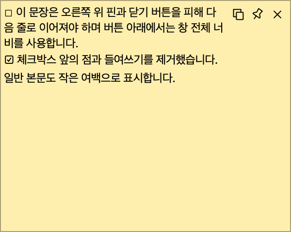
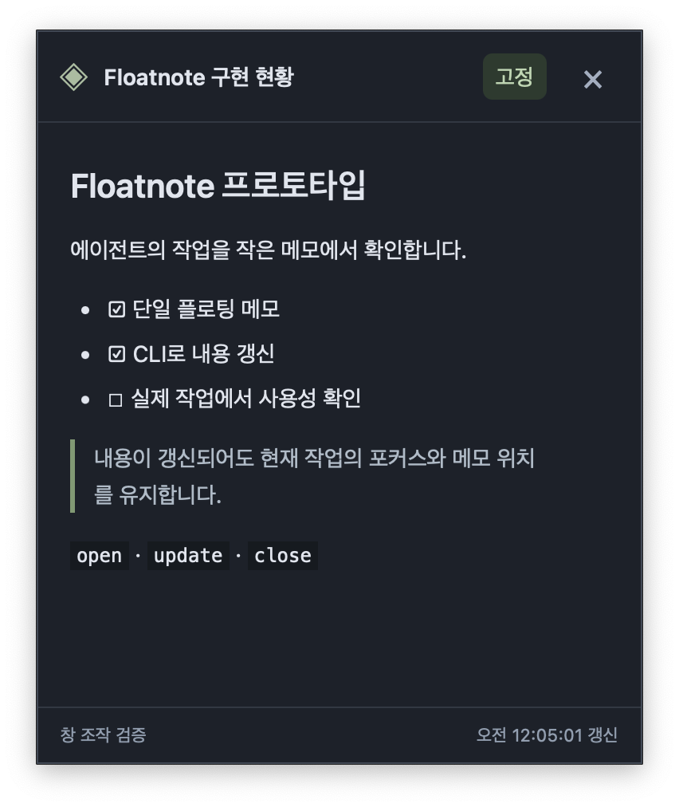

# Floatnote 검증 기록

검증일: 2026-10-10 (Asia/Seoul)

## 화면 재구성 중 AppKit 크래시 완화 (2026-10-27)

- v0.2.7 보고서 `D007C9E8-E177-4854-9248-5EC8BDFFA593`의 실행 파일 UUID가 설치본과 일치합니다. 동일 macOS 15.6.1 (24G90)에서 `atos`로 `_reactToDisplayChanges:` → `_adjustWindowToScreen` → `_setFrameCommon:display:fromServer:` → `_adjustNeedsDisplayRegionForNewFrame:` 경로를 확인했습니다. SIGTRAP은 메인 스레드 AppKit 내부에서 발생했습니다.
- 접기 시 `setContentAspectRatio(0, 0)` 호출을 제거하고 `setContentResizeIncrements(1, 1)`로 비율 제약을 해제합니다. 펼칠 때 이미지의 원래 비율을 다시 설정하는 동작은 유지합니다. [Apple 비율·크기 증분 설명](https://developer.apple.com/documentation/appkit/nswindow/aspectratio)과 [동일한 영 비율 설정 후 SIGTRAP 재현 보고](https://github.com/libsdl-org/SDL/issues/14229)를 근거로 한 완화입니다.
- 한계: 보고서만으로 사고 당시 접힌 창이나 화면 변경 원인을 특정할 수 없습니다. 별도 AppKit 창에서 접기·크기 조정·펼치기를 10회 수행한 비교 실험은 수정 방식과 기존 방식 모두 통과했으므로, 원본 크래시 재현·해결 확정으로 간주하지 않습니다. 실제 모니터 연결·해제와 절전 복귀는 미검증입니다.
- macOS arm64, Rust 1.91.1, Node 24.21.0에서 Rust 64개·UI 39개 테스트, Clippy, Rustfmt, diff 공백 검사와 워크트리 개발 debug 빌드 통과. 설치 앱 바이너리는 교체하지 않았습니다.
- 실제 개발 앱에서 `python3 scripts/fold-contact-smoke.py` 통과: 20ms 접촉 10회 접기·펼치기, 접힌 창의 접촉 여유, 위치·크기·포커스·고정·본문 보존과 숨긴 메모 유지 확인. 첫 실행은 System Events 미실행 오류로 실패했고, 테스트에서 시작한 개발 프로세스만 정리한 뒤 System Events를 시작하여 재실행했습니다. 마지막 테스트가 만든 개발 프로세스는 자체 정리됐습니다.
- Conf 4 (실제 접기·펼치기 회귀) / Risk Low. 원본 크래시 원인의 확정과 해결 검증은 보류합니다.

## 보조키 접촉 진입 조건 (2026-10-26)

- 커서가 노트 밖에서 안으로 들어올 때만 Option 이동·Control 접기·세 키 조합 닫기를 허용합니다. 노트 안에서 키를 누르거나 다시 누르기, 포커스된 노트, 안에 머문 채 포커스 해제로는 실행하지 않습니다.
- 공통 접촉 상태 회귀 테스트로 최초 내부 관측, 키 없이 진입 후 키 누르기, 포커스 차단·해제, 실제 이탈 후 재진입, 이동·접힘에 의한 반복 실행 차단을 확인했습니다.
- macOS arm64, Rust 1.91.1, Node 24.21.0: Rust 61개·Node 24개 통과, Clippy 경고 없음, Rustfmt·diff 검사와 개발 debug 빌드 통과.
- 해당 워크트리의 개발 CLI로 open/inspect/close/update 및 숨긴 상태의 내용 갱신을 확인했습니다. 검증에서 시작한 정확한 개발 바이너리 PID만 종료했습니다.
- 실제 보조키·포인터 제스처와 포커스 전환의 UI 검증, Intel·Windows 실행 및 release 빌드는 수행하지 않았습니다. 설치 앱은 교체하지 않았습니다.
- Conf 3 / Risk Low.

## 워크트리별 개발 인스턴스 분리 (2026-10-25)

- 후속 `main` 통합 검증: Agent Gibbon 이름 전환과 v0.2.6 접촉 닫기 기능을 모두 보존했습니다. 개발 실행 파일·문서는 `agent-gibbon`으로 맞췄고 `scripts/floatnote-dev`는 호환 래퍼로 유지했습니다. 통합 상태에서 Rust 42개·Node 18개, Clippy, debug·release 빌드와 두 워크트리 실제 동시 실행·포커스·설치 앱 불변 검증을 다시 통과했습니다.

- 환경: macOS arm64, Rust/Cargo 1.91.1, Node 24.21.0, npm 11.19.0, Tauri CLI 2.12.1. Intel Mac 실행은 이번에 검증하지 않았습니다.
- 실제 절대 경로의 SHA-256 앞 24자리를 사용하는 개발 실행기를 추가했습니다. 개발 CLI는 debug 바이너리의 빌드 출처를 확인하며, release·설치본으로 대체하지 않습니다. 환경변수 미지정 설치 앱의 `/tmp/floatnote-{uid}` 경로는 유지됩니다.
- `npm test`: Rust 42개와 Node 18개 통과. 기존 Sentry 실전송 테스트 1개는 의도적인 ignore 상태로 실행하지 않았습니다. Rustfmt·Clippy(`-D warnings`)·diff 공백 검사 통과. 두 워크트리의 debug 빌드와 release macOS 앱 번들 빌드 통과. 배포 서명·공증은 이번 검증 범위에 포함하지 않았습니다.
- 현재 워크트리와 HEAD에서 만든 임시 detached 워크트리에 동일 변경을 적용하고 각각 빌드했습니다. `scripts/isolation-smoke.py`로 A는 개발 CLI 자동 시작, B는 `npm run dev -- --no-watch`로 동시에 실행했습니다. 같은 메모 ID의 서로 다른 내용, 부분 갱신, 숨김 유지, 별도 원본 파일 연결, 독립 중복 실행 잠금, A 종료·재시작 후 B 유지, 기본 앱의 모든 메모 내용·위치·크기·숨김·포커스·핀 보존을 확인했습니다. `/` 디렉터리에서 개발 CLI를 호출해 호출 위치 독립성도 검증했습니다.
- 네이티브 활성 앱 확인을 추가해 CLI 자동 시작·npm 개발 실행·새 창 생성·갱신에서 이전 앱이 유지됨을 검증했습니다. 현재 Wry의 WKWebView 생성 경로는 앱 활성화를 요청하므로, 첫 표시 시점에 이전 앱을 복원하도록 보완했습니다. 창 생성 도중 사용자가 제3의 앱으로 이동했으면 덮어쓰지 않습니다. 별도 실환경 반복 확인에서 보이는 메모의 메타데이터 갱신 시 위치·크기·포커스 유지도 통과했습니다. 이 검증은 명령 완료 후 상태를 확인하며, 생성 도중의 순간적인 활성화 전환을 완전히 없앤다는 보장은 아닙니다.
- 개발 창의 `DEV isolate-dev · 65069dd1` 표시를 네이티브 창 캡처로 확인했습니다. 설치 앱의 본문에는 개발 표시를 추가하지 않으며, 접힌 제목과 트레이에도 개발 인스턴스를 표시합니다. 단축키 안내의 localStorage 키도 인스턴스별로 분리했습니다.
- 기존 설치 앱과 `name` 워크트리의 파일·프로세스는 변경하지 않았습니다. 검증에서 시작한 개발 프로세스만 종료했고, 임시 워크트리는 정리했습니다. 기존 전체 UI 회귀 스크립트(드래그·편집 버튼·트레이 클릭)는 이번에 재실행하지 않았으며, 핵심 CLI 동시 실행과 새 창 포커스·개발 표시를 실제 환경에서 검증했습니다.
- 같은 `--file` 원본을 지정하면 파일 자체는 공유됩니다. 워크트리 이동 시 개발 ID도 바뀌며, 개발 실행기는 호스트 debug 빌드만 지원합니다. Conf 5 / Risk Medium: IPC 선택과 앱 상태에 관여하지만 변경 범위는 로컬이며 복구 가능합니다.

재현: 두 워크트리에서 `npm run dev:build`를 실행하고 해당 개발 앱이 꺼진 상태에서 `python3 scripts/isolation-smoke.py --peer /다른/워크트리`를 실행합니다. 기본 설치 앱은 실행 중이어야 합니다. 테스트는 기존 개발 앱이 감지되면 중단하며, 다른 앱을 종료하지 않습니다.

공식 API 근거: [Tauri CLI의 dev·no-dev-server 옵션](https://v2.tauri.app/reference/cli/), [macOS 활성 앱 조회](https://developer.apple.com/documentation/appkit/nsworkspace/frontmostapplication), [앱 활성화 API](https://developer.apple.com/documentation/appkit/nsrunningapplication?language=objc).

## 편집 기능 재검증 (2026-10-14)

- `npm test` 26개(Rust 21 + Node 5), Clippy, Rustfmt, JS/Python 문법과 diff 검사를 다시 통과했습니다.
- 재사용 가능한 `scripts/editor-ui-smoke.py`를 추가했습니다. 최신 UI·Rust 구현과 동일함을 파일 비교로 확인한 독립 macOS 앱에서 실행했습니다. 테스트는 고유 ID의 메모 두 개와 임시 Markdown 파일만 사용하고 테스트 창을 숨긴 뒤 원래 앱 포커스를 복원합니다.
- 실제 UI 통과: 4단계 글자 크기, 주변 버튼과 동일한 크기, 창별 독립 설정, 갱신·숨김 후 크기 유지, 한글 원본 저장·체크박스 렌더링, 취소, 숨긴 초안 유지, CLI/원본 파일 충돌 방지, Markdown 오류 교정 후 재저장, 파일 연결 해제 후 빈 메모 저장, 위치·크기·고정 상태 보존.
- 첫 실행에서 테스트 자동화의 입력 포커스 누락으로 교정 문자가 반영되지 않았습니다. 입력란에 포커스를 주고 실제 입력값을 확인하도록 테스트를 수정한 뒤 전체가 통과했습니다. 앱 코드 변경은 필요하지 않았습니다.
- 기존 운영 프로세스와 메모는 유지했습니다. 테스트 인스턴스만 종료했습니다. 단축키의 실제 키보드 입력과 전체 트레이 회귀는 이번 재검증 범위에 포함하지 않았습니다.
- Conf 5 / Risk Medium.

## 글자 크기 4단계·연필 편집 (2026-10-14)

- Intel x86_64, Node v24.21.0, Cargo 1.97.1에서 Rust 21개 + Node 5개, Clippy, Rustfmt, JS 문법 및 diff 공백 검사를 통과했습니다. release 앱 번들도 빌드했습니다.
- `aA`는 12·14·16·18px를 순환합니다. 주변 버튼과 동일한 19px 버튼, 14px SVG, 1.7 선 두께를 사용합니다. 본문 크기를 바꿔도 아이콘 크기는 유지됩니다.
- 기존 프로세스의 메모를 보존하기 위해 임시 소스 복사본에서 IPC 디렉터리와 앱 식별자만 분리한 debug 인스턴스를 만들고 실제 macOS 접근성 API로 버튼을 조작했습니다. 실제 4단계 순환, 연필에서 한글 Markdown 편집·원본 파일 저장·렌더링 반영, 취소, CLI 갱신 충돌, 원본 파일 변경 충돌을 확인했습니다.
- 단위 테스트는 파일 저장 성공·삭제된 파일·잘못된 체크리스트·오래된 편집 거부, 파일 연결 유지/해제, 메타데이터 유지와 빈 본문 저장을 검사합니다. UI 로직 테스트는 폴링 중 초안 유지, 오류 메시지 유지, 저장·취소·Escape, 편집 영역 드래그 방지를 검사합니다.
- 파일은 동일 디렉터리의 임시 파일을 완성하고 교체합니다. 파일 내용 비교 후 교체 사이의 외부 쓰기까지 직렬화하지는 않습니다. 기존 inode의 확장 속성·ACL·하드링크 관계는 보존하지 않으며 일반 텍스트 파일 편집을 대상으로 합니다.
- 기존 실행 앱은 이전 버전으로 유지했습니다. 새 빌드는 재실행 후 적용되며 기존 버전의 메모는 원문/파일 경로가 없어 자동 이관하지 않았습니다. 기존 전체 드래그·트레이 회귀 스크립트는 이번에 재실행하지 않았습니다.
- Conf 5 / Risk Medium: 실제 파일을 변경하는 기능이며 일반 파일 저장과 충돌 처리를 실환경에서 확인했습니다.

## Markdown 오류 안내·포인터 반투명

- 행 첫머리의 `[ ]`, `[x]`, `[X]` 뒤에 공백 또는 줄 끝이 오면 목록 기호 누락으로 감지합니다. CLI와 서버 모두 수정 전에 검증하며 `MARKDOWN_TASK_MARKER`·행 번호·수정 예시를 JSON error 문자열로 반환합니다. 코드 블록·인라인 코드·정상 링크·이스케이프는 제외합니다.
- Rust 19개 + Node 2개, Clippy, release 빌드, JS/Python 문법, 스킬 검증 통과. 스킬 검증기의 PyYAML 누락은 격리된 임시 가상 환경에 설치해 해결했습니다.
- `scripts/markdown-validation-smoke.py`: 실제 CLI 종료 코드 1, 행 번호·교정 예시, raw Unix socket 요청 거부, 모든 메모 필드 보존, 수정 후 성공, 코드 블록 허용 통과.
- macOS 창 전체의 네이티브 alpha를 사용합니다. `scripts/macos-opacity-smoke.swift 'Floatnote — markdown-opacity-plan'`에서 실제 포인터를 창 밖→안→밖으로 이동하고 CoreGraphics 창 정보로 alpha `0.5 → 1.0 → 0.5`를 확인했습니다. 테스트 후 포인터를 원래 위치로 복원합니다.
- 새 release 실행 시 기존 메모 30개의 위치·크기·핀·숨김을 복원했습니다. 다른 호출자가 다시 입력했던 목록 기호 없는 체크 항목도 발견해 복원 과정에서 표준 체크리스트 문법으로 정정했습니다.
- `scripts/multiwindow-ui-smoke.py`도 최신 빌드에서 통과했습니다. 실제 전체 창 드래그·복사·클립보드 복원·핀·숨김·크기 조절·포커스 보존에 회귀가 없었습니다.
- 기본 사용 스킬에 올바른 문법, 오류 후 수정·재시도, 반복 실패 시 중단 절차를 추가했습니다. 이 검증은 Markdown 전체의 문법 검사가 아니라 실제 발생한 체크리스트 실수에 한정합니다.
- Conf 5 / Risk Low. 반투명 동작은 macOS에서 검증했으며 다른 OS는 현재 이 효과를 적용하지 않습니다. 공식 근거: [NSWindow alphaValue](https://developer.apple.com/documentation/appkit/nswindow/alphavalue).

## 오른쪽 우선·세로 무작위 배치

- 새 창은 현재 화면의 오른쪽 여백 8px부터 배치하며, 기존 창과 겹치지 않는 모든 세로 좌표 중 무작위 선택합니다. 오른쪽 열이 차면 왼쪽 빈 열을 사용합니다. 기존 창 복원은 다시 배치하지 않습니다.
- Rust 17개 + Node 2개, Clippy, release 앱 빌드 통과. 오른쪽 정렬·허용 세로 구간·배치 변화·충돌 회피를 단위 테스트로 확인했습니다.
- 최신 release를 실행하고 실제 창 8개를 순차 생성해 물리 x=2584의 오른쪽 정렬과 서로 다른 y 좌표(206, 972, 280, 1146, 762, 1226, 908, 1298)를 확인했습니다. 네이티브 이동 반영 후 inspect로 측정했습니다. open 직후 응답 좌표는 이벤트 처리 타이밍에 따라 일시적으로 이전 좌표일 수 있습니다.
- 다중 창 CLI 회귀 테스트 통과. 노란색·파란색 테스트 창을 실제 실행했습니다. 기존 숨김/표시·고정·크기를 복원했으나 화면 밖에 있던 기본 창의 y=-154는 macOS에 의해 y=50으로 보정됐습니다.
- Conf 5 / Risk Low. 실제 다중 모니터 검증은 수행하지 않았습니다.

## 창 전체 드래그·본문 복사 — 후속 변경

본문과 빈 공간에서 마우스를 누르면 창을 드래그합니다. 버튼과 크기 조절 영역은 제외하며 텍스트 선택 대신 복사 아이콘으로 렌더링된 본문 전체를 복사합니다. Tauri 공식 clipboard-manager 플러그인의 쓰기 권한만 허용합니다.

- `npm test`: Rust 16개 + Node 2개 통과. `npm run check`와 release 빌드 통과.
- 실제 본문/빈 공간 드래그, 버튼 클릭 시 위치 보존, 복사 내용의 창별 격리 검증을 `scripts/multiwindow-ui-smoke.py`에 추가했습니다. 테스트는 클립보드의 모든 표현을 임시 보관하고 사용자가 중간에 다른 내용을 복사하지 않았을 때 복원합니다.
- 화면 잠금 해제 후 최신 release를 적용했습니다. 보이는 기존 창 6개의 위치·크기·고정 상태를 비교해 보존을 확인했습니다. `scripts/multiwindow-ui-smoke.py`에서 실제 본문/빈 공간 드래그, 본문 복사와 클립보드 복원, 버튼 클릭 시 위치 유지, 창별 핀·숨김 격리, 모서리 크기 조절, 배경 포커스 보존을 모두 통과했습니다.
- `scripts/macos-tray-smoke.py`도 최신 빌드에서 통과했습니다. 아래 화면 캡처를 최신 복사·핀·닫기 아이콘이 있는 실제 창으로 교체했고 본문이 버튼을 피해 줄바꿈되는 것을 확인했습니다.
- 최신 변경 Conf 5 / Risk Low. 공식 API: [Clipboard](https://v2.tauri.app/plugin/clipboard/).

## 슬림 UI·신규 창 배치·메뉴 막대 복원 — 이전 빌드 검증

사용자 후속 요청을 같은 브랜치와 PR #4에 반영했습니다. 아래 최초 제출 시점의 화면 잠금 보류는 이번 실환경 검증으로 해소했습니다.

| 검증 | 결과 |
|---|---|
| `npm test` | Rust 16개 + Node 2개 통과 |
| 배치 단위 테스트 | 빈 위치 유지, 기존 창 간격, 창 사이 빈 공간, 음수 모니터 좌표·배율, 공간 부족, 반복 생성 충돌 검사 통과 |
| 체크박스 렌더링 | 점·들여쓰기 없는 체크 행, 일반/혼합/중첩/느슨한 목록 구분과 HTML 안전성 통과 |
| Clippy / Rustfmt / JS·Python 문법 / diff 공백 | 통과 |
| `npm run build` | Intel x86_64 release 앱·번들 생성 성공 |
| `scripts/smoke.py` | 기본 창 CLI 회귀 통과 |
| `scripts/multiwindow-smoke.py` | 실제 신규 창끼리 및 기존 보이는 창과 겹치지 않음, 기본 창 호환·색상·목록·숨김·포커스·재열기 통과 |
| `scripts/macos-ui-smoke.py` | 기본 창의 실제 본문·핀·숨기기 버튼·배경 갱신 통과 |
| `scripts/multiwindow-ui-smoke.py` | 두 WebView 본문 격리, 핀·숨기기 독립 동작, 얇은 상단 영역 드래그와 모서리 크기 조절, 배경 포커스 보존 통과 |
| `scripts/macos-tray-smoke.py` | 실제 메뉴 막대 아이콘 클릭, 백그라운드 조회·상태 갱신 중 메뉴 유지, 열린 메모 앞으로가 숨긴 창을 열지 않음, 선택한 숨긴 메모만 복원하며 위치·크기·고정 유지 확인 |
| 실제 화면 캡처 | 체크 행의 점 제거, 제목·하단바 제거, 핀·닫기 옆 줄바꿈과 아래 전체 너비 사용 확인 |



기본 창은 300×240 논리 픽셀, 최소 160×80, 본문 12px/1.4, 자간 -0.025em, 패딩 3px입니다. 사용자 조작으로 더 작게 줄인 실제 창도 확인했습니다. 기존 창의 이동·크기·고정 상태는 이후 갱신에서 유지합니다.

처음 실환경 검사에서 신규 창의 `open` 응답이 네이티브 이동 이벤트 처리 전의 좌표를 반환하는 문제를 발견했습니다. 실제 배치는 올바르지만 JSON 좌표가 이전 값이었으며, `open` 성공 후 별도 IPC 차례에서 실제 프레임을 다시 조회하도록 고쳐 회귀 테스트를 통과했습니다. UI 테스트는 변경된 접근성 계층에 맞게 본문 그룹에서 버튼을 찾고, 메뉴 막대는 실제 마우스 입력으로 검증합니다. 입력 후 포인터와 원래 앱 포커스를 복원합니다. 메뉴는 창 생성 또는 제목 변경 때만 갱신해 백그라운드 조회·상태 갱신이 사용자가 연 메뉴를 닫지 않도록 했습니다.

새 창은 보이는 Floatnote 창만 피합니다. 현재 모니터부터 각 모니터 작업 영역을 검사하고 8 논리 픽셀 간격을 확보하며, 공간이 부족하면 오류를 반환합니다. 기존 창 복원은 위치를 보존합니다. 다른 앱의 창은 배치 장애물에 포함하지 않습니다. 다중 모니터·서로 다른 DPI는 좌표 단위 테스트 및 구현 검토를 했으나 실제 다중 모니터 환경에서는 검증하지 않았습니다.

- Conf 5: 이 Intel Mac에서 실제 앱·CLI·WebView·메뉴·포인터 입력으로 확인했습니다.
- Risk Medium: 다중 창 배치·CLI 응답·앱 상태에 영향을 주며 로컬에서 되돌릴 수 있습니다.
- 공식 API 확인: [Monitor 작업 영역과 배율](https://docs.rs/tauri/latest/tauri/window/struct.Monitor.html), [System Tray](https://v2.tauri.app/learn/system-tray/).

## 다중 창·색상 최초 제출 시점 — 이슈 #3

현재 Floatnote 폴더의 `3-multiwindow-color` 브랜치에서 구현했습니다. 아래 초기 프로토타입 기록과 구분합니다.

| 검증 | 결과 |
|---|---|
| 기준 테스트 | 변경 전 Rust 4개 통과 |
| `npm test` | Rust 9개 + Node 2개 통과. ID/색상 검증, 거부 시 원자성, 기본 창 호환, 중복 옵션, 라벨 충돌 및 4,096개 RGB 샘플의 본문·코드/버튼 배경 대비 검사 |
| `npm run check` | Clippy 모든 타깃, 경고를 오류로 처리하여 통과 |
| Rustfmt / JS / Python 문법 / diff 공백 | 통과 |
| `npm run build` | Intel x86_64 release 실행 파일과 Floatnote.app 생성 성공 |
| `python3 scripts/smoke.py` | 기존 기본 창 CLI 회귀 통과 |
| `python3 scripts/multiwindow-smoke.py` | 실제 창 2개의 독립 내용·색상·목록·반복 갱신·숨김·재열기·위치/크기/포커스 상태 보존, 잘못된 raw IPC 거부, 기본 창 호환 통과 |
| `python3 scripts/multiwindow-ui-smoke.py` | 실행했으나 미완료: macOS 화면 잠금으로 System Events가 창을 조회하지 못함(exit 1, -1728). 버튼 격리와 실제 렌더링은 미검증 |
| 실화면 색상·드래그·리사이즈 | 이번 확장에서는 미검증. 초기 프로토타입 결과를 새 다중 창 검증으로 간주하지 않음 |

첫 빌드는 로컬 npm 의존성 미설치로 `tauri: command not found`(127)였으며 `npm ci` 후 성공했습니다. UI 테스트 작성 중 AppleScript 문자열의 Unicode 이스케이프 오류를 고쳤으나, 수정 후 실행은 화면 잠금 때문에 중단됐습니다. CoreGraphics 세션 정보로 잠금 상태를 확인했고, 잠금 해제는 자동 수행하지 않았습니다.

실제 CLI의 네이티브 상태는 검증했지만, 잠긴 세션에서는 사용자가 보는 포커스·색상과 버튼 동작을 최종 확인할 수 없습니다. 구버전 프로세스에서 신버전으로 전환할 때 창 위치가 기본값으로 초기화됐으며, 잠금 때문에 접근성 API로 이전 위치를 복원하지 못했습니다. 이는 프로세스 재시작 시 상태를 초기화하는 기존 정책입니다.

수동 확인: 화면 잠금을 해제한 뒤 다른 앱에 포커스를 두고 `python3 scripts/multiwindow-ui-smoke.py`를 실행합니다. 이어 서로 다른 ID로 밝은 색과 어두운 색 창을 열어 배경과 글자 가독성을 확인하고, 각각 드래그·리사이즈한 뒤 다른 창의 `update`가 위치나 크기를 바꾸지 않는지 확인합니다. 테스트용 창은 종료 시 숨겨집니다.

- Conf 5(실제 네이티브 CLI 검증), Risk Medium(다중 창 상태와 CLI 계약 변경). GUI 미검증 범위는 위와 같습니다.
- 메모·색상·위치의 영구 저장 및 프로세스 간 자동 복원은 범위 밖입니다.
- 창 생성과 권한 범위는 [Tauri WebviewWindowBuilder](https://docs.rs/tauri/2.12.2/tauri/webview/struct.WebviewWindowBuilder.html)와 [Capabilities](https://v2.tauri.app/security/capabilities/)를 확인했습니다.

## 초기 프로토타입 기록

다음은 확장 전 단일 창 버전의 검증 기록입니다.

## 환경

| 항목 | 확인 결과 |
|---|---|
| macOS | 15.8 (24H23) |
| CPU / 실행 파일 | Intel x86_64 / Mach-O 64-bit x86_64 |
| Rust / Cargo | 1.97.1 |
| Node.js / npm | 24.21.0 / 11.19.0 |
| Tauri Rust / CLI | 2.12.2 / 2.12.1 |
| 개발 도구 | Command Line Tools와 macOS SDK 설치됨 |
| 전체 Xcode | 미설치 (`xcodebuild -version` 실패) |
| origin | egoing/floatnote, private 확인 |

전체 Xcode 없이 설치된 CLT/SDK로 데스크톱 release 빌드와 `.app` 번들 생성에 성공했습니다. CLT 경로는 `/Library/Developer/CommandLineTools`입니다. Clippy는 누락되어 rustup으로 설치한 뒤 사용했습니다.

## 수행 결과

| 검증 | 결과 |
|---|---|
| Rust 단위 테스트 | 4개 통과: 안전한 Markdown, 부분 갱신, 거부된 요청, 잘못된 CLI 옵션 |
| Clippy | 모든 타깃, 경고를 오류로 처리하여 통과 |
| Rustfmt / JS 문법 | 통과 |
| release 빌드 / 앱 번들 | x86_64 성공, 앱 번들 약 11.83MiB |
| 실제 CLI | 자동 실행, JSON 응답/오류 종료 코드, 연속 갱신, 숨김, 재열기 통과 |
| 창 상태 보존 | 갱신 전후 실제 네이티브 위치·크기·포커스·가시성·상단 고정 비교 통과 |
| 실제 WebView | 접근성 트리에서 한글 제목·본문·☑/☐·갱신 시각 확인 |
| 앱 수명 / 시작 포커스 | 새 자동 실행과 별도 명령 세션에서 동일 프로세스 유지, Orca 포커스 보존 확인 |
| 실제 버튼 | 상단 고정 켜기/끄기, 닫기 버튼, 닫은 뒤 update로 숨김 유지 확인 |
| 마우스 드래그 | 제목 영역 드래그로 물리 좌표 (1540,348) → (1620,408) 변화 확인 |
| 마우스 크기 조절 | 우하단 드래그로 물리 크기 760×920 → 860×1000 변화 확인 |
| 화면 검토 | 아래 앱 창 캡처로 텍스트·체크리스트·상태·버튼 표시 확인 |
| 로컬 스킬 | 스킬 검증기 통과, 사용 예제 CLI 실행 확인 |



## 재현

```sh
npm ci
npm run build
npm test
npm run check
cargo fmt --manifest-path src-tauri/Cargo.toml -- --check
node --check ui/app.js
python3 scripts/smoke.py
python3 scripts/macos-ui-smoke.py
```

UI 검증은 macOS 자동화/손쉬운 사용 권한이 필요하며 실행 중 다른 앱에 포커스를 둡니다. 두 스크립트 모두 검증용 메모로 교체하고 마지막에 숨깁니다. 드래그·크기 조절은 실제 CGEvent 마우스 입력으로 별도 확인했습니다. 마우스 위치는 입력 후 복원하고 검증 뒤 Orca로 포커스를 돌렸습니다.

## 범위와 한계

- 확인한 실제 환경은 이 Intel Mac 한 대입니다. Apple Silicon, Linux, Windows 검증은 수행하지 않았습니다. 첫 버전의 IPC는 Unix 전용입니다.
- 배포 서명·공증·DMG·다른 Mac 설치 검증은 수행하지 않았습니다. 로컬 앱 번들만 생성했습니다.
- 메모 내용·창 위치는 프로세스 수명 동안만 유지됩니다. 영구 저장·재부팅 후 자동 실행은 없습니다.
- 체크리스트는 읽기 전용이며 이미지·링크 이동·원시 HTML 실행은 지원하지 않습니다.
- Conf 5: 이 환경에서 실제 앱과 CLI를 실행해 확인했습니다. Risk Low: 로컬 단일 메모와 개발 파일 범위이며 쉽게 되돌릴 수 있습니다.


## 2026-10-14 워프 기능

- 좌우 위치 계산: 현재 모니터의 작업 영역·8 논리 px 여백·최초 세로 위치, 음수 모니터 원점, 화면 밖 높이 보정, 과대 창 거부 단위 테스트 통과.
- 접촉 상태: Alt 없는 접촉 무시, 이동 직후 반복 방지, 실제 포인터 이탈 후 재진입·Alt 재입력으로 재실행 테스트 통과.
- UI: 아이콘·접촉 후 안내 표시, 닫기·다시 보지 않기, 다른 노트/재로딩에서 설정 유지, 실패 시 초안 유지 테스트 통과. Rust 23개 + Node 7개, Clippy 경고 없음, 릴리스 app 빌드 성공.
- 실제 Intel macOS에서 별도 식별자·소켓을 가진 QA 앱으로 아이콘 좌우 왕복, 수동 이동 후 최초 높이 복원, 다른 앱 포커스 중 Alt 접촉, 반복 접촉, 연속 튕김 방지, 초안·크기·고정·본문 유지, 숨긴 노트 미이동을 확인했다. 실제 QA 앱 종료·재실행 후에도 ‘다시 보지 않기’가 유지됨을 확인했다.
- `scripts/warp-ui-smoke.py`: 새 테스트 프로필의 격리 앱에 `FLOATNOTE_TEST_BIN`과 `FLOATNOTE_TEST_PROCESS`를 지정한다. macOS 접근성 권한과 Swift 컴파일러가 필요하다. 고유 테스트 노트만 만들고 종료 시 숨기며 Option 키를 해제하고 이전 앱 포커스를 복원한다. 안내 설정을 변경하므로 사용자 앱에서 실행하지 않는다.
- 기존 편집 UI 실환경 회귀 검증도 전체 통과했다(글자 크기·파일 저장·초안·충돌·검증 오류 교정·파일 연결 해제).
- 워프는 다른 노트와의 겹침을 허용한다. 여러 DPI/모니터 간 실제 이동과 화면보다 큰 창의 GUI 오류는 실기기에서 재현하지 않았으며 계산 테스트로 검증했다. 일반 실행 중인 사용자 앱과 메모는 재시작하지 않았다.
- API 근거: [Tauri Monitor 작업 영역](https://docs.rs/tauri/latest/tauri/window/struct.Monitor.html), [NSEvent modifierFlags 바인딩](https://docs.rs/objc2-app-kit/latest/src/objc2_app_kit/generated/NSEvent.rs.html).


## 2026-10-14 v0.1.0 Intel Mac 배포판

- `npm test`(Rust 23 + Node 7), `npm run check`, Rust 포맷·JS 문법·diff 검사 통과.
- `npm run build:release`로 app과 `Floatnote_0.1.0_x64.dmg` 생성. DMG 약 3.60 MiB, Apple Developer ID 서명·공증 미설정.
- `hdiutil verify` 통과 후 읽기 전용 마운트하여 버전 0.1.0, x86_64 실행 파일, Applications 링크 확인. 마운트된 앱 내부 CLI `--help` 정상 실행 후 볼륨 해제.
- 다운로드·격리 속성이 붙은 다른 Mac에서의 최초 실행 및 Apple Silicon 실행은 검증하지 않았다. 체크섬은 배포 자산 `SHA256SUMS.txt`에 제공한다.

## 2026-10-23 패널 등장 이동

- arm64, rustc 1.91.1 환경에서 개발 빌드와 `cargo clippy --all-targets -- -D warnings` 통과.
- `git diff --check` 통과. 새 debug CLI로 기존 앱의 메모 조회 성공.
- 새 창·숨긴 창은 해당 모니터 작업 영역 중앙에서 목적지까지 420ms cubic ease-out으로 이동하도록 구현.
- 실행 중인 앱의 다른 작업 메모를 보존하기 위해 재시작하지 않음. 새 앱의 실제 애니메이션, 드래그 중단, 숨김 복원, 다중 모니터 동작은 미검증.

### 실제 앱 재검증

- 별도 임시 소스 복사본의 IPC 경로만 분리하여 기존 앱·메모를 유지한 채 새 앱 실행.
- 최초 실행에서 macOS 물리 좌표 1px 반올림을 사용자 이동으로 오인해 중앙에서 중단되는 결함 재현. 2px 오차 허용 및 배치 계산 목적지 직접 전달로 해결.
- 실제 IPC 조회: 0.002초 (1748, 938) → 0.203초 (3206, 418) → 0.444초 (3480, 320), cubic ease-out 이동 확인.
- 이동 중 opacity 1.0, 도착 후 포인터가 밖일 때 0.5 확인.
- 이동 도중 숨기기·다시 열기 후 목적지 (3480, 320) 보존 확인.
- 테스트 앱 창은 사용자 확인을 위해 유지. 기존 앱은 재시작하지 않음. 직접 드래그와 다중 모니터는 미검증.

## 2026-10-23 내용 크기와 혼잡 화면 배치

- 자동 크기: 가로 240~480, 세로 48~420 논리 픽셀. 새 창은 WebView에서 실제 내용을 측정한 뒤 배치·등장한다.
- 실제 테스트 앱의 짧은 체크리스트는 240×100 논리 픽셀(480×200 물리 픽셀)로 표시됐고, 캡처에서 하단의 큰 여백이 사라진 것을 확인했다.
- 긴 본문은 480×420 논리 픽셀(960×840 물리 픽셀) 상한을 지켰다.
- 실제 연결 모니터에서 16개 창까지 겹침 없이 배치했고 17번째 창은 모든 화면에서 빈 공간을 찾지 못해 최소 겹침 대안으로 표시됐다. 임시 테스트 창은 숨기고 예시 패널만 유지했다.
- Rust 기존 테스트 23개 통과. 개발 빌드·Clippy·JavaScript 문법·diff 공백 검사 통과.
- 수동 크기는 자동 범위 밖으로 허용하며 하한은 144×32, 상한은 없다. 드래그 시작 시 자동 조절 중단을 구현했다. GUI 자동화의 합성 드래그로는 실제 크기 변화가 확인되지 않아 수동 드래그와 갱신 후 유지의 실환경 검증은 미완료다.
- 기존 앱과 메모를 보존하기 위해 별도 IPC 경로의 임시 테스트 빌드를 사용했다. 실제 설치 앱 교체와 커밋은 하지 않았다.

## v0.2.0 배포 범위

- 사용자 승인에 따라 변경 사항 커밋 후 Apple Silicon(arm64)용 앱·DMG를 빌드하고 비공개 GitHub 저장소에 릴리스한다.
- 기존 v0.1.0 Intel Mac 릴리스는 보존한다. 이번 버전의 Intel 실행 검증과 빌드는 포함하지 않는다.
- Apple Developer ID 서명·공증은 기존과 동일하게 제공하지 않는다. 실행 중인 기존 앱과 메모는 자동 교체·재시작하지 않는다.

### Apple Silicon 배포 서명

최초 앱 번들 검사에서 링커 서명만 남아 리소스 봉인이 없는 상태를 발견했다. `bundle.macOS.signingIdentity`를 `-`로 명시해 Tauri가 번들 전체에 애드혹 서명을 하도록 변경하고 앱·DMG를 다시 생성한다. Developer ID 인증·공증을 의미하지 않는다.

### 배포 빌드 확인 결과

- v0.2.0 arm64 앱·DMG 생성 완료. 앱 번들의 `codesign --verify --deep --strict` 통과.
- DMG 이미지 무결성 검사 통과. 읽기 전용으로 마운트한 DMG 안 앱도 서명 검증을 통과했고 버전 0.2.0, 빌드된 앱과의 바이너리 SHA-256 일치, CLI `--help` 실행을 확인했다.
- 다운로드 검증용 SHA256SUMS.txt를 배포 파일과 함께 제공한다.

## 2026-10-25 폭 통일·복원 배치·중앙 대기

- 자동 폭을 300 논리 픽셀로 통일하고 세로 크기만 내용에 맞춘다. 사용자가 조절한 크기는 유지한다.
- 숨긴 창을 다시 열 때 목적지를 재계산하며, 이동 중인 다른 패널의 최종 위치도 점유된 자리로 계산한다.
- 중앙에서 3초 대기 후 420ms cubic ease-out으로 이동한다. 대기 중에도 불투명도를 1.0으로 유지한다. CLI open은 이동 완료 상태를 조회할 때까지 기다린다.
- 별도 IPC의 실제 테스트 앱에서 짧고 긴 본문 모두 폭 600 물리 픽셀(배율 2에서 300 논리 픽셀), 중앙 대기 중 위치 불변과 opacity 1.0, 이동 후 연속 재열기 비중첩을 확인했다.
- 개발 빌드·Clippy·JavaScript 문법·diff 검사 통과. 검증 후 로컬 설치 앱을 교체했다. 커밋·GitHub 배포는 하지 않았다.

- 로컬 앱 빌드·애드혹 서명 후 /Applications/Floatnote.app을 교체하고 재실행했다. 직전 메모 72개의 내용·원본 파일 연결·숨김 상태를 복원·대조했으며 설치 앱과 빌드 바이너리 SHA-256 일치를 확인했다. 이전 앱과 메모 백업은 ~/Library/Application Support/Floatnote/backups/restart-20261025-012550/에 보존했다.

### v0.2.1 배포 준비

자동 폭 통일·중앙 3초 대기·재열기 목적지 재계산을 v0.2.1로 배포한다. Apple Silicon용 앱·DMG에 애드혹 서명을 적용하고, 설치 후 메모 내용·원본 연결·숨김 상태를 복원한다.

- v0.2.1 Rust 23개·Node 7개·Clippy·포맷·문법 검사 통과. Apple Silicon 앱·DMG 생성 후 앱 서명, DMG 무결성, 내부 앱 버전 0.2.1과 빌드 바이너리 SHA-256 일치를 확인했다. CLI --help 실행도 통과했다.

## 2026-10-25 본문 변경 알림 — 이슈 #5 / PR #6

- 기준 `ff0712c4421364ff9a60ce132123ddafb01be8d8`, red `cd2b6a2a930b1eeda2519ae2e15b18629ead9d82`. 최초 기준 트리에서 회귀·타입·린트·빌드를 실행했고 모두 통과했습니다. 기존 실패 제외는 0건입니다.
- 환경: Apple Silicon arm64, Rust/Cargo 1.91.1, Node 24.21.0, npm 11.19.0, Tauri CLI 2.12.1. 기존 사용자 앱은 종료·교체하지 않았습니다.
- 요구사항 테스트 4개가 `change_html`/삭제 표시 부재로 실제 실패한 뒤 테스트 전용 red 커밋을 push했습니다. 원본 `/tmp/floatnote-is2-5/red.log`. 기존 red 테스트의 assertion은 유지했습니다.
- 신규 게이트: `cargo test --manifest-path src-tauri/Cargo.toml feedback` 및 `node --test --test-name-pattern=feedback tests/editor.test.mjs`. 회귀: `npm test`. 타입: `cargo check --manifest-path src-tauri/Cargo.toml --all-targets`. 린트: `npm run check`, Rustfmt, JS/Python 문법, diff 공백. 빌드: `npm run build`.
- 단위 검증: 변경 행·분리된 변경 사이 유지 행, 체크리스트·표·여러 줄 코드, 삭제-only·빈 본문·초기 표시, 메타데이터·동일 본문, HTML 안전성, 편집 저장, 큰 본문의 제한된 비교, 창별 기한·연속 갱신·만료, revision 변경 없는 강조 해제와 초안 유지.
- 실환경 격리: 작업 경로의 `src-tauri/target/is2-instance`에 현재 소스를 복사하고 **IPC 디렉터리와 앱 식별자만** 변경해 별도 debug 실행 파일을 빌드했습니다. 기존 앱의 IPC `/tmp/floatnote-<uid>`와 구분되는 `/tmp/floatnote-is2-5-<uid>`를 사용했습니다. UI와 기능 소스는 같으며 이 격리 변경은 배포 소스에 포함하지 않습니다.
- 실제 macOS/CLI 통과: CoreGraphics PID·좌표로 테스트 창을 식별하여 전면 순서와 alpha 확인, 다른 앱 포커스·좌표·크기·핀 유지, 다른 창 alpha 불변, 마지막 실제 변경부터 3초 복귀, 오래된 기한이 새 알림을 끊지 않음, 메타데이터/동일 본문 무연장, 숨김 중 갱신·재열기에서 이전 효과 없음, 빈 본문 삭제 효과 만료. 원본 `/tmp/floatnote-is2-5/native-feedback-cli.log`.
- UI 한계: osascript 접근성 권한 오류(-1728), CoreGraphics 창 제목 비공개, Orca 연결에서도 해당 프로세스 창 목록이 비어 있어 **강조 색상/삭제 안내의 실제 화면·복사 버튼·편집/워프/수동 크기 UI·핀 해제 상태의 전면 순서**는 이번 환경에서 확인하지 못했습니다. 초기 UI 실행 실패 로그는 `/tmp/floatnote-is2-5/native-feedback.log`. 제목 대신 PID·좌표로 native 순서를 검증했으며 UI assertion은 `FLOATNOTE_TEST_UI=1`로 별도 보존했습니다. UI 미검증을 통과로 계산하지 않습니다.
- 재현: 격리 인스턴스에 `FLOATNOTE_TEST_BIN`, `FLOATNOTE_TEST_PROCESS`, 필요시 `FLOATNOTE_TEST_PID`를 지정하고 `python3 scripts/update-feedback-smoke.py`를 실행합니다. 접근성 권한이 있는 환경은 `FLOATNOTE_TEST_UI=1`, 스크린샷 권한도 있으면 `FLOATNOTE_TEST_SCREENSHOT=/tmp/feedback.png`를 지정합니다. 기존 `editor-ui-smoke.py`, `warp-ui-smoke.py`도 같은 격리 바이너리 환경변수로 실행할 수 있습니다.
- 원본 baseline/final 명령·종료 코드는 `/tmp/floatnote-is2-5/baseline.json`, `final.json`, 각 `baseline-*.log`, `final-*.log`에 있습니다. 최초 baseline은 덮어쓰지 않았습니다.
- 사전/최종 Risk Medium: 창 순서와 native/UI 상태 상호작용. 자동 병합하지 않고 사전 리뷰로 제출합니다. Conf 5는 위에 명시한 실제 네이티브 동작 범위에 한정하며 UI 미검증 범위는 별도입니다.
- 공식 API 근거: [Tauri WebviewWindow](https://docs.rs/tauri/latest/tauri/webview/struct.WebviewWindow.html), [NSWindow orderFrontRegardless](https://developer.apple.com/documentation/appkit/nswindow/orderfrontregardless()). 기존 포커스 비탈취 전면 배치 경로를 재사용했습니다.

### is2 커버리지 대조

2026-10-25 실사용, egoing/floatnote #5 / PR #6, Codex CLI 0.164.0(현재 담당 세션), Orca 1.4.239. 스킬 커버리지 표와 대조한 이번 실행의 증거는 **Medium 프런트엔드·백엔드 작업 → 자동 병합 보류 → Ready PR** 경로입니다. red/green·5종 게이트·실제 native 검증·독립 감사의 결과를 PR에 기록합니다. 새 터미널 준비는 반복하지 않았고 기존 base ref를 유지했습니다. 권한 제한 UI는 미검증입니다. 독립 감사가 동일 본문 저장 시 만료된 강조가 재등장하는 결함을 발견했고, 재현 테스트를 추가해 실패를 기록한 뒤 1회 수정 재시도를 수행했습니다. mock은 실제 모델의 동일 본문 저장 동작에 맞게 보완했고 기존 assertion은 유지했습니다. 의심 발동·rebase 충돌·자동 병합·롤백 경로는 이번에 검증하지 않았습니다. 공유 스킬 원본의 유지보수는 작업 범위가 아니므로 원본 표를 수정하지 않고 이 프로젝트 기록을 남깁니다.

- 감사 후 보완: 저장 직후에는 원본 렌더링을 표시하고, 다음 snapshot의 실제 효과 상태로 강조 여부를 결정합니다. 추가 테스트가 실제 실패한 원본은 `/tmp/floatnote-is2-5/audit-red.log`, 보완 후 5종 게이트 원본은 `retry1.json`, `retry1-*.log`입니다. 앞선 final 로그는 이전 시도 증거로 그대로 보존했습니다.

## 2026-10-25 후속 요청 — 커서 확인까지 변경 강조 유지

사용자 요청: diff는 도입하지 않고 행 강조를 유지하며, 커서가 노트에 닿거나 다음 변경이 올 때 이전 강조를 지웁니다. 3초 불투명 효과는 유지합니다.

- 불투명 기한과 미확인 강조 상태를 분리했습니다. 3초가 지나도 강조·삭제 안내는 유지되고, 커서 진입/노트 내부 이동으로 현재 표시된 변경을 확인합니다. 이미 커서가 노트 위에 있을 때 갱신되면 이후 움직임으로 확인합니다.
- 다음 실제 본문 변경은 직전 본문과의 비교 결과로 강조를 교체합니다. 메타데이터/동일 본문은 유지합니다. 숨김은 불투명 기한만 종료하고 미확인 강조는 유지하며, 숨긴 상태의 변경도 새 강조로 교체하되 창은 열지 않습니다.
- 확인 명령은 창·변경 revision에 묶여 늦게 도착한 이전 확인이 새 변경을 지우지 않습니다. UI는 이미 확인한 revision의 늦은 snapshot도 무시합니다. 확인은 불투명 기한을 줄이지 않습니다.
- 후속 기준은 검증된 `141c6acbff193a150c21ed51fb92e1d5e68c4b89`이며 최초 is2 base/red/attempts ref와 baseline을 보존합니다. `3ef1700`에서 변경된 요구사항의 실제 red를 기록했습니다. 기존 3초 후 강조 해제 assertion을 사용자 요청에 맞게 커서 확인 방식으로 교체했고 초안·메타데이터 보존 assertion은 유지했습니다.
- 5종 게이트 PASS: 원본 `/tmp/floatnote-is2-5/persistent.json`, `persistent-{new,regression,typecheck,lint,build}.log`. Rust 30개, Node 10개. 추가 stale snapshot assertion 및 스모크 문법도 재확인합니다.
- 새 IPC `/tmp/fn-persist-5-<uid>`와 앱 식별자로 검증 인스턴스를 분리했습니다. 기존 사용자 앱 및 앞선 시연 노트는 종료하지 않았습니다.
- 실환경 커서 입력 시도는 실패했습니다. `CGEvent.post`로 좌표 (5,40)을 요청했으나 실제 (1123,669)가 유지되어 입력 미전달을 확인했습니다. `persistent-native.log`의 커서 확인 실패는 이 환경 제한이며 실제 커서 확인 통과로 보고하지 않습니다. 스모크는 이후 요청/실제 좌표를 비교하여 미전달만 SKIP으로 분리하고, 입력이 전달되면 강조 해제 assertion을 반드시 실행합니다.
- 실제 창 순서·3초 alpha 및 강조 상태 유지·숨김/재열기/빈 본문은 `persistent-native-partial.log`에 기록합니다. 강조 색상/커서 접촉/편집·복사·워프 UI 실환경 제한은 남아 있습니다. 후속 변경의 Conf 3(기능 경계조건 단위 검증), Risk Medium이며 자동 병합하지 않습니다.
- 커버리지 대조: 사용자 요구사항 변경에 따른 정당한 테스트 변경, 불투명·확인 상태 분리, stale 확인/snapshot 처리의 실사용 검증을 추가했습니다. 공유 스킬 원본은 수정하지 않습니다.
## 2026-10-25 커서 근처 등장 — 이슈 #7

- 기준 SHA `ff0712c4421364ff9a60ce132123ddafb01be8d8`에서 baseline을 캡처했다. `npm test`(Rust 23 + Node 7), `cargo check --all-targets`, Clippy·Rustfmt·JS 문법·diff 검사, `npm run build` 모두 통과했으며 제외한 기존 실패는 없다.
- 환경: Apple Silicon arm64, Rust/Cargo 1.91.1, Node 24.21.0, npm 11.19.0, Tauri Rust 2.12.2.
- TDD red: `scripts/entrance-smoke.py`를 실제 기준 release 앱의 격리 사본에서 실행했다. `open`이 3.589초 동안 대기하여 2.5초 반환 상한 assertion이 실패했다. red ref는 `refs/is2/red/7`에 보존한다.
- 실제 앱 검증은 release 실행 파일 사본의 IPC 디렉터리 문자열만 같은 길이의 `/tmp/floatnot7-`로 교체하고 애드혹 서명한 `floatnote-qa7` 프로세스에서 수행했다. 테스트가 만든 프로세스만 종료하며 사용자 앱을 재시작·교체하지 않았다. 테스트는 고유 ID 메모만 만들고 커서·전면 앱을 복원한다.
- 최초 green: Rust 27 + Node 7, 타입·린트·빌드 통과. 실제 커서 오른쪽 하단에서 왼쪽 위 여백, 3.6초 이상 위치 불변과 opacity 1.0, 즉시 CLI 반환, 이미 보이는 창의 open/갱신 유지, 마우스 이동 후 목적지 이동·opacity 0.5, 지연된 자동 크기 적용, 숨김/복원/취소/창 독립성 통과.
- 추가 드래그 검증은 최초 AppleScript Unicode escape 오류, 1차 교정 후 접근성 권한 거부(-1728), CLI 프레임 조회로 바꾼 2차 실행에서는 드래그 최종 위치 assertion 실패를 기록했다. assertion을 약화하지 않았으며 별도 작업자에게 에스컬레이션했다.
- 독립 감사에서 테스트 완화·실행 결과 퇴행·스코프 이탈은 미발동이었다. 다른 배율의 모니터에서 대기하는 창의 목적지 예약 크기 결함(P2)을 발견해 보완 대상으로 기록했다.
- 실제 다중 모니터·혼합 배율 장비 검증은 수행하지 않았다. 단위 테스트와 API/소스 검토 범위를 실제 장비 검증으로 간주하지 않는다.
- 좌표 API 근거: [Tauri WebviewWindow](https://docs.rs/tauri/latest/tauri/webview/struct.WebviewWindow.html). 설치된 Tao 0.37.1의 macOS cursor_position, monitor position/size, window outer_size 구현을 함께 확인했다.

### 에스컬레이션 보완과 남은 실환경 검증

- 목적지의 물리 크기를 함께 저장하여 대기 모니터의 배율과 무관하게 예약 영역을 유지한다. 목적지 2x/커서 1x 및 반대 방향을 단위 테스트로 검증한다.
- 본문 드래그는 백엔드에서 등장 상태를 취소한 뒤 시작한다. 수동 크기 조절도 현재 위치를 유지하며 취소한다. 숨김·워프에 사용하는 목적지 완료 처리와 구분한다. UI 이벤트 단위 테스트에서 본문 드래그 요청과 편집/버튼/보조 버튼 제외를 확인한다.
- `CGPreflightPostEventAccess() == false`로 합성 버튼 이벤트 권한 부재를 확인했다. `scripts/macos-input.swift`는 입력 전 이를 검사하고 `INPUT_UNAVAILABLE`과 종료 코드 77을 반환한다. 커서 위치 이동은 가능했지만 클릭·드래그가 전송되지 않아 기존 실패를 실제 드래그 결함 재현으로 해석하지 않는다.
- 보완 후 Rust 28 + Node 9, 타입·린트·release 앱 빌드와 기존 red 실앱 스크립트 전체가 통과했다. 기존 red 테스트의 assertion은 바꾸지 않았다.
- 실제 버튼 드래그·수동 크기 조절은 **SKIP(입력 권한 없음)**, 실제 혼합 배율 다중 모니터는 **미검증**이다. 자동 병합을 보류하며 권한이 허용된 환경에서 `entrance-interaction-smoke.py`를 격리 앱으로 실행한 후 리뷰해야 한다. 기존 앱 설치·교체·재시작은 수행하지 않았다.

### 후속 요구: 최소 1초 대기

- 표시 직후 1초간 마우스가 움직여도 자동 이동하지 않는다. 이때 감지한 움직임은 기억했다가 1초 후 출발하며, 움직임이 없으면 계속 대기한다. 타이머는 네이티브 표시 완료 뒤 시작한다.
- 새 단위 테스트는 기존 코드에서 100ms 시점의 조기 출발로 실패했다(`hold-red.log`). 수정 후 999ms 대기·1000ms 출발·420ms 이동, 조기 이동 후 원래 포인터 위치로 돌아오는 경우를 포함해 Rust 29 + Node 9 테스트가 통과했다. 타입·Clippy·포맷·release 빌드도 통과했다.
- 격리 실앱에서 조기 포인터 이동 후 14회 연속 불투명·위치 불변 및 최소 대기 후 도착을 확인했다(`hold-live-pass.log`). 최초 테스트는 무작위 목적지가 커서 아래에 있어 opacity 1.0을 반환했다. 외부 포인터 반투명 검사 전에 커서를 노트 밖 화면 모서리로 옮기도록 테스트 조건만 바로잡고 assertion은 유지했다.
- 사용자 확인용 격리 테스트 앱을 별도 실행한다. 기존 설치 앱·노트는 그대로 유지한다. 실제 버튼 이벤트 권한 제약과 다중 모니터 미검증 범위는 이전과 같다.

## v0.2.2 Apple Silicon 릴리스

- 커서 근처 등장·최소 1초 불투명 대기·마우스 이동 후 배치·빠른 CLI 응답을 v0.2.2로 배포한다. 미병합 PR #6 변경은 포함하지 않는다.
- package.json·npm lock·Cargo package/lock·Tauri 버전을 0.2.2로 맞췄다.
- Rust 29 + Node 9, Clippy·Rustfmt·JS·diff 검사와 `npm run build:release`(arm64 app·DMG) 통과.
- DMG 무결성 검사, 읽기 전용 마운트 앱의 `codesign --verify --deep --strict`, 버전 0.2.2, arm64, 빌드 앱과 바이너리 바이트 일치, CLI `--help`를 확인했다. 검증 후 마운트를 해제했다.
- DMG와 SHA256SUMS.txt, 검증 메타데이터를 로컬 `~/Library/Application Support/Floatnote/releases/v0.2.2/`에 보관한다. 코드·게이트 원본 로그는 `~/Library/Logs/floatnote-is2-7/`에 보관한다.
- 애드혹 서명이며 Developer ID·공증 및 다른 Mac의 최초 설치는 미검증이다. 자동화 드래그·실제 다중 모니터 미검증 한계는 이전 기록과 같다.

## v0.2.3 통합·릴리스

- 사용자 명시 승인으로 PR #6 병합·push·릴리스·로컬 설치 및 해당 워크스페이스 삭제를 진행한다. Medium의 자동 병합이 아닌 사용자 승인 병합이다.
- 최신 main `dc8990e`의 커서 근처 등장·최소 1초 대기를 유지하며 통합했다. 충돌은 검증 문서의 두 기록을 모두 보존하여 해결했다. 모든 패키지 버전을 0.2.3으로 맞췄다.
- Rust 36 + Node 12, cargo check, Clippy·Rustfmt·JS 문법 통과. `npm run build:release`는 샌드박스에서 DMG 생성이 실패했고 권한을 허용한 동일 명령으로 app·DMG 생성이 완료됐다. 원시 실패 로그와 성공 로그를 모두 보존한다.
- 앱 및 DMG 내부 앱의 애드혹 서명, DMG 무결성, 내부 버전 0.2.3, 바이너리 바이트 일치와 CLI --help를 확인했다. Developer ID·공증은 제공하지 않는다.
- 최종 release 실행 파일에서 IPC 문자열만 같은 길이의 별도 namespace로 교체·애드혹 서명하여 native 격리 검증했다. 최소 1초 대기와 등장 회귀 모두 PASS. 등장 중 본문 변경은 독립적인 3초 불투명을 유지해야 하므로 기존 스모크의 즉시 0.5 기대를 1.0 및 기한 후 0.5 검사로 교체했다.
- `CGWarpMouseCursorPosition`은 실제 커서 위치를 이동시킬 수 있지만, `CGPreflightPostEventAccess`가 false이면 WebView에 합성 pointer 이벤트를 전달하지 못한다. 좌표 일치만으로 이벤트 전달을 단정했던 검사 실패를 보존했고, 권한 확인을 추가하여 이 경우만 SKIP한다. 실제 커서 접촉·강조 색상·편집/복사/워프/수동 크기 UI 한계는 남아 있다.
- 검증 로그는 `/tmp/floatnote-is2-5/release-*`, `entrance-hold-smoke-release.log`, `entrance-smoke-release.log`, `update-feedback-smoke-release.log`에 있으며 삭제 전 `~/Library/Logs/floatnote-is2-5/`로 보존한다. 원본 감사 ref와 시도 이력도 번들로 보존한다.
- 로컬 배포는 기존 메모·초안·위치·숨김 보존을 위해 앱 설치 파일을 교체하되 실행 중인 기존 프로세스는 재시작하지 않는다. 설치 버전은 다음 앱 재시작부터 적용된다. 이전 앱과 메모 snapshot을 로컬 private 백업에 남긴다.

## Sentry 오류 수집 (2026-10-25)

- macOS arm64, Node v24.21.0, Rust 1.91.1에서 확인했습니다.
- `npm test`: Rust 37개, Node 13개 통과. 오류 메시지의 민감정보 제거와 WebView의 고정 오류 종류 전달·IPC 실패 처리를 검증했습니다.
- `npm run check`, Rustfmt, JavaScript 문법 검사, `git diff --check` 통과.
- `npm run build`: macOS 앱 번들 생성 및 새 release CLI `--help` JSON 응답 확인.
- 오류 수집 프로젝트를 생성하고 공개 수신 DSN을 기본값으로 연결했습니다.
- 명시적 실제 전송 테스트 `telemetry::tests::live_sentry_delivery` 1개 통과. Sentry에서 테스트 이벤트 수신을 직접 확인했습니다(릴리스 `floatnote@0.2.3`, environment `development`).
- DSN 반영 후 일반 테스트 50개 통과(실제 전송 테스트 1개는 기본 생략), Clippy·Rustfmt·앱 빌드를 다시 통과했습니다. 기존 앱 프로세스와 사용자 메모는 유지했으며, 새 번들은 빌드 산출물 경로에 생성했습니다.
- Conf 5(실제 SDK 전송·수신) / Risk Medium: 외부 서비스로 진단 이벤트를 전송합니다. 실제 WebView에서 오류를 유발하는 E2E는 수행하지 않았습니다.

## v0.2.4 변경 표시·마우스 확인 및 릴리스

- 추가는 녹색, 수정은 호박색, 삭제된 이전 행은 붉은색 배경과 취소선으로 표시한다. 별도 삭제 안내를 제거했다. 삭제 전후 텍스트는 안전한 Markdown 렌더링을 거치며 원문과 최종 HTML은 최신 내용만 유지한다.
- 비활성 WebView에서도 네이티브 포인터 좌표로 접촉을 확인한다. 확인은 포커스나 3초 불투명 기한을 바꾸지 않는다.
- 환경: Apple Silicon arm64, Rust 1.91.1, Node 24.21.0, Tauri CLI 2.12.1. Rust 37 + Node 12 테스트, Clippy, Rustfmt, diff 검사와 app·DMG 빌드 통과.
- 최종 v0.2.4 release 앱 사본의 IPC namespace만 격리하여 네이티브 검증했다. 전면 순서·불투명 기한·동일 본문/메타데이터 무효과·포커스/핀/위치 보존·숨김 갱신·빈 본문 삭제 표시 유지가 통과했다. 합성 입력 권한 없이 실제 커서 좌표 접촉으로 강조가 해제되고 기존 전면 앱과 포커스가 유지되는 것을 확인했다.
- 접근성 UI를 통한 핀 버튼·편집·복사 및 색상/취소선 픽셀 검증은 미실행이다. 다른 Mac·Intel·다중 모니터 검증은 수행하지 않았다.
- DMG 무결성, 내부 앱 애드혹 서명, 버전 0.2.4, 빌드 앱과 내부 바이너리 바이트 일치, CLI --help 통과. Developer ID 서명·공증은 제공하지 않는다.
- 사용자 승인으로 PR 병합·비공개 GitHub 릴리즈·로컬 설치를 진행한다. 실행 중인 기존 앱은 메모 보존을 위해 재시작하지 않으며 새 버전은 다음 시작부터 적용된다. 설치 전 메모 snapshot·이전 앱과 릴리즈 파일은 로컬 private 백업에 보존한다.
- 검증 로그: ~/Library/Logs/floatnote-v0.2.4/. 릴리즈·백업: ~/Library/Application Support/Floatnote/releases/v0.2.4/.

### Sentry 병합 검증

- 최신 `origin/main`의 v0.2.4를 통합했고 검증 기록의 양쪽 내용을 보존했습니다.
- 통합 상태에서 Rust 38개(실제 전송 테스트 1개 기본 생략)와 Node 13개, Clippy, Rustfmt, diff 검사와 v0.2.4 macOS 앱 빌드를 통과했습니다.


## Control 접촉 접기 (2026-10-25)

- 현재 Mac의 Apple 스티커 접힌 창을 화면과 Window Server 경계로 확인했다. 논리 크기 300×12, Retina 캡처 600×24였으며 메모의 접힌 높이도 12 논리 px로 맞췄다. 제목은 10px 한 줄과 말줄임, 오른쪽에는 펼치기 버튼만 표시한다.
- Control + 포인터 접촉으로 창별 접기·펼치기를 전환한다. 원래 논리 크기를 저장·복원하고 접힌 동안 자동 맞춤과 가장자리 크기 조절을 막는다. 본문·편집 초안은 유지한다.
- 포인터가 밖에 있을 때 접힘 불투명도 0.8, 펼침 0.5이며 기존 포인터 접촉·등장·변경 알림의 1.0 우선 규칙을 유지한다.
- Rust 36 + Node 13 테스트, Clippy, Rustfmt, JS 문법 및 app 빌드를 통과했다. Node 회귀 테스트는 접힘 중 CLI 갱신과 편집 초안·제목 표시·펼치기 버튼 복원을 확인한다.
- 소스 사본의 IPC 디렉터리만 별도로 지정한 임시 debug 앱에서 실제 macOS 입력으로 접기·펼치기, 중복 토글 방지, 12px 높이, 0.8/0.5 불투명도, 이전 크기 복원, 접힘 중 갱신, 펼치기 버튼 클릭과 다른 메모의 독립 상태를 확인했다. 임시 앱은 검증 후 종료했다. 검증 도구와 로그는 `/tmp/floatnote-fold-validation/`에 있다.
- 검증 입력 도구의 초기 시도는 등장 이동 중 좌표와 합성 Control 해제 플래그 때문에 실패했다. 등장 완료 후 좌표를 다시 읽고 해제 이벤트의 플래그를 비운 뒤 검증했다. 제품 코드의 성공으로 오인하지 않았다.
- 기존 설치 앱과 실행 중 메모는 보존했다. 실제 다중 모니터 배율 변경 중 접기·펼치기는 미검증이다. Conf 4 / Risk Low.


### 명시적 접기 버튼과 롤오버 안내

- 펼친 상태의 도구 모음에 위쪽 화살표 접기 버튼을 추가했다. 접히면 같은 버튼이 오른쪽 아래쪽 화살표와 ‘메모 펼치기’로 전환된다. 롤오버에는 Control을 누른 채 메모에 포인터를 올리는 단축키를 기본 툴팁으로 표시한다.
- Rust 36 + Node 14 테스트, Clippy·Rustfmt·JS 문법·diff 및 app 빌드 통과. Node 테스트는 버튼의 양방향 전환·접근성 이름·펼침 상태·단축키 툴팁 문구를 검증했다.
- `/tmp/floatnote-fold-buttons/`의 격리 앱에서 펼친 상태의 접기 버튼과 접힌 상태의 펼치기 버튼을 실제 클릭해 전환을 확인했다. 이전 크기 복원·12px 높이·불투명도·Control 전환 검증도 통과했다. 툴팁의 실제 화면 출현은 별도로 자동 검증하지 않았다.
- 새 미리보기 창을 실행하고 이전 미리보기만 숨겼다. 기존 설치본과 다른 사용자 메모는 유지했다.


## v0.2.5 접기 기능 통합·릴리스

- 사용자 명시 승인으로 접기 기능 커밋·최신 main 통합·PR 병합·릴리스·설치 및 folding 워크스페이스 삭제를 진행한다. v0.2.4의 변경 표시와 Sentry 통합을 보존했다. 문서와 CSS의 충돌은 양쪽 기능을 유지하도록 해결했다.
- 패키지·npm lock·Cargo package/lock·Tauri 버전을 0.2.5로 맞췄다. Apple Silicon arm64, Rust 1.91.1, Node 24.21.0 환경이다.
- 통합 후 Rust 38 + Node 15 테스트 통과, 실제 Sentry 전송 테스트 1개는 기본 생략했다. Clippy·Rustfmt·JS 문법·diff 검사 및 app·DMG 빌드를 통과했다.
- 최종 release 바이너리 사본에서 IPC 경로만 같은 길이의 별도 namespace로 바꾸고 애드혹 서명하여 격리 검증했다. 실제 접기/펼치기 버튼 클릭과 Control 접촉 전환·중복 토글 방지·12px 높이·0.8/0.5 불투명도·이전 크기 복원·접힘 중 갱신·창별 독립 상태를 확인했다.
- DMG 무결성, 내부 앱 서명·버전 0.2.5·빌드 바이너리 일치 및 CLI --help를 확인했다. 검증용 마운트는 해제했다. Developer ID 서명·공증·Intel·다중 모니터 배율 변경 및 툴팁 픽셀 자동 검증은 미수행이다.
- 설치는 기존 앱과 메모 snapshot을 로컬 private 경로에 백업하고 앱 파일을 교체한다. 기존 프로세스는 초안·위치·숨김 보존을 위해 유지하며 새 버전은 다음 재시작부터 적용한다.
- 릴리스 파일·이전 앱·메모 snapshot은 `~/Library/Application Support/Floatnote/releases/v0.2.5/`, 테스트 로그·격리 검증 도구는 `~/Library/Logs/floatnote-v0.2.5/`에 보존한다. 설치와 게시 확인 후 Orca CLI로 이번 folding 워크스페이스만 삭제한다.
- Conf 4 / Risk Medium: main에서 통합한 기존 Sentry 외부 오류 수집을 포함한다. 접기 기능 자체는 국소적이며 복구 가능하다.


## Agent Gibbon 이름 전환 (2026-10-25)

- 앱 표시명은 Agent Gibbon, 저장소·CLI·스킬 이름은 agent-gibbon으로 전환했다. GitHub 저장소의 private 상태를 확인했다. 이전 scripts/floatnote는 새 CLI로 연결하는 호환 진입점이다.
- 기존 메모와 설정을 위해 앱 식별자, Unix socket 디렉터리와 UI 설정 키를 유지했다. 새 Sentry 환경변수를 우선하고 이전 환경변수도 지원한다.
- Apple Silicon MacBook(Cargo 1.91.1)과 Intel iMac Pro(Cargo 1.97.1)에서 각각 Rust 38개 및 Node 15개 테스트, Clippy와 앱 빌드를 통과했다. 실제 Sentry 전송 테스트 1개는 기본 생략했다. 최신 Clippy가 발견한 기존 오류 전파 구문은 동작이 같은 `?` 구문으로 정리했다.
- 두 컴퓨터에서 release 바이너리 사본의 IPC 경로만 같은 길이의 별도 경로로 바꾸고 애드혹 서명하여 격리 검증했다. 새 프로세스 실행, 두 메모의 독립 내용, 숨김 갱신과 위치 보존, CLI 도움말을 확인했다. 검증 프로세스만 종료했다.
- 각 컴퓨터의 /Applications/Agent Gibbon.app을 설치하고 서명 검사 및 빌드 번들 내부 바이너리와 바이트 일치를 확인했다. 새 CLI와 호환 CLI의 도움말, 기존 프로세스 메모 조회도 통과했다. 기존 앱은 실행 상태로 보존했고 새 UI 이름은 다음 앱 시작부터 적용된다.
- 두 컴퓨터의 소스 파일 해시가 일치함을 확인했다. 저장소 실경로와 새 Orca 등록 경로는 ~/dev/project/agent-gibbon, 새 워크트리 기본 경로는 ~/orca/workspaces/agent-gibbon이다. Agents·Codex·Claude의 설치 스킬은 새 저장소의 스킬을 가리킨다.
- Orca 기존 등록은 'Agent Gibbon · 이전 대화'로 보존했다. 이전 경로는 호환 심볼릭 링크로 유지한다. 이전 대화 로그의 경로를 다시 쓰거나 기존 세션 등록을 삭제하지 않았다.
- 이번 검증에서 전체 버튼·트레이·접기·워프 UI 회귀 및 Developer ID 서명·공증, 새 DMG 배포는 수행하지 않았다. 로그는 각 컴퓨터의 ~/Library/Logs/agent-gibbon-rename-20261025/에 있다.
- Conf 4 / Risk Medium: 두 CPU 환경에서 실제 앱 검증을 수행했으며 경로·설치·Orca 등록 변경은 호환 경로와 기존 등록을 통해 복구 가능하다.


## v0.2.6 접촉 닫기 (2026-10-25)

- Control + Option + Command 접촉 시 닫기를 워프·접기보다 우선 처리한다.
- macOS Apple Silicon, Rust 1.91.1, Node 24.21.0에서 테스트 53개 통과, 기존 라이브 Sentry 테스트 1개 제외. Clippy와 앱·DMG 빌드 통과.
- 릴리즈 실행 파일의 IPC 경로만 같은 길이의 테스트 경로로 바꾼 임시 실행본을 재서명하여 기존 앱과 격리했다. 실제 CoreGraphics 키·포인터 입력으로 숨김, 접기 상태·위치·본문 보존을 확인했다. 숨긴 뒤 CLI 갱신 시 숨김 유지도 확인했다.
- 접힌 상태·편집 초안의 실제 접촉 검증은 별도로 실행하지 않았다. 설치는 기존 프로세스를 종료하지 않고 앱 번들만 교체하여 기존 메모를 보존한다.


## v0.2.7 두 CPU 배포·설치 (2026-10-25)

- 이름 전환을 main에 통합한 뒤 다른 작업에서 게시한 v0.2.6 접촉 닫기와 워크트리 개발 인스턴스 분리 변경도 보존했다. 버전 충돌을 피하기 위해 이번 Apple Silicon·Intel 통합 배포는 v0.2.7로 올렸다.
- 두 CPU에서 Rust 42개·Node 18개 테스트, Clippy, 앱 빌드와 격리 CLI 검증을 통과했다. 실제 Sentry 전송 테스트 1개는 생략했다. 격리 검증은 최종 release 바이너리 원본을 서로 다른 개발 인스턴스로 실행해 앱 시작·도움말·같은 ID 메모의 독립 내용·숨김 갱신·위치 보존을 확인했다.
- 두 DMG의 hdiutil 무결성, 내부 앱 버전 0.2.7·CPU 종류·애드혹 서명·빌드 번들과 바이너리 일치·CLI 도움말을 확인했다. 검증 마운트는 해제했다. Intel은 Finder 자동화가 대기하여 bundle_dmg.sh의 --skip-jenkins 옵션으로 아이콘 자동 배치를 생략했고 앱과 Applications 바로가기를 포함했다.
- 두 Mac에 /Applications/Agent Gibbon.app을 설치하고 설치본 서명·버전·바이너리 일치·기존 메모 CLI 조회를 확인했다. 덮어쓰기 뒤 macOS 서명 캐시로 실행이 종료되는 현상을 해결하기 위해 새 번들을 별도 경로에 준비한 뒤 기존 앱을 백업 경로로 이동하고 교체했다. 기존 프로세스를 종료하지 않아 메모·초안·숨김을 보존했으며 새 버전은 다음 앱 실행부터 적용된다.
- 기존 앱과 메모 snapshot·설치 자산은 ~/Library/Application Support/Agent Gibbon/releases/v0.2.7/, 검증 로그는 ~/Library/Logs/agent-gibbon-v0.2.7/에 보존한다.
- Developer ID 서명·공증 및 전체 UI 회귀는 이번 배포에서 수행하지 않았다. Conf 4 / Risk Medium.

## 2026-10-25 열린 메모 메뉴 표시

- 개별 메뉴에 네이티브 체크 표시를 사용하고 `✓ 열린 메모` 범례를 추가했다. 실제 창 가시성으로 표시하며 접힌 창도 열린 상태로 취급한다.
- CLI 열기/숨기기, 닫기 버튼, 접촉 닫기, 창 닫기 요청에서 상태를 동기화한다. 체크된 항목 재선택도 기존 복원 동작을 유지한다. 가시성만 변경할 때는 메뉴를 재생성하지 않는다.
- 환경: macOS arm64, Node v24.21.0, rustc 1.91.1.
- 통과: `npm run dev:build`, `npm test`, `npm run check`, `cargo fmt --manifest-path src-tauri/Cargo.toml -- --check`, `git diff --check`.
- 워크트리 전용 개발 CLI로 최초 열기·숨기기·재열기·반복 열기·숨긴 상태 갱신을 확인했다. 실제 창의 숨기기 버튼 클릭 후 CLI에서 `visible: false`를 확인했다.
- 제한: 메뉴 막대 자동화에서 메뉴를 펼치지 못해 체크 표시의 실제 렌더링 및 메뉴 항목 클릭 회귀는 미검증이다. 다른 워크트리와 설치 앱은 교체하거나 종료하지 않았다.
- Conf 3 / Risk Low: 테스트 및 개발 앱 기본 동작 통과, 최종 메뉴 시각 검증은 남아 있다.


## 2026-10-25 Markdown 영속 저장

- 환경: macOS arm64, Node v24.21.0, rustc 1.91.1.
- 메모별 `.md`에 본문과 HTML 주석 메타데이터를 함께 원자적으로 저장. 개발 인스턴스별 경로 분리, 대소문자 ID 구분, 저장 파일 0600 권한.
- `npm run dev:build` 성공. `npm test`: Rust 44 통과·외부 전송 테스트 1 무시, JavaScript 18 통과. `npm run check` 통과.
- `python3 scripts/persistence-smoke.py` 실제 개발 앱 검증 통과: 파일 내용·권한·개발 저장 경로, 숨김 중 갱신, 프로세스 종료/재실행 후 본문·제목·색상·상태 복원, 숨김 유지, 명시적 재열기. 실행기가 확인한 현재 워크트리 바이너리만 시작·종료하고 테스트 파일만 제거.
- 단위 검증: 한글·빈 본문·주석 구분자 포함 제목, 대소문자 ID, 인스턴스 분리, 손상 파일 오류, 편집 저장, stale revision 거부, 저장소 실패 시 연결 원본과 메모 롤백.
- 제한: 실제 연필 버튼 UI 조작은 미실행(같은 저장 경로의 Rust 테스트 수행). 저장소와 연결 원본 사이 강제 종료 원자성, 전원 장애, 두 워크트리 동시 실행 회귀는 검증하지 않음. 저장된 메모는 숨겨 복원하며 창 배치·핀·글자 크기·초안은 영속화하지 않음.
- Conf 5(실제 개발 앱 저장/재시작 경로), Risk Medium(영속 데이터 변경). 설치 앱은 교체하지 않음.


### 노트별 폴더 구조 후속 검증

- 설치 경로: 문서 폴더의 `agent-gibbon/docs/<ID>/index.md`. 개발 경로: 앱 데이터의 `notes/dev-<해시>/docs/<ID>/index.md`. 대문자만 이스케이프하여 소문자 ID의 가독성과 대소문자 구분을 유지.
- 이전 평면 파일을 원본 보존 복사하며 기존 대상은 덮어쓰지 않는 이관 테스트 통과. 같은 폴더에 다른 파일이 있어도 메모 복원 성공.
- `npm run dev:build`, `npm test`(Rust 44 통과/1 무시, JS 18 통과), `npm run check`, 실제 `scripts/persistence-smoke.py` 통과. smoke에서 `docs/<ID>/index.md`와 개발 인스턴스 경로를 검증.
- 이미지 기능 및 날짜 메타데이터 추가 없음. 설치 앱 교체 및 실제 사용자 Documents 경로 쓰기는 수행하지 않음. Conf 5는 개발 앱의 저장/재실행 경로 기준, Risk Medium.


## 2026-10-25 Ctrl 접촉 감지 개선

- macOS 앱 내부·외부 마우스 이동/드래그 및 modifier 변경 이벤트에서 접기 판정을 실행한다. 기존 100ms 확인은 보조로 유지한다. 이벤트는 소비하거나 변경하지 않는다.
- 접힌 노트만 사방 4 논리 px까지 감지한다. 클릭 영역과 실제 12px 창 크기는 유지하며, 펼친 노트에는 여유 영역을 적용하지 않는다.
- AppKit의 창 frame과 마우스 위치를 함께 사용하여 서로 다른 화면 배율에 따른 좌표 단위 혼합을 피한다.
- 환경: arm64 macOS, Node v24.21.0, Rust 1.91.1. `npm run check`, `npm test`, `npm run dev:build` 통과.
- `python3 scripts/fold-contact-smoke.py` 실환경 통과: 20ms 접촉 10회 반복 전환, 접힌 제목 위쪽 3px 여유 영역, 펼친 창의 영역 외 접촉 무시, 창 크기·위치·포커스·핀·본문 보존, 숨긴 노트 유지. 검사 후 Ctrl과 포인터를 복원하고 테스트 노트를 숨긴 뒤 직접 시작한 워크트리 프로세스만 종료했다.
- 입력 검증에는 macOS 이벤트 전송 권한이 필요하다. 실행 전 modifier 키를 놓고 테스트 중 마우스와 키보드를 조작하지 않는다. `npm run dev:build` 후 실행하며, 다른 개발 노트는 숨긴 상태여야 한다.
- 이번 실환경 검증은 다른 앱에 포커스를 둔 접촉을 확인했다. 여러 배율의 모니터 간 이동과 앱 내부 이벤트 경로를 별도로 재현하지는 않았다. 설치 앱 교체와 두 워크트리 격리 회귀는 수행하지 않았다.
- 설계 참고: [Apple NSEvent 이벤트 모니터](https://developer.apple.com/library/archive/documentation/Cocoa/Conceptual/EventOverview/MonitoringEvents/MonitoringEvents.html), [Tauri Rust 명령](https://v2.tauri.app/develop/calling-rust/).

## 2026-10-25 등장 방향 선택

- 표시 당시 커서에서 우세 축으로 8 논리 px 이상 이동한 첫 방향을 고정한다. 두 축이 같으면 수평을 우선한다. 첫 1초 동안도 선택을 기억하지만 실행하지 않으며, 이후 반전해도 바꾸지 않는다. 정지·미세 떨림에는 계속 대기한다.
- 좌우는 표시 시작 시 커서 모니터의 작업 영역 가장자리(8 논리 px 여백)로 420ms cubic ease-out 이동한다. 위는 기존 펼친 크기를 저장하여 접고 오른쪽으로 이동하며, 이미 접혔으면 그대로 유지한다. 아래는 등장 상태를 취소한 뒤 X 버튼의 숨김 경로를 호출하여 현재 위치·본문을 보존한다. 일반 사용 중에는 반복하지 않는다.
- tick은 해당 등장 세대의 상태를 잠금 밖에서 소유한 채 접기·숨김을 호출한다. 숨김/재열기 후 이전 세대의 프레임이 새 등장 동작을 실행하지 않도록 기존 세대 검사도 유지한다. 화면 좌표/배율 변환과 직접 조작 취소 경로를 재사용한다.
- 실제 회귀에서 macOS 네이티브 테두리 크기 조절이 WebView의 수동 크기 기록을 우회하여 재열기 후 자동 크기로 돌아가는 문제를 확인했다. `WindowEvent::Resized`에서 `NSWindow.inLiveResize`인 경우에만 수동 조절을 기록하도록 보완했다. 자동 크기·접기·배치가 수동 크기로 잘못 기록되지 않으며 최종 실제 검증을 통과했다. API 근거: [Tauri WindowEvent](https://docs.rs/tauri/2.12.2/tauri/enum.WindowEvent.html), [Apple NSWindow.inLiveResize](https://developer.apple.com/documentation/appkit/nswindow/inliveresize), 설치된 objc2-app-kit 0.3.2 바인딩.
- 환경: macOS 15.6.1 arm64, rustc/cargo 1.91.1, Node v24.21.0, npm 11.19.0, tauri-cli 2.12.1. 런타임 tauri 2.12.2.
- 통과: `npm test`(Rust 49 통과/외부 전송 테스트 1 무시, Node 18 통과), `npm run check`, Rustfmt, `node --check ui/app.js`, Python 문법 검사, `git diff --check`, `npm run dev:build`.
- `python3 scripts/entrance-direction-smoke.py` 최종 통과: 실제 개발 CLI와 macOS 포인터 이동으로 네 방향, 1초 대기 중 정지, 첫 방향 반전 무시, 1초 이후 미세 떨림 대기, 420ms 동작 종료, 포커스 비탈취, 반복 open 무동작, 숨김 갱신·복원, 접힌 채 재열기·위 방향 재실행·펼치기, 실제 드래그 취소, 네이티브 수동 크기 조절 후 접기/펼치기 크기 복원 확인. 입력 도구는 드래그 시작 전 포인터도 해당 좌표로 옮겨 합성 이벤트와 실제 커서 좌표를 일치시킨다.
- smoke는 이 워크트리의 `scripts/agent-gibbon-dev`만 호출하며 고유 테스트 노트를 숨기고 포인터를 복원한다. 자신이 시작한 정확한 개발 바이너리의 PID만 종료한다. 설치 앱·다른 워크트리 프로세스와 원래 세션 작업 파일은 변경하지 않았다. 작업 시작부터 있던 `package-lock.json` 변경도 보존했다.
- 한계: 실제 입력 검증은 기본 모니터에서 수행했다. 음수 좌표·혼합 배율 변환은 Rust 테스트로 확인했으나 서로 다른 배율의 실제 모니터를 오가는 등장, 모니터 연결 해제, Intel 실행, 편집 초안 UI·워프 버튼 전체 회귀 및 두 워크트리 동시 격리 검증은 미실행이다. 방향을 명시한 가장자리 이동은 다른 노트와 겹칠 수 있다. 커밋·병합·배포는 수행하지 않았다.
- Conf 4 / Risk Low: 개발 앱의 실제 입력 회귀 통과, 변경은 로컬 창 동작이며 쉽게 복구 가능.

## 2026-10-25 새 노트 자동 색상

- 제공된 스티커 메뉴 이미지의 RGB 표본으로 노랑·파랑·초록·분홍·보라·회색 순환을 추가했다. 저장된 노트 수를 기준으로 하며 시작 시 빈 main 자리표시는 제외한다. 명시 색상은 우선하고 기존 노트는 변경하지 않는다.
- 환경: arm64 macOS, Node v24.21.0, Rust 1.91.1. `npm test`: Rust 47 통과·외부 전송 테스트 1 무시, JavaScript 18 통과. `npm run check`, `npm run dev:build`, `git diff --check` 통과.
- 실제 `scripts/agent-gibbon-dev` CLI로 7개 생성 후 여섯 색상과 반복 확인, 숨긴 상태의 본문 갱신과 색상 유지, 재열기 색상 유지, 명시 색상 정규화, 개발 앱 종료·재실행 후 저장 색상·숨김 복원과 다음 순환 색상 확인. 검증에서 시작한 정확한 개발 바이너리 PID만 종료했다.
- Conf 5(실제 개발 앱 CLI 검증), Risk Low. 설치 앱은 교체하지 않았다. 육안 색상 비교와 두 워크트리 격리 회귀는 이번에 수행하지 않았다.

## 공식 배포 빌드에만 Sentry 수집 허용 (2026-10-25)

- 기본 DSN 파일과 런타임 DSN 재지정/구형 환경변수 호환을 제거했다. release 빌드에 `AGENT_GIBBON_SENTRY_DSN`을 주입한 경우만 SDK를 초기화하며, debug 및 test 빌드는 항상 초기화를 건너뛴다. 유효한 내장 DSN이 없으면 `sentry::init`을 호출하지 않아 SDK의 일반 `SENTRY_DSN` 자동 적용도 차단한다.
- Apple Silicon arm64, Rust/Cargo 1.91.1, Node 26.0.0, npm 11.12.1, Tauri CLI 2.12.1에서 Rust 44개 및 Node 18개 테스트, Clippy, Rustfmt, diff 검사를 통과했다. 기존 실제 전송 테스트는 테스트 빌드 수집 금지 정책에 따라 전송 없는 조건 검증으로 교체했다.
- `npm run dev:build` 및 DSN 환경변수를 제거한 `npm run build`의 release 앱 번들 생성을 통과했다. `scripts/agent-gibbon-dev`로 테스트 노트의 open/update/close/inspect 및 숨김·본문을 확인했다. 실행 환경에는 실제 서비스가 아닌 example.invalid 테스트 DSN을 제공했다. 직접 시작한 개발 앱 PID만 종료했으며 설치 앱은 변경하지 않았다.
- 유효한 release DSN 조건은 단위 테스트로 확인했다. 공식 DSN을 주입한 배포판의 실제 Sentry 수신 및 네트워크 캡처 검증, Intel 빌드, 앱 공증은 수행하지 않았다. 배포 담당자는 다음 공식 빌드에 DSN을 주입하고 실제 수신을 별도로 확인해야 한다. 이번 결과물은 설치·배포하지 않았다.
- Conf 3 / Risk Low: 수집 조건은 단위 테스트로 검증했고 개발 CLI의 실제 실행도 확인했지만 공식 서비스 전송은 미검증이다.


## MIT 공개 준비와 최신 main 통합 (2026-10-25)

- MIT LICENSE와 npm/Cargo 라이선스 메타데이터를 추가하고 비공개 저장소 다운로드 안내를 제거했다. 기존 의존성에는 각 라이선스를 유지한다.
- 원격 main의 영속 저장·접촉 감지·홈페이지·자동 색상 변경을 별도 oss-publication 워크스페이스에서 통합했다. 검증 문서의 추가 기록 충돌은 양쪽 내용을 모두 보존했다. 원래 작업 폴더의 개발 표시 이름 관련 미커밋 변경은 포함하지 않았다.
- 통합본 Rust 49개·Node 18개 테스트 및 Clippy 통과. 검증용 Cargo 아티팩트 캐시만 기존 target을 재사용했으며 통합 워크스페이스의 개발 앱을 실행하거나 기존 개발 바이너리를 대체하지 않았다.
- 공개 전 Git 이력 391개 blob에서 대표 비밀키 패턴을 검사해 일치 없음. 문서 스크린샷 두 개와 릴리스 자산 목록을 확인했다. 이는 전용 비밀정보 탐지·모든 바이너리 내용 감사의 대체가 아니다.
- Conf 3 / Risk Medium: 공개 전환은 Git 이력과 기존 릴리스까지 외부에서 접근 가능하게 한다. 기존 배포 앱은 재제작·교체하지 않았다.

## 2026-10-26 등장 방향 개선 main 통합

- 사용자 승인으로 구현 커밋을 만든 뒤 최신 origin/main의 자동 색상·MIT·배포 전용 Sentry 변경과 통합했다. 검증 문서 충돌은 양쪽 기록을 보존했다.
- 원래 워크스페이스의 미커밋 package-lock.json을 보존하기 위해 별도 임시 체크아웃에서 병합했다. 원래 작업 폴더와 다른 워크트리는 변경하지 않았다.
- 통합본 Rust 52개·Node 18개 테스트, Clippy, Rustfmt 및 diff 검사 통과. 기존 target은 테스트/정적 검사 캐시로만 사용했으며 개발 실행 바이너리를 교체하지 않았다.
- 이번 병합 단계에서는 실제 UI 회귀를 다시 실행하지 않았다. 등장 동작의 실제 입력 검증과 한계는 위 기록을 따른다. 앱 설치·배포 없음.

## 2026-10-26 — 롤오버 시점에만 diff 해제

- 네이티브 접촉 상태의 바깥→안 전환에서만 변경 표시를 해제한다. 커서를 올려 둔 채 새 본문이 도착하거나 노트 내부에서 움직여도 diff를 유지한다. 포커스 변경과 3초 불투명 기한은 해제 조건이 아니다.
- WebView의 별도 변경 확인 경로를 제거했다. 실앱 검사에서 전면 재배치 후 늦게 전달된 pointerenter가 새 diff를 지우는 중복 경로를 발견하여 네이티브 판정으로 통일했다.
- Rust 53개·Node 18개 테스트, Clippy, Rust 포맷 검사, 개발 빌드 통과.
- 워크트리 개발 CLI와 실제 macOS 커서 이동으로 진입 후 갱신·내부 이동 시 diff 유지, 이탈·재진입 시 해제를 확인했다. 최초 검사에서는 등장 이동 후 바뀐 위치를 반영하지 않아 실패했으며, 이동 완료 후 좌표를 다시 읽도록 검사 절차를 고쳤다. 최종 검사 통과 후 테스트 메모를 숨기고 커서를 복원했으며 직접 시작한 정확한 개발 바이너리의 PID만 종료했다.
- 설치 앱 교체·두 워크트리 격리 회귀는 수행하지 않았다. Conf 5(실앱 커서·CLI 상태 확인), Risk Low.

### 후속 요청 — 명시적 버튼으로 변경 표시 해제

위 롤오버 정책은 사용자 후속 요청으로 대체했다. 최종 동작은 다음과 같다.

- diff가 있을 때 도구 모음에 ‘변경 표시 지우기’ 텍스트 버튼을 표시한다. 클릭하면 최종 본문으로 전환하고 버튼을 숨긴다. 변경 확인 중에는 중복 클릭을 막는다.
- 네이티브 자동 확인을 제거하여 마우스 진입·내부 이동·재진입·포커스 변경으로는 diff가 사라지지 않는다. 기존 불투명 효과는 유지한다.
- 버튼 요청은 표시 중인 revision을 전달한다. 다음 변경에 대한 오래된 클릭은 거부하고, 이미 확인한 변경은 지연된 snapshot으로 다시 표시하지 않는다. 편집 초안과 다른 메모는 보존한다.
- Rust 52개·Node 19개 테스트, Clippy·포맷·개발 빌드·diff 공백 검사 통과. 롤오버 전용 테스트 하나를 제거하고 버튼 테스트로 대체했다.
- 실제 워크트리 개발 CLI·macOS 커서 이동으로 진입 후 갱신·내부 이동·이탈 후 재진입 모두 diff 유지 확인. 테스트 메모를 숨기고 커서를 복원했으며 직접 시작한 개발 프로세스만 종료했다.
- 버튼 클릭과 표시 상태는 프런트엔드 테스트로 검증했다. 실제 화면의 버튼 클릭·레이아웃, 설치 앱 교체·워크트리 간 격리 회귀는 수행하지 않았다. Conf 3(버튼 동작), Risk Low.

### 후속 요청 — 클릭 복구, 하단 메뉴와 마지막 확인 이후 누적 diff

최종 요구사항은 앞선 롤오버·직전 변경 비교 정책을 대체한다.

- 클릭 실패 재현: 실제 상단 버튼의 좌표 클릭은 해제되지 않았고 접근성 AXPress는 성공했다. 브라우저 hit-test에서 버튼 중앙의 대상이 `dev-instance`로 반환되어 개발 이름 영역의 stacking context가 입력을 가로채는 것을 확인했다. 도구 모음에 명시적 쌓임 순서를 주어 해결했다.
- 하단에 작은 ‘변경사항 · ✓ 확인’ 메뉴를 배치했다. 본문과 독립된 flex 행으로 공간을 확보하며 자동 크기 계산에 실제 메뉴 높이를 포함한다. 접으면 메뉴를 숨기고, 확인하면 공간을 본문에 돌려준다. 메뉴 영역은 노트 드래그를 시작하지 않는다.
- `scripts/diff-action-layout-smoke.py` 통과: 실제 Chromium CSS로 300×240, 144×160(18px 본문), 300×80에서 버튼 hit-test, 본문과 메뉴 비겹침, 마지막 줄 스크롤, 메뉴 제거 후 공간 회복, 접힌 상태, 개발 도구 모음 hit-test를 확인했다.
- 누적 비교는 마지막 확인 본문을 기준으로 계산한다. `A → B → C`는 `A → C`, 확인 후 `D`는 `C → D`다. 중간 버전은 이력으로 남기지 않으며, 기준으로 되돌린 부분은 표시에서 빠진다. 전체 복귀 시 메뉴도 사라진다.
- 비교 기준을 선택적 로컬 저장 메타데이터로 보관하며 기존 파일도 읽는다. 저장된 기준은 HTML로 재계산하고, 재시작 시 미확인 상태를 복원하되 창을 열거나 불투명 알림을 시작하지 않는다. 확인 저장에 실패하면 기준과 강조를 유지하고 재시도할 수 있다. 본문 revision은 확인 자체로 증가시키지 않는다.
- Rust 누적 diff 테스트의 기존 구현 실패를 확인한 뒤 구현했다(`/tmp/gibbon-cumulative-red.log`). Rust 57개, Node 21개 테스트와 Clippy·개발 빌드 통과. 저장 실패, 기준 전환, 부분·전체 복귀, 메타데이터·동일 본문, 메모별 독립성, 오래된 클릭, 저장·복원을 검증했다.
- 실앱 확인: 비활성 개발 창에서 실제 좌표 클릭으로 diff와 메뉴가 사라지고 본문·위치가 유지됨을 CLI와 WebView 접근성 트리로 확인했다. Orca 도구가 클릭 후 창 축소에 따른 포커스 확인 오류를 보고한 시도도 재클릭하지 않고 CLI와 새 화면을 읽어 성공 여부를 검증했다.
- 실제 개발 CLI로 A→B→C, 숨김·메타데이터 갱신, 프로세스 재시작 후 기준 유지, 실제 버튼 클릭 후 C→D, C로 복귀 시 diff 제거, 다시 C→D→E 누적을 모두 확인했다. 직접 시작한 정확한 워크트리 PID만 재시작했다. 최종 테스트 메모는 사용자가 확인할 수 있도록 개발 앱에 남겼으며 위치를 이전 테스트 위치로 복원했다.
- 기존 feedback smoke의 롤오버·삭제 기준 assertion도 새 요구사항에 맞췄다. 해당 전체 스크립트, 설치 앱 교체, 두 워크트리 격리 회귀는 이번에 실행하지 않았다. Conf 5(실앱 클릭·누적·재시작), Risk Medium(확인 기준 저장과 상태 관리).

## Windows 지원 검증 — 2026-10-26

### 환경과 재현 명령

Windows 11 Home 10.0.26200 x64, Rust/Cargo 1.99.1(MSVC), Node 20.11.0, npm 10.2.4, Visual Studio Build Tools 2022 17.14.42(C++·Windows SDK), WebView2 155.0.4283.62에서 검증했습니다. 개발환경 구성은 [Windows 안내](windows.md)를 따릅니다. 원격 제어 도구는 앱의 실행·빌드 의존성이 아닙니다.

```powershell
npm.cmd ci
npm.cmd test
npm.cmd run check
npm.cmd run dev:build
node scripts/windows-smoke.mjs
npm.cmd run build:windows
# 생성한 설치 파일을 설치한 뒤 실제 실행 파일 경로를 지정합니다.
node scripts/windows-smoke.mjs '<설치 경로>\agent-gibbon.exe'
```

### 결과

- Windows Rust 테스트 52개, Node 테스트 17개와 Clippy 통과. POSIX 실행 파일 fixture 테스트 1개는 Windows에서 제외하고 실제 Windows 바이너리로 CLI를 검증했습니다.
- 개발 앱과 NSIS로 설치한 배포판에서 CLI 자동 시작, 한글 Markdown, 두 창의 독립 갱신, 포커스·위치 보존, 숨김 후 갱신, 저장 파일, 오류 입력 시 상태 보존, 재열기를 확인했습니다.
- 재시작 후 메모 내용·숨김 상태 복원과 인자 없는 실행 시 main 메모 표시·포커스 보존을 확인했습니다.
- 설치 앱과 개발 앱에 동일한 ID의 서로 다른 메모를 생성해 인스턴스·저장 경로·본문 분리를 확인했습니다. 테스트 메모는 검증 종료 시 숨겼습니다.
- NSIS x64 설치 파일 생성 및 현재 사용자 설치 성공. 서명과 공개 릴리스는 수행하지 않았습니다.
- macOS 회귀: Rust 53개, Node 18개, Clippy 통과. Windows 예약 장치 이름 인코딩은 Windows에만 적용하여 기존 macOS 저장 경로를 보존합니다.

### 한계

원격 화면 제어 권한이 없어 화면 캡처·버튼 클릭·편집·트레이 메뉴의 실제 UI 검증은 미실행입니다. Windows 10, ARM64, 다중 모니터·혼합 DPI와 두 Windows 개발 워크트리 간 격리는 별도로 검증하지 않았습니다.

## 태그 기반 자동 릴리스 — 2026-10-26

- macOS ARM64·Intel 및 Windows x64 검증·패키징 워크플로 추가. 일반 브랜치 push와 수동 실행은 빌드만 수행하고, 버전 태그 push는 모든 빌드 성공 뒤 설치 파일 세 개와 체크섬을 Draft에 업로드하고 공개합니다.
- 버전 갱신 및 일치 검사, 누락·빈 파일·다른 버전·예상 외 파일 차단과 SHA-256 생성 테스트를 추가했습니다. 로컬 Node 테스트 21개, 버전 검사, actionlint와 diff 검사 통과.
- 실제 태그에 의한 공개·Sentry 수신·배포 서명은 이 검증에 포함하지 않습니다. 기존 Windows 실환경 검증 범위는 위 기록을 참고하세요.

## Rust 빌드 캐시 저장·복원 검증 — 2026-10-26

- `Swatinem/rust-cache`를 Rust 도구 설치 뒤에 추가하고 `src-tauri -> target` 및 플랫폼별 target 키를 설정했습니다. Cargo 다운로드와 의존성 컴파일 결과를 캐시하며 앱·설치 파일 재빌드와 모든 검증은 유지합니다.
- `127c23d`의 [첫 실행](https://github.com/egoing/agent-gibbon/actions/runs/40252362011/attempts/1)과 [동일 커밋 재실행](https://github.com/egoing/agent-gibbon/actions/runs/40252362011/attempts/2)을 비교했습니다. 첫 실행은 세 플랫폼 캐시 저장 성공, 재실행은 모두 `full match: true` 및 `Cache restored successfully`를 확인했습니다.
- 두 실행 모두 Rust·Node 테스트, Rustfmt, Clippy, 설치 파일 빌드·artifact 업로드 성공. 일반 브랜치 실행으로 공개 릴리스는 생략했습니다. actionlint·diff 검사도 통과했습니다.

| 플랫폼 | 캐시 없는 첫 실행 | 캐시 복원 재실행 | 단축률 |
|---|---:|---:|---:|
| macOS ARM64 | 7분 18초 | 2분 9초 | 70.5% |
| macOS Intel | 16분 51초 | 3분 10초 | 81.2% |
| Windows x64 | 11분 37초 | 2분 47초 | 76.0% |

시간은 각 build job의 시작부터 종료까지로, 도구 설치·캐시 복원/저장·테스트·패키징·업로드를 포함하고 runner 대기 시간은 제외합니다. 동일 커밋 두 실행의 관측값이며 runner 성능·Rust/의존성 변경·브랜치별 접근 범위에 따라 이후 시간과 적중 여부는 달라집니다. 실제 태그 공개 동작이나 앱 UI를 이 단계에서 재검증하지 않았습니다.

## 2026-10-26 영역 캡처 이미지 메모

- 환경: macOS ARM64, Node 24.21.0, Rust 1.91.1. 워크트리 개발 실행기만 사용하고 설치 앱과 다른 개발 인스턴스는 유지.
- `npm run dev:build`, `npm run check`, `npm test`: 통과 (Rust 54개, UI 24개). Rustfmt·JavaScript 구문 검사·diff 공백 검사 통과.
- 실제 Ctrl+Shift+1로 정지 화면 위의 선택 UI 확인. 사용자 피드백에 따라 검정 덮개를 55%에서 25%로 낮추고, 모든 화면 이미지의 디코딩 완료 후에만 창을 표시하도록 변경. 이미지 로딩 실패 시 선택 창 정리.
- macOS 실제 포인터 드래그 `(200,200) → (500,350)`로 300×150 논리 픽셀 이미지 메모 생성. Retina 물리 위치 `(400,400)`, 크기 `600×300`, `animating:false` 확인. 숨기기·다시 열기에서 위치와 크기 보존 확인.
- Escape 취소 뒤 메모 수 증가 없음 확인. 역방향 드래그·좌표 제한·클릭만 할 때 생성 방지·이미지 디코딩 전 표시 방지를 UI 테스트로 확인. 이미지 메타데이터 저장 복원과 Retina crop 경계는 Rust 테스트로 확인.
- 메뉴에 `영역 캡처 · Ctrl+Shift+1`을 연결. 이 환경의 메뉴 접근성 자동화는 메뉴 자식 노드를 읽지 못해 메뉴 클릭의 실환경 검증은 완료하지 못함.
- Windows·다중 모니터/혼합 배율·권한 거부 상황의 실제 UI 검증은 미실행. 화면 간 드래그 선택과 Ctrl+Shift+2 텍스트 노트는 미지원.

### 첫 클릭 전 캡처 화면이 나타나지 않는 현상 보완

- 숨긴 WebView의 비활성 스케줄링을 해제하고, 이미지 `decode()` 완료 뒤 캡처 창을 표시한다. native 단축키/메뉴 콜백에서는 창 생성 대신 메인 이벤트 루프에 작업을 보내고, macOS에서 창 표시와 앱 활성화를 명시적으로 수행한다. 첫 마우스 입력도 바로 수신한다.
- 전체 화면 미리보기에는 빠른 PNG 필터 설정을 적용하고 개발 빌드의 이미지 처리 의존성만 최적화한다. 저장하는 캡처 PNG와 앱 코드의 디버그 설정은 유지한다.
- 실제 macOS에서 **추가 클릭 없이** 단축키만으로 캡처 화면 표시와 키보드 포커스를 확인했다. 수정된 개발 앱 측정은 약 **2.83초**였으며 즉시 표시될 정도로 지연이 모두 제거된 것은 아니다.
- 활성화용 클릭 없이 첫 마우스 드래그 `(100,200) → (400,360)`로 캡처 완료. 저장된 영역 `300×160`, Retina 물리 위치 `(200,400)`, 크기 `600×320`, 등장 이동 없음 확인. 별도 단축키→Escape 취소 검증도 통과.
- `npm run dev:build`, Rust 54개·UI 26개, Clippy, Rustfmt, JavaScript 구문과 diff 검사 통과. Windows 및 다중 화면 실환경 검증은 미실행.
- 비활성 스케줄링 설정 참고: [Tauri WebviewWindowBuilder](https://docs.rs/tauri/latest/tauri/webview/struct.WebviewWindowBuilder.html#method.background_throttling), [Apple WKPreferences](https://developer.apple.com/documentation/webkit/wkpreferences/inactiveschedulingpolicy-swift.property).

### 준비 지연 원인 확인 및 바이너리 미리보기 전달

- 사용자 실측으로 5초 기다리면 추가 클릭 없이 선택 화면이 나타나는 것을 확인했다. 앞선 '활성화 클릭 필요' 진단은 충분하지 않았으며, 주요 원인은 미리보기 준비 지연이었다.
- 로컬 개발 진단에서 화면 캡처·창 생성 약 0.11초 이후 PNG 압축과 base64/JSON 전달·이미지 디코딩에 약 2.6초가 추가되는 경로를 확인했다.
- 임시 미리보기는 **무압축 무손실 PNG + Tauri 바이너리 IPC + Blob URL**로 변경했다. 저장되는 캡처 PNG는 기존 압축 방식과 원본 픽셀을 유지한다. Blob URL은 디코딩 성공·실패 모두 해제한다. CSP에는 이미지의 `blob:`만 추가했다.
- 새 개발 앱의 단축키→표시 측정: 내부 단계 약 0.46초, 독립 화면 관측 약 0.60~0.63초. 추가 클릭 없이 키보드 포커스·Escape 취소와 첫 드래그 캡처를 재검증했다. 앞 절의 약 2.83초 측정은 이전 구현에 해당한다.
- 첫 드래그 영역의 위치 `(100,200)`·크기 `300×160` 및 Retina 물리 좌표·크기 확인. 테스트에서 만든 메모만 숨겼다.
- 빌드, Rust 54개·UI 27개, Clippy·Rustfmt·JavaScript 구문·diff 검사 통과. 개발 진단 로그는 화면 내용 없이 고정된 단계 이름과 경과 시간만 로컬 stderr에 기록한다.

### 이미지 겹침 정렬 및 원본 픽셀 미리보기

- 이미지 노트의 `display: contents`, 개발 표시줄의 문서 흐름, 본문 테두리가 이미지 크기·시작 위치에 영향을 주던 경로를 수정했다. 펼친 이미지 노트는 테두리 없이 창 전체를 채우며, 조작 버튼과 개발 표시는 hover/키보드 포커스 때만 이미지 위에 겹쳐 표시한다. 접힌 메모와 일반 텍스트 메모의 레이아웃은 유지한다.
- 실제 headless Chrome으로 이미지 경계가 뷰포트 `[0,0,800,513]`와 일치하고, 버튼에 포커스가 있어도 경계가 변하지 않으며, 접으면 이미지가 숨겨지는 것을 검증했다.
- 실제 macOS에서 `300×160` 논리 영역 캡처→`600×320` Retina 이미지 메모를 생성했다. 같은 데스크톱 영역의 표시 스크린샷도 `600×320`이며 원본 PNG 대비 RGB 채널 평균 절대 차이는 각각 약 `0.19/0.18/0.33` (0~255)였다. 조작 UI가 이미지 시작점을 밀지 않는 것을 시각적으로도 확인했다.
- 미리보기는 PNG 대신 크기 헤더와 **원본 RGBA 픽셀**을 바이너리 IPC로 전달하고 canvas에 한 번 그린다. 미리보기의 압축·해제·Blob URL 과정을 제거했으며, 저장 PNG와 원본 해상도는 유지한다. PNG 미리보기에만 필요했던 CSP `blob:` 허용은 제거했다.
- 내부 단축키→표시 단계 약 0.235초, 독립 네이티브 관측 약 **0.34~0.42초**. 클릭 없는 표시·포커스·Escape 취소·첫 드래그 캡처를 확인했다.
- 개발 빌드, Rust 55개·UI 27개, Clippy·Rustfmt·JavaScript 구문·diff 검사 통과. RGBA 차원·픽셀 순서 보존과 비정상 미리보기 취소를 테스트했다. Windows·혼합 배율 실환경 검증은 미실행.

### 이미지·텍스트 메모의 공통 롤오버 UI

- 공통 조작 버튼과 개발 표시를 기본 35%, 메모 롤오버 또는 키보드 포커스 시 100%로 표시한다. 이미지 메모의 완전 숨김 규칙을 제거했고 접힌 메모에도 동일하게 적용한다.
- headless Chrome의 실제 마우스 이동으로 텍스트·이미지·접힌 메모의 `0.35 → 1 → 0.35` 변화와 레이아웃 불변을 검증했다.
- macOS 비활성 WKWebView에서 CSS hover만으로는 즉시 반응하지 않는 문제를 실환경에서 확인했다. 네이티브 마우스 감지에 포인터 상태 동기화를 연결하고, 상태 변경 시 해당 메모에만 이벤트를 전달한다. snapshot도 현재 포인터 상태를 제공한다.
- 실제 텍스트 메모에서 **클릭 없이 포인터만 이동**하여 버튼이 흐림→진함으로 바뀌는 스크린샷을 확인했다. 다른 앱의 포커스는 유지됐다. 기존 앱의 메모를 덮어쓰지 않고 별도의 테스트 메모만 사용했다.
- 개발 빌드·Rust 55개·UI 28개·Clippy 통과. 네이티브 롤오버 이벤트가 DOM 클릭 없이 표시 상태만 바꾸고 본문을 보존하는 테스트를 추가했다. Windows의 실제 마우스 입력 검증은 미실행.


### 이미지 메모 비율 유지 리사이즈 (2026-10-26)

- macOS NSWindow contentAspectRatio를 생성·복원 시 설정. 접기 중 해제하고 펼칠 때 복구하며 이미지의 최소 크기는 2×2로 유지. 텍스트 메모에는 비율을 지정하지 않음.
- 실제 개발 앱에서 원본 300×160 메모를 모서리 드래그로 375×200, 오른쪽 가장자리 드래그로 435×232로 변경하고, 접기·펼치기 후 315×168로 축소됨을 CLI 실제 크기로 확인(모두 원본 비율 1.875). 테스트 메모는 다시 숨김. 기존 사용자 메모의 표시·위치·크기를 복구함.
- npm test: Rust 55개·UI 28개 통과. npm run check 및 npm run dev:build 통과.
- 새 캡처를 만드는 자동 입력은 이번 실행에서 오버레이 출현 시간 초과로 실패했으며, 비율 검증은 기존에 저장된 캡처 메모로 수행함. Windows 비율 고정은 미구현이며 Windows 실행 검증은 수행하지 않음.

### 누적 diff 병합 전 통합 검증

- 사용자 지시로 이번 작업을 커밋하고 최신 origin/main의 Windows 지원·세 플랫폼 빌드 워크플로를 통합했다. 저장 테스트와 검증 기록 충돌은 양쪽 내용을 보존했다.
- 통합본 Rust 58개·Node 24개 테스트, Clippy, Rustfmt, 버전 일치 검사, 개발 빌드 및 diff 검사 통과. 기존 package-lock.json의 미커밋 정렬 변경은 제외·보존했다.
- 통합 후 실제 UI를 다시 실행하지 않았으며, 실제 클릭·누적 기준·재시작 검증은 위 기록을 따른다. 브랜치 push는 검증·빌드만 실행하며 공개 릴리스 태그를 만들지 않는다.

### 이미지 캡처와 최신 main 통합 검증

- 누적 변경 표시·하단 확인 메뉴와 이미지 캡처·롤오버·비율 유지 기능을 통합했다. 충돌한 테스트와 스타일, 검증 기록은 양쪽 기능을 보존했다.
- 통합본 Rust 60개·UI 31개 테스트, Clippy, Rustfmt, 버전 일치 검사, 개발 빌드 및 diff 검사 통과.
- 병합 후 실제 UI 재실행은 수행하지 않았다. 네이티브 드래그 검증은 앞 절의 병합 전 결과이며 Windows 비율 고정은 미지원이다.
- 기존 package-lock.json 정렬 변경은 커밋에서 제외하고 보존한다.

## 2026-10-26 · macOS 앱 실행 아이콘

- 환경: Apple Silicon arm64, Node v24.21.0, Cargo 1.91.1.
- macOS activation policy를 Regular로 변경하여 Dock에 앱 아이콘 표시. Reopen 이벤트에서 열린 메모만 앞으로 가져오고, 모두 숨겨졌으면 main 메모를 복원.
- `npm run dev:build`, `npm run build`, `npm test` (Rust 63 + UI 33), `npm run check`, `git diff --check` 통과. 설치 앱의 `codesign --verify --deep --strict` 통과(로컬 ad-hoc 서명, 공증 아님).
- 격리된 개발 앱에서 실제 Dock AXPress로 main 복원, 반복 클릭 시 위치·크기·핀 보존, 다른 숨긴 메모의 숨김 유지 확인. 개발 CLI는 `scripts/agent-gibbon-dev` 사용. 이번 검증에서 시작한 개발 프로세스만 종료.
- 기존 설치 앱을 로컬 백업한 뒤 `/Applications/Agent Gibbon.app`에 새 빌드 설치. Dock의 ‘Dock에 유지’를 선택하고 persistent-apps의 경로 확인. 이번 작업에서 시작한 설치 앱을 종료한 상태에서 고정된 Dock 아이콘 클릭으로 새 프로세스 실행 및 main 표시 확인.
- Windows 실행 검증과 macOS 공증은 수행하지 않음. 배포 태그·릴리스 및 저장소 커밋은 생성하지 않음.

## 2026-10-26 · 메뉴 막대의 앱 종료

- 메뉴 막대 아이콘의 메모 목록 뒤에 구분선과 `Agent Gibbon 종료` 추가. Tauri `AppHandle::exit(0)`으로 현재 인스턴스를 종료하며, 기존 메모 닫기/숨기기 동작은 유지.
- `npm run dev:build`, `npm run build`, `npm run check`, Rustfmt 검사 통과.
- 개발 인스턴스의 실제 메뉴를 클릭하여 종료 항목 존재, 해당 프로세스 소멸, 개발 CLI list 실패 확인. 개발 CLI로 재실행 후 저장된 검증 메모 본문 복원 확인.
- 기존 설치본을 백업하고 새 앱을 설치·실행. Windows 실환경 종료 검증은 미수행. 저장하지 않은 편집 초안은 기존 종료 동작처럼 유지되지 않음.

## 2026-10-26 · 영역 지정 빈 텍스트 노트

- Ctrl+Shift+2 및 메뉴의 영역 텍스트 노트 항목 추가. 기존 화면 선택을 공유하며, 텍스트 모드에서는 PNG 인코딩·저장을 건너뛰고 빈 Markdown 편집기를 선택 위치·크기로 생성한다. 이미지 비율 제한은 적용하지 않으며 수동 크기 상태로 자동 맞춤을 방지한다.
- 최초 편집 의도는 세션에서만 유지하며 저장 파일에는 기록하지 않는다. UI가 처음 한 번만 처리하므로 저장·취소 뒤 폴링으로 편집기가 다시 열리지 않는다.
- Apple Silicon에서 Rust 64개·UI 35개 테스트, Clippy, Rustfmt, 개발 빌드, diff 검사 통과. 새 회귀는 빈 노트의 이미지 미포함, 자동 편집, 초안 유지, 저장·취소 후 재진입 방지를 확인했다.
- 개발 CLI open/list/close 및 실제 Ctrl+Shift+2의 영역 선택 창 출현 확인. 자동화 드래그가 선택 화면에 반영되지 않아 실제 선택 완료·편집 포커스·최종 위치와 크기의 실환경 검증은 미완료다. Windows 실행 검증도 수행하지 않았다.
- 검증용 개발 메모를 숨기고 이번에 시작한 개발 프로세스만 종료했다. 설치 앱은 교체하지 않았다.

## 2026-10-26 · 직접 편집 저장의 변경 표시 생략

- 화면에서 직접 저장하면 전체 내용을 확인한 것으로 처리해 누적 diff 기준과 변경 확인 메뉴, 일시 강조를 지운다. 내용 변경 없이 저장할 때도 동일하며, 저장 실패 시 기존 상태를 유지한다. 이후 CLI 등 외부 갱신은 직접 저장한 내용을 기준으로 다시 표시한다.
- 저장된 기준 제거와 재시작 후 복원, 동일 내용 저장, 이후 외부 변경 기준, UI 메뉴 즉시 제거 회귀 검증 포함 Rust 65개·UI 36개 통과. Clippy·개발 빌드·diff 검사 통과.
- 실행 중인 개발 앱에는 재시작 전까지 이전 동작이 유지된다. 사용자 초안·창 상태 보존을 위해 재시작 확인을 요청했으며 이 시점에서는 실제 앱 반영 전이다.

## 2026-10-26 · 편집 포커스와 변경 알림 스타일

- Markdown textarea의 포커스 outline·box-shadow를 제거하고 기본 입력 영역 경계는 유지. 변경 알림의 둥근 패널·그림자·체크 아이콘을 제거하고 `내용이 변경되었습니다.`와 `확인` 버튼으로 변경했다.
- 편집 저장 영역과 변경 알림의 글자 크기·간격·버튼 스타일을 공유한다. UI 36개 테스트·개발 빌드·diff 검사 통과. 실행 앱 재시작 및 실제 화면 시각 검증은 미수행.

## 2026-10-26 · 최종 실행 상태 및 병합 전 확인

- 사용자 요청으로 기존 Agent Gibbon 인스턴스를 종료하고 최신 개발 인스턴스 하나만 다시 실행했다. 직접 저장 diff 제거와 편집·변경 알림 UI를 포함한 빌드가 실행 중임을 프로세스 경로와 개발 CLI로 확인했다.
- 노트가 사라진다는 제보를 점검하는 동안 생성된 노트의 숨김 상태와 개발 앱 연결 종료를 관찰했으나 원인은 확정하지 못했다. 사용자 요청으로 단일 인스턴스로 정리한 뒤 재확인하도록 했으며, 이 증상을 수정·해결했다고 판정하지 않는다.
- 최종 Rust 65개·UI 36개 테스트, Clippy, Rustfmt, 버전 일치, diff 검사 수행. 개발 빌드는 앞선 UI 변경 후 통과했으며 실행 앱 보존을 위해 동일 빌드를 다시 덮어쓰지 않는다.

## 2026-10-26 등장 이동 단일 동작

- 마우스 방향별 왼쪽 이동·접기·숨기기를 제거하고, 모든 방향에서 기존 오른쪽 우선 빈 공간 배치 목적지로 이동한다. 등장 중인 다른 메모의 예약 목적지도 유지하여 겹침을 피한다. 빈 공간이 없을 때의 최소 겹침 대체 배치는 기존 정책을 유지한다.
- 최소 1초 대기, 축별 8 논리 px 움직임 임계값, 움직임 기억, 420ms 이동, 드래그 취소와 수동 크기 보존을 유지한다. README와 로컬 사용 스킬을 갱신했다.
- macOS ARM64, Node v24.21.0, rustc/cargo 1.91.1에서 `npm test`, `npm run check`, Rustfmt, `npm run dev:build`, `git diff --check` 통과.
- `python3 scripts/entrance-direction-smoke.py` 최종 통과: 실제 개발 CLI와 macOS 입력으로 상하좌우 오른쪽 도착, 표시·펼침 유지, 최소 대기·반전·미세 떨림, 반복 open 무이동, 숨김 갱신·재열기, 드래그 취소·수동 크기 보존, 세 메모 동시 등장 후 겹침 없음 확인.
- 초기 검증 두 차례는 open 직후 네이티브 좌표 확정 전 응답을 기준으로 대기·드래그를 검사하여 실패했다. 짧은 안정화 후 inspect로 좌표를 다시 읽도록 검증 스크립트를 보정했고 최종 전체 실행이 통과했다. 테스트 메모를 숨기고 커서를 복원했으며 이번 검증에서 시작한 정확한 개발 바이너리 PID만 종료했다.
- 한계: 실제 다중 모니터·혼합 배율, Windows·Intel 실행은 미검증이다. 설치 앱 교체·배포·커밋은 하지 않았다. Conf 4 / Risk Low.

### 2026-10-26 — 최신 본문·캡처 이미지 복사와 하단 성공 안내

- 텍스트는 최신 `note.html`을 화면 밖 DOM에서 `innerText`로 읽어 기존 렌더링 텍스트 형식을 유지한다. 보이는 누적 diff, 확인 기준과 메뉴는 변경하지 않는다. 버튼과 ⌘C/Ctrl+C가 같은 경로를 사용하고 편집 중 기본 선택 복사는 유지한다.
- 이미지 복사는 Rust가 호출 창의 앱 생성 `capture.png`만 읽고 Tauri clipboard-manager로 기록한다. CSP가 차단하는 `fetch(data:...)`를 제거했으며 CSP를 넓히지 않았다. JavaScript 이미지 리소스·이미지 쓰기 권한도 추가하지 않는다.
- 성공 안내는 하단 `role=status`에 1.2초 표시하고 사라진다. 전체 밝기 flash는 사용하지 않고 레이아웃·이미지 비율·창 크기에 영향을 주지 않는다.
- macOS arm64, Node 24.21.0/Rust 1.91.1: Rust 66개·UI 39개 테스트, Clippy, Rustfmt, JavaScript 구문, 개발 빌드와 diff 공백 검사 통과. PNG→RGBA 치수·바이트 보존 및 잘못된 이미지 거부, 최신 텍스트·diff 보존, 버튼·단축키·편집기 기본 복사·성공 만료·실패 안내를 확인했다.
- Chromium `scripts/copy-layout-smoke.py`에서 제목·문단·목록·코드·표의 기존 `innerText` 동일성, 하단 확인 버튼 hit-test, diff와 viewport 유지, 알림 만료, 이미지 영역 크기 유지를 확인했다. 기존 `scripts/diff-action-layout-smoke.py`도 통과했다.
- 워크트리 개발 CLI `list`와 `inspect --id main` 성공. 기존 개발 프로세스는 재시작하지 않았으므로 새 빌드의 실제 macOS WebView·OS 클립보드 붙여넣기와 Windows 실행은 미검증이다. 기존 메모의 숨김 상태와 실행 프로세스를 보존했다. Conf 4 / Risk Low.


## 2026-10-27 파일 내보내기

- Ctrl+S / Cmd+S 및 툴바 저장 버튼으로 텍스트는 Markdown, 캡처는 원본 PNG를 선택한 경로에 저장. 편집 중에는 초안을 내보내고 메모/원본 연결은 유지.
- Rust 테스트 66개, UI 테스트 42개 통과. UTF-8·바이너리 보존, 기존 파일 교체, 실패 시 임시 파일 정리, 단축키·초안·취소·오류·중복 실행 방지 확인.
- Rustfmt, Clippy(all-targets, warnings deny), 워크트리 개발 빌드 통과(macOS ARM64).
- 격리 개발 CLI open/close 및 실제 툴바 → macOS 저장 창 → /tmp/export-smoke.md 저장 후 원문 일치 확인. Cmd+S로 저장 창 재진입 및 Escape 취소 확인. 검증용 개발 프로세스만 종료.
- 미검증: 실제 캡처 PNG의 저장 대화상자 전체 경로, Windows 네이티브 대화상자 및 설치본. Ctrl+S는 UI 자동 테스트로 검증.
- Conf 4 / Risk Low.
