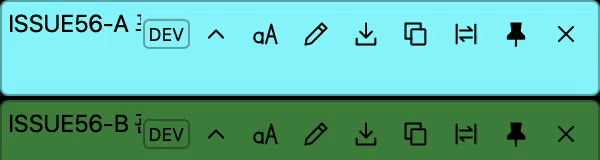
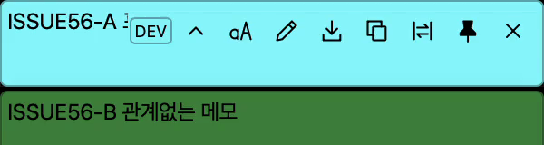

# 다중 메모 Toolbar 깜빡임 — #56, 2026-11-05

## 결과와 원인

수정 전 두 창의 Toolbar가 동시에 나타나는 현상을 재현했다. 창별 포인터 좌표 판정과 캐시는 이미 분리돼 있었으나, Rust의 `window.emit`이 불리언 상태를 전체 리스너에 방송했다. 또한 기본 JavaScript `event.listen`은 `Any` 대상이므로 Rust만 `emit_to`로 바꿔도 다른 창에서 수신했다. 송신을 `emit_to(window.label(), ...)`, 수신을 현재 창의 `Window` 대상으로 제한했다.

설치된 Tauri 2.12.2의 `src/event/listener.rs`에 있는 `match_any_or_filter`는 `EventTarget::Any` 리스너를 대상 필터와 무관하게 허용한다. [공식 이벤트 안내](https://tauri.app/develop/calling-frontend/)의 일반 리스너와 창별 리스너 구분도 함께 확인했다. 기본 리스너를 유지한 중간 수정본에서 실제 깜빡임이 남았고, 양쪽을 제한한 최종 앱에서 해소됐다.

외형·배치·키보드 표시 정책은 기존 [디자인 시스템](../../design-system.md#toolbar-롤오버--확정-2026-10-28)을 유지하며 SVG/PNG 시안을 변경하지 않았다.

## 환경과 출처

- macOS 15.6.1 (24G90), ARM64, 배율 2, 화면 2056×1329 논리 px.
- 앱 0.2.7, 기준 커밋 `fb5c4f38c4183337514808d248d8234f2c45e596` 및 이번 변경. Node v24.21.0, Rust 1.91.1, Tauri 2.12.2.
- 작업 루트: `/Users/egoinglee/orca/workspaces/agent-gibbon/floatnote/issue-56`.
- `npm run dev:info` ID: `dev-ae1520595bc95087ada44ff1`.
- 실행 파일: 위 루트의 `src-tauri/target/debug/agent-gibbon`. `ps -p PID -o comm=`으로 실제 프로세스 경로를 대조했다.
- 수정 전 비교 PID 66162, 최종 비교 PID 70404. 앞선 최종 구현 검사 PID 62549에서도 420프레임 동시 표시 0개였다.
- 메모 ID `issue56-a`, `issue56-b`; 본문의 `ISSUE56-A`, `ISSUE56-B` 표식과 해당 루트의 개발 CLI `inspect` 응답을 확인했다. `ok: true`, 예상 instance, 메모 ID·본문을 대조했다.
- PID에 속한 네이티브 창 제목 `Agent Gibbon [DEV egoing/issue-56 · ae152059] — issue56-a` 및 `— issue56-b`로 창을 특정했다. 네이티브 창 목록과 CLI 상태는 [수정 전](before.json)·[수정 후](after.json)에 보관했다.

검증용 메모만 생성·이동·편집·접기·숨김 처리했다. 설치 앱과 다른 워크트리는 종료하지 않았다. 재빌드마다 이 작업에서 시작한 PID와 절대 경로를 확인한 뒤 해당 프로세스만 종료·재시작하고 출처를 다시 확인했다.

## 동일 조건 전후 비교

두 메모를 물리 좌표 (2000,1000), (2000,1100)에 배치했다. 포인터를 창 밖 → A → 창 밖 → B → A → 창 밖 → B로 이동했다. macOS 원시 포인터를 사용했으며 종료 후 최초 좌표 (849,994.5)로 복원했다. 각 이동 사이 0.6초를 뒀다.

`ffmpeg -f avfoundation -framerate 60 -i 3:none`으로 7초간 촬영하고 검증 창 영역만 잘랐다. 장치 번호 3은 당시 `-list_devices true`에서 확인한 Capture screen 0이다. 비교 원본은 600×196이며 보관 영상은 하단의 무관한 배경을 덜어낸 600×160이다. 이 영상은 화면 합성 결과이며 메모의 반투명도는 그대로다.

| 검사 | 수정 전 | 수정 후 |
|---|---:|---:|
| 60fps 디코딩 프레임 | 421 | 421 |
| 두 Toolbar 동시 표시 | 42 | 0 |
| 포인터가 방문한 A/B Toolbar 표시 | 확인 | 확인 |
| 위치·크기·표시·고정·포커스 전후 보존 | 확인 | 확인 |
| 활성 앱 PID 전후 보존 | 확인 | 확인 |

[수정 전 영상](before.mp4) · [수정 후 영상](after.mp4)

프레임별로 두 메모의 닫기 아이콘 영역 (x=558..574, y=26..42 및 126..142)의 RGB 평균 명도 표준편차가 각각 12를 넘는지 계산했다. 아이콘이 없는 단색 영역과 아이콘이 표시된 영역을 구분하고 추출 프레임을 눈으로 확인했다. 이 기준은 이번 화면·색상·배율에 한정한 영상 판독 보조값이며 일반적인 UI 검출 테스트가 아니다. 원래 배치에서 다른 인스턴스가 반투명 메모 뒤에 비친 첫 촬영과, 배경 글자가 판독 영역에 들어온 촬영은 정량 통과 근거에서 제외했다.

## 회귀 검사

- `npm run test:ui`: 54개 통과. Rust 송신 대상 계약 검사 추가, 실제 JavaScript 리스너의 창 대상 등록 확인, 기존 포인터 표시 토글·편집 초안·접기 동작 검사 유지. 계약 검사는 원본 방송 코드에서 실패함을 확인했다.
- `cargo test --manifest-path src-tauri/Cargo.toml`: 94개 통과.
- `cargo fmt --manifest-path src-tauri/Cargo.toml -- --check`: 통과.
- `cargo clippy --manifest-path src-tauri/Cargo.toml --all-targets -- -D warnings`: 통과.
- `npm run dev:build`: 최종 송신·수신 수정으로 통과, 새 PID에서 실제 동작 검증.
- `PLAYWRIGHT_MODULE=<설치된 playwright/index.mjs> node scripts/toolbar-layout-smoke.mjs`: 144×32, 144×48, 300×80, DEV 표시 여부 6조합 통과. 포인터 표시·이전/다음 도구·Tab/Shift+Tab·본문 크기·이미지·접힘 레이아웃을 확인했다.
- 네이티브 PID 70404에서 A의 편집 버튼과 B의 접기 버튼을 Accessibility로 실행했다. A의 AXTextArea와 원문을 확인하고, B의 `inspect.folded: true`를 확인했다. 편집 입력 포커스만으로 Toolbar가 나타나지 않고 A에 포인터를 올릴 때만 표시됐다. B의 펼치기 버튼도 B에 포인터를 올릴 때 표시됐다. 아래 창별 캡처로 비교했다.
- B를 숨긴 뒤 A를 호버해도 B의 숨김·위치·크기·접힘·포커스가 유지됐다: [숨김 전후 상태](hidden-state.json). 검증 후 A의 편집을 취소하고 A/B를 숨겼으며 진행 메모는 유지했다.

[편집 창: 포인터 밖](editor-outside.png) · [편집 창: 포인터 위](editor-hover.png) · [접힌 창: 포인터 밖](folded-outside.png) · [접힌 창: 포인터 위](folded-hover.png)

## 한계

60fps 표본에서 깜빡임이 없음을 확인했으며 프레임보다 짧은 모든 시간 구간을 증명하지 않는다. 실제 캡처 이미지 메모와 실제 macOS 키보드 Toolbar 탐색은 이번 네이티브 검사에 포함하지 않았고 Chromium 레이아웃·키보드 검사로 확인했다. Windows·Intel·복수 모니터는 실행하지 않았다. 설치 배포·릴리스는 수행하지 않았다.
