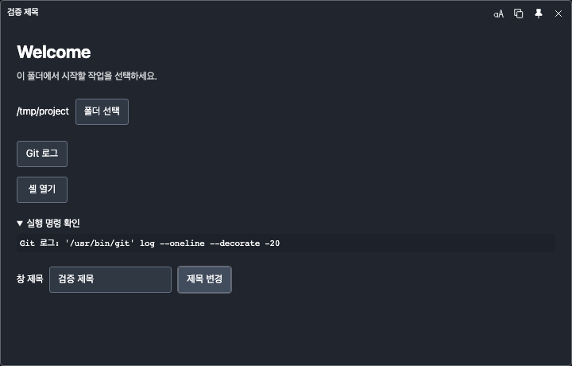

# #57 터미널 Welcome 검증

## 출처와 기준

- 작업 루트: `/Users/egoinglee/orca/workspaces/agent-gibbon/agent-gibbon/57-terminal-welcome`
- 인스턴스: `dev-868cf91c545212324aa21ebf`
- 바이너리: 위 작업 루트의 `src-tauri/target/debug/agent-gibbon`
- base: `fb5c4f38c4183337514808d248d8234f2c45e596`, red: `cbd07472ede18ed97d45cf9f49475ea4b67fcf21`
- macOS ARM64, Node 24.21.0, npm 11.19.0, Rust/Cargo 1.91.1.
- 원본 로그: `/tmp/agent-gibbon-is2-57/`. 기존 원본 저장소의 사용자 변경은 이 작업에 포함하지 않는다.

## baseline / TDD

기준 트리의 Rust 94개·UI 53개, `cargo check --locked --manifest-path src-tauri/Cargo.toml --all-targets`, Rustfmt·Clippy, `npm run dev:build` 통과. baseline 제외 없음.

첫 baseline 테스트 컴파일 도중 테스트 초안을 추가한 것을 발견해 해당 결과를 `pre-red-test.log`로 분리했다. 테스트 초안을 제거하여 기준 트리와 diff가 없음을 확인한 뒤 baseline 테스트를 다시 실행했다. 재실행 결과만 baseline으로 사용한다. 이후 테스트만 추가해 2개의 assertion 실패를 `red.log`로 확인하고 별도 red 커밋·ref·Draft PR로 보존했다.

## is2 검증 명령

- 신규: `cargo test --locked --manifest-path src-tauri/Cargo.toml terminal::` 및 `node --test tests/terminal-welcome.test.mjs`
- 회귀: `cargo test --locked --manifest-path src-tauri/Cargo.toml` 및 `npm run test:ui`
- 타입: `cargo check --locked --manifest-path src-tauri/Cargo.toml --all-targets`, 변경 JavaScript의 `node --check`
- 린트: `cargo fmt --manifest-path src-tauri/Cargo.toml -- --check`, `cargo clippy --locked --manifest-path src-tauri/Cargo.toml --all-targets -- -D warnings`, `git diff --check`
- 빌드: `npm run dev:build`; 배포 플랫폼 빌드는 GitHub Actions의 macOS ARM64·Intel 및 Windows x64 행렬에서 별도 확인.

## 구현 경계

기존 portable-pty·xterm·IME·리사이즈·로컬 통신을 재사용한다. 범용 셸은 기존 에이전트의 CLI 탐색·자동 시작과 별도 분기로 구분한다. 설치 감지는 파일 검사만 수행한다. 셸은 자체 초기화 파일을 읽을 수 있으나 앱은 명령·히스토리를 수집/저장하지 않는다.

macOS는 `proc_pidinfo(PROC_PIDVNODEPATHINFO)`로 셸의 현재 경로를 읽고, Unix PTY 전경 프로세스 그룹 및 자식 PID로 작업 여부를 판단한다. Windows는 PowerShell prompt의 제한된 경로 제어 시퀀스와 Toolhelp 프로세스 부모 관계를 사용한다. ConPTY에서는 Unix job-control API를 사용하지 않는다. 상태 조회 실패는 종료 확인으로 처리한다.

공식 API 근거: [portable-pty MasterPty](https://docs.rs/portable-pty/latest/portable_pty/trait.MasterPty.html), [Tauri Dialog](https://v2.tauri.app/plugin/dialog/).

## 실제 환경 / 진행 중

개발 CLI `inspect`의 `ok`, 인스턴스, 메모 ID를 확인했다. GUI 대상은 정확한 바이너리 경로의 PID 54693, 네이티브 제목 `Agent Gibbon [DEV 57-terminal-welcome · 868cf91c] — terminal-57001`, 창 ID 36135로 특정했다. 검증용 메타데이터는 앱 종료 후 새 ID로 만들었다. 이는 shortcut/영역 선택을 통한 신규 생성의 증거가 아니다.

최종 게이트·실환경·독립 감사 결과는 완료 후 아래에 기록한다.

## 1차 게이트와 독립 감사

시도 커밋 `62d84e42d96c708bf697729eca80b508ec1d1315`:

| 신규 | 회귀 | 타입 | 린트 | 개발 빌드 |
|---|---|---|---|---|
| FAIL | PASS (Rust 101 / UI 58) | PASS | FAIL (Clippy 2건) | PASS |

신규 테스트 범위에 포함된 기존 `login_then_interactive_preserve_codex_priority_over_current_claude`가 호출 순서 assertion에서 실패했다(기대 `-lc\n-ilc\n`, 실제 `-ilc\n`). 같은 시도의 전체 회귀에서는 통과했지만 원본 실패를 제외하지 않는다. Clippy는 테스트 모듈 뒤 항목 및 불필요한 clone을 지적했다.

구현 이력을 상속하지 않은 독립 검토자 `audit57`은 **테스트 완화 미발동 / 퇴행 신호 발동 / 스코프 이탈 미발동**으로 판정했다. Windows 내장 명령의 busy 판정, 같은 경로 재사용 시 최신 경로 추천, 문서 모순 및 수명 검증 부족을 지적했다. is2 규칙에 따라 `escalate57`에게 1회 에스컬레이션했다. 이후 통과하더라도 최초 퇴행 신호를 clean으로 소거하지 않으며 자동 병합하지 않는다.

## 브라우저 검증

`PLAYWRIGHT_MODULE=/tmp/agent-gibbon-is2-57/browser-tools/node_modules/playwright/index.mjs node scripts/terminal-welcome-smoke.mjs` 통과. 실제 HTML/CSS/xterm 자산을 Chromium에서 로드하고 Tauri IPC만 대체했다. 720×460 및 320×240에서 경로 없는 Welcome, 폴더 선택 응답, 실행 명령, 제목 변경, 추천 앱 선택, 종료 명령 전달, 스크롤/가로 넘침을 확인했다. 최초 버튼 최소 폭 검사 실패 후 텍스트 버튼 최소 너비를 64px로 보완했다. **native PTY·대화상자 검증을 대신하지 않는다.**

## 네이티브 GUI 제한

첫 관찰에서는 PID 54693 / 창 36135의 Welcome·설치 앱 목록을 접근성 트리로 확인했다. 이후 사용자가 검증 창을 직접 조작한 정황이 있어 그 입력·종료를 자동 검증 통과로 세지 않는다. 최종 조회에서 세션이 종료되고 마지막 경로·위치·크기가 유지된 상태를 확인했다.

새 메모가 보이지 않던 시점에 `CGGetActiveDisplayList` 결과는 성공코드0/활성 화면0이었다. `caffeinate -u -t 120`으로 일시적으로 깨운 뒤 동일 개발 CLI `open`이 visible:true가 되는 것을 확인했다. 영구 전원 설정은 변경하지 않았다. 그러나 Orca 접근성 조회는 `permission_denied`(visible windows but no accessibility window)로 실패했다. 권한 조회에서는 accessibility/screenshots granted였고, 프로젝트의 PID/정확한 제목 기반 Swift AX helper도 target window not ready였다. 한 차례 restore-window로도 해소되지 않았다. 권한 토글·잠금 해제·다른 인스턴스 대체를 수행하지 않았다.

따라서 최종 코드의 macOS 실제 버튼 기반 idle/busy 종료·취소·포커스 숨김·세 보조키·영역 생성 전체 회귀와 Windows 실앱 검증은 **미검증**으로 남긴다. 과거 작업이나 사용자 조작을 이 검증의 대체 증거로 사용하지 않는다.

## 에스컬레이션 후 최종 결과

독립 작업자가 prompt 확인·입력 상태로 내장 명령 busy 판정을 보완하고, 시작/입력 활동 시 최근 경로 시각을 갱신했다. reader와 종료 확인 callback은 세션 identity를 대조한다. 이전 세션의 출력이 새 세션 상태를 덮지 않는다. Channel 전달이 끝나도 PTY를 drain하며, 자식 wait는 PTY handle 해제 후 별도 reaper가 수행한다. 실제 셸 수명 테스트에서 발견한 동기 wait 정지를 수정했다. 부모는 닫힌 메모의 Feedback 자식 창을 함께 파괴하도록 보완했다.

| 신규 범위 | 전체 회귀 | 타입 | 린트 | 개발 빌드 |
|---|---|---|---|---|
| **FAIL (Rust 21 PASS / 기존 탐색 1 FAIL)** | PASS (Rust 104 / UI 59) | PASS | PASS | PASS |

원본은 `gate2-*.log/json`. 신규 명령의 `&&` 뒤 UI 부분은 미실행이며, 같은 UI 테스트 5건은 전체 UI 59개에 포함되어 통과했다. 별도 작업자의 직렬 terminal 22개 PASS를 부모의 부분 범위 실패와 교환하지 않는다. baseline 제외는 0건이다. 최초 baseline에서는 성공했으므로 기존 결함으로 추정해 제외하지 않는다. 실패는 `login_then_interactive_preserve_codex_priority_over_current_claude`의 동일 호출 순서 assertion이다. 해당 discovery 코드와 assertion·timeout은 변경하지 않았다.

실제 `/bin/sh`를 사용하는 자동 테스트로 prompt idle→내장 무한루프 busy→종료 및 백그라운드 자식 정리를 확인했다. 사용자의 셸 초기화 파일을 실행하지 않도록 이 테스트에는 `/bin/sh`를 명시했다. 이는 테스트 전용 production 분기가 아니라 production에서 사용하는 동일 `start_shell` 실행 경로다.

**남은 제한:** 사용자 셸 설정이 PS1 marker를 덮거나 여러 줄 입력으로 prompt 수를 확정하지 못하면 idle에서도 보수적으로 종료 확인을 표시할 수 있다. Windows 실행 검증은 미실시다. 이 제한과 네이티브 GUI 미검증을 숨기지 않고 사람 리뷰 대상으로 남긴다.

is2는 퇴행 신호 시 1회 격리 에스컬레이션, 부모 재검증 후 미해결이면 PR·워크트리를 보존하고 중단하도록 정한다. 이 한도에 도달했으므로 추가 테스트 완화/수정 루프, 스쿼시, 자동 병합을 진행하지 않는다. Risk는 사전/최종 모두 Medium이다.
