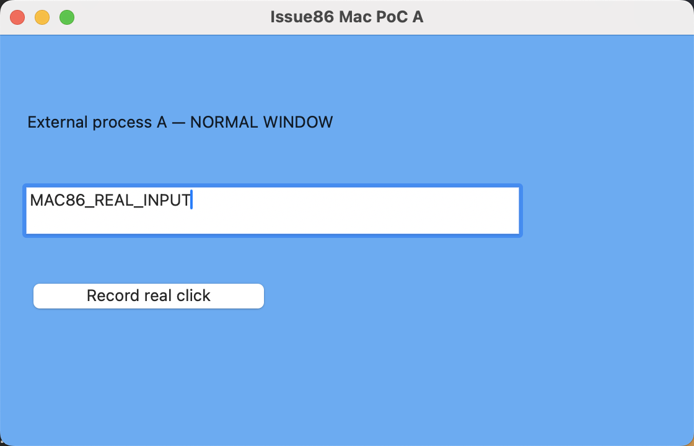
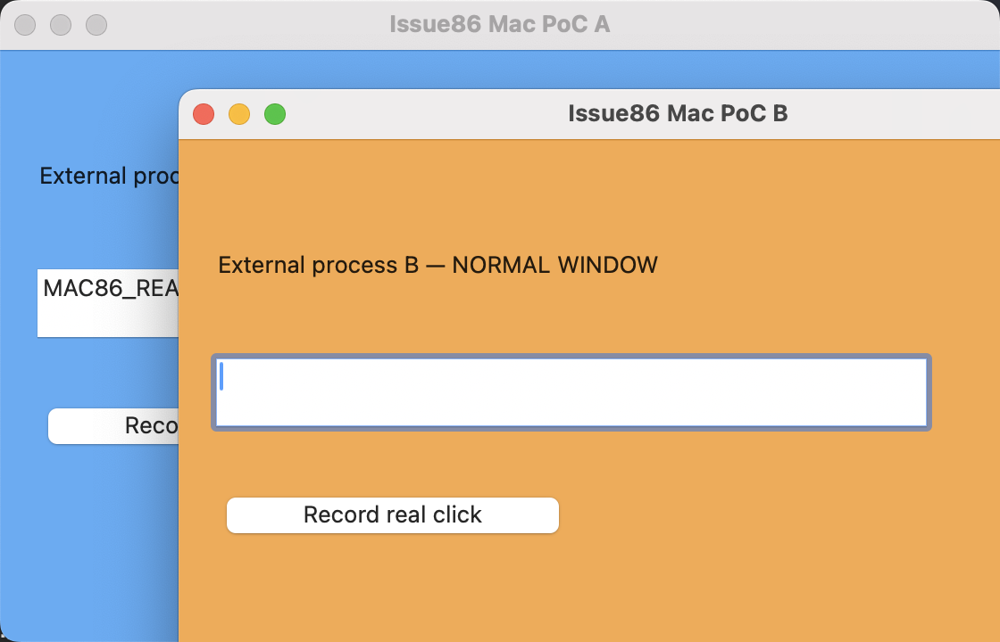

# #86 macOS 외부 창 선행 검증 — 2026-11-07

## 결론

**현재 공개 접근성 API 후보로는 필수 조건을 충족하지 못했다. Mac 제품 구현 게이트는 닫힌 상태다.** 외부 창의 위치·크기 변경, 실제 클릭·문자 입력, 원래 기하학 복원은 실기 PASS다. 일반 창 B가 활성화된 상태에서 A에 `AXRaise`를 요청해도 A는 B 뒤에 있었고, 이후 B의 실제 클릭 뒤에도 가려졌다. 모든 macOS 기법이 불가능하다는 증명으로 확대하지 않는다.

Windows 제품 지원과 별개의 사용자가 요청한 추가 PoC다. Gibbon 제품·전역 단축키·설치 목록·Welcome·통신 코드에는 변경이 없다. Mac에서 제품 기능을 지원한다는 뜻이 아니다. [디자인 시스템](../../design-system.md)의 Windows 전용 범위를 유지한다.

## 출처·환경

- 작업 루트: `/Users/egoinglee/orca/workspaces/agent-gibbon/agent-gibbon/86-windows-floating-apps`.
- 실행 시 저장소 SHA: `ec8ab42318aebcb177742257255a587c6aa6d11b`.
- macOS 15.6.1 / 24G90, ARM64, Apple Swift 6.2.4 / swift-driver 1.127.15.
- 독립 시험 소스: [probe.swift](probe.swift), SHA256 `d4f165acc752ca57ec5efd36de3e670fb554ca1a5b80bbc7c97f5092dc38578c`. 당시 미커밋 PoC이므로 저장소 SHA만으로 소스가 특정된다고 주장하지 않고 파일 해시를 별도로 남긴다.
- [실행기](run.py), [원시 API·관측·명령 로그](result.json), [파일 해시 목록](sha256.json).
- 접근성·이벤트 전송·화면 기록 사전 권한 검사 모두 true. 기본 사용자 세션이며 권한 설정을 변경하지 않았다.
- 화면 3대 연결, 모두 scale 2: 주 화면 2048×1152, 왼쪽 1728×1117, 아래 1920×1080. 실험 좌표는 주 화면 안의 논리 포인트다. 다른 화면/배율/Spaces 동작을 검증한 것은 아니다.
- 시험 도구가 새로 시작한 AppKit 일반 창 2개를 서로 다른 프로세스로 실행했다. 대상 앱은 자체 `NSWindow.level`을 변경하지 않는다. 부모 제어 프로세스가 AX로 별도 프로세스를 제어한다. 임의 설치 앱 전체에 대한 호환성 증거가 아니다.

| 대상 | PID | 실행 파일 | CGWindowID | 네이티브 제목 |
|---|---|---|---|---|
| A | 10506 | `/Users/egoinglee/.codex/artifacts/agent-gibbon-is2-86/macos-poc/probe` | 44381 | Issue86 Mac PoC A |
| B | 10510 | 위와 동일, 별도 프로세스 | 44388 | Issue86 Mac PoC B |

## 실제 관측

| 요구사항 | API 결과와 별도 관측 | 판정 |
|---|---|---|
| 외부 창 이동·크기 | AXPosition/AXSize 각각 0. A의 CGWindowBounds가 `(100,624,480,328)`에서 `(220,180,560,360)`으로 바뀜 | PASS |
| 실제 클릭·키보드 | CGEvent 마우스 down/up 및 Unicode key down/up. A 내부 버튼 수신 횟수 1, 실제 NSTextField 값 `MAC86_REAL_INPUT`, 활성 PID 10506. AXValue 직접 쓰기/클립보드 붙여넣기를 사용하지 않음 | PASS |
| 다른 일반 창 활성화 후 지속 최상단 | B를 활성화한 뒤 A에 AXRaise=0. 그러나 `02-A-raised` 관측은 활성 PID 10510, 순서 B→A, 두 창 모두 layer 0. B의 노출 부분 실제 클릭과 버튼 클릭 후에도 B→A, B 버튼 횟수 1. 1초 뒤에도 동일 | FAIL |
| 원래 위치·크기 | AXPosition/AXSize 각각 0. A의 CGWindowBounds가 원래 `(100,624,480,328)`와 정확히 일치 | PASS |
| 고정 해제·전체 원상 복귀 | 지속 고정을 얻지 못했고 레벨 변경도 없으므로 pin/unpin 왕복 검증을 통과했다고 주장하지 않음 | SKIP — 기하학 복원만 PASS |

`AXWindowLevel`이라는 문자열도 역량 탐색으로 질의·설정했으나 둘 다 -25205(attributeUnsupported), settable=false였다. 이는 Apple 공개 AX 속성명이 아니며, 이 한 번의 실패로 모든 레벨 제어 수단이 불가능하다고 결론 내리지 않는다. 창의 전체 AX 속성 목록과 settable 목록도 원본에 보존했다.

`02-A-raised` 파일 이름은 **API 요청 단계 이름**이며 실제로 A가 앞에 올라왔다는 뜻이 아니다. `backgroundRaiseObserved=false`를 명시적으로 기록했다. API 성공만으로 화면의 성공을 판단하지 않은 사례다.






이미지는 전체 데스크톱 대신 A 시험 창의 고정 좌표 영역만 캡처했다. 각 캡처 직전 정확한 두 PID의 CGWindowID·제목·bounds·앞뒤 순서와 활성 PID를 JSON에 남겼다. 실제 렌더링을 열어 확인했고 파란 A/주황 B와 문자가 로그와 일치했다.

## 재현과 시험 도구 보완 이력

저장소 루트를 현재 디렉터리로 유지하고 소스 두 개를 별도 쓰기 가능한 실험 폴더로 복사한 뒤 절대경로로 실행한다. 실행기는 현재 디렉터리에서 `git rev-parse HEAD`를 사용한다. Swift 산출물·런타임 파일을 저장소에 추가하지 않는다.

```sh
cd /Users/egoinglee/orca/workspaces/agent-gibbon/agent-gibbon/86-windows-floating-apps
POC_DIR=$(mktemp -d /tmp/issue86-macos.XXXXXX)
cp docs/verification/issue86-macos-poc/probe.swift docs/verification/issue86-macos-poc/run.py "$POC_DIR/"
swiftc "$POC_DIR/probe.swift" -o "$POC_DIR/probe"
python3 "$POC_DIR/run.py"
```

필수 topmost FAIL을 포함한 최종 실행 종료 코드는 **2**다. `COMPLETED_WITH_TOPMOST_FAILURE`는 실험 수행 완료이며 기능 통과가 아니다. 권한/활성화/입력 관측이 실패하면 `INCOMPLETE`로 구분한다. 현재 실행기는 좌표가 주 화면 2048×1152 안에 있다고 가정하므로 다른 디스플레이 배치에서는 재검토해야 한다. 원본 실험 폴더는 `/Users/egoinglee/.codex/artifacts/agent-gibbon-is2-86/macos-poc/`다.

보존한 실행기는 이번 실패 실험의 원본이며 범용 합격 판정기로 사용하지 않는다. `topmost` 값은 즉시 순서로 계산하고 1초 뒤 순서는 기록만 한다. 또한 완료 status 문자열은 고정된 실패 문구라, 향후 다른 환경에서 PASS가 나오는 경우의 status/종료 코드에는 일관성 보완이 필요하다. 이번 원본은 즉시·1초 뒤 모두 B→A여서 최종 FAIL 결론에 영향이 없다. 이를 숨기기 위해 원본 소스를 사후 변경하지 않았다.

- 최초 준비 실행: 포인터 복원 명령의 빈 stdout을 JSON으로 파싱해 종료 단계에서 오류. 시험 프로세스 종료와 포인터 복원은 실행됐지만 구조화 결과가 저장되지 않았다. 이 실행을 검증 근거로 쓰지 않는다.
- [attempt1](attempt1/result.json): 이동 성공 후 NSRunningApplication.activate 반환 true와 실제 활성 PID 불일치로 중단. 포인터 복원의 JSON 처리 오류를 보완한 실행이다.
- [attempt2](attempt2/result.json): activate 후 run loop를 기다려도 활성 PID 불일치로 중단. 모두 프로세스 정리·원래 앱/포인터 복원 관측을 기록했다.
- [attempt3](attempt3/result.json): AXFrontmost로 활성화하고 실제 PID를 확인해 입력·이동·복원 및 topmost 실패를 관측. 이 단계의 AXRaise는 A가 이미 앞에 있는 조건이라, 최종 실행은 **B가 활성화된 뒤 A에 AXRaise**하도록 보강했다. 판정을 PASS로 바꾸지 않았다.
- 최종 [result.json](result.json): PID 10506/10510, 실제 B 노출 부분 클릭 포함. 모든 필수 assertion을 유지하고 topmost 실패를 nonzero로 반환한다.

각 실행은 자신이 subprocess로 시작한 PID만 종료했다. 최종 A/B 모두 종료(-15)를 확인했다. 시작 활성 PID 16242를 끝에도 확인했고, 포인터 `(708,1002)`도 동일하게 복원했다. 기존 앱 창의 이동·종료, 기존 메모 수정, SIP 변경·주입·sudo는 하지 않았다. 진행 메모의 개발 인스턴스는 inspect 결과 미실행이어서 새 인스턴스를 시작하지 않았다.

## 기술 판단과 미검증 대안

Apple의 [AXRaise](https://developer.apple.com/documentation/applicationservices/kaxraiseaction)는 앞에 올리기 동작이며 지속적인 topmost 계약이 아니다. [NSWindow.level](https://developer.apple.com/documentation/appkit/nswindow/level-swift.property)은 NSWindow 객체의 속성으로, 외부 앱의 객체를 공개 AX API로 얻어 설정하는 수단을 이번 조사에서 확인하지 못했다.

절대 불가능이라고 단정할 수는 없다. 실제 [yabai의 공식 문서](https://github.com/asmvik/yabai/wiki/Disabling-System-Integrity-Protection)는 외부 창 layer/topmost 제어를 Dock scripting addition과 SIP 일부 해제가 필요한 기능으로 분류한다. 이는 접근성 권한만으로 충족된다는 근거가 아니며 이번에 실행·설치하지 않았다. 보호 설정 변경·코드 주입·private SkyLight API는 검증 범위 밖이다. 반복 AXRaise, 미러 창/입력 전달, 앱 자체 협력 방식도 시험하지 않았다. WebView 임베딩으로 범위를 넓히지 않는다.

따라서 **기본 보호 설정을 유지한 일반적인 Agent Gibbon 설치에서, 임의 외부 앱의 원래 창을 지속 topmost로 제어하는 지원 경로는 아직 확보하지 못했다.** Mac 제품 구현은 보류하고 Windows 전용 동작을 유지한다. 이 결론은 Intel/다른 macOS/실제 설치 앱 전체 또는 미시험 대안의 불가능 판정이 아니다.

## 이번 변경의 검사 범위

제품 소스·매니페스트·lockfile·빌드 설정 변경이 없는 문서/실험 증거 추가다. Swift PoC 빌드와 실기 실행·스크린샷 대조·원본 해시를 확인했다. 제품의 5종 게이트·3플랫폼 release workflow를 새 HEAD에서 재실행하지 않았으며 기존 SHA의 CI를 최신 SHA 통과로 표시하지 않는다. Mac 기능 선행 게이트 FAIL과 Windows 제품의 기존 5종 PASS를 분리한다. 독립 검토 결과는 후속 감사 절에 기록한다. UI 외형/기준 변경이 없어 SVG/PNG 시안은 유지하고 실기 캡처를 별도로 보존한다.

## 독립 감사

구현 대화를 상속하지 않은 별도 검토자가 원본 18개 해시, 각 시도 Swift 소스 해시, 세 캡처, 실제 입력 수신·PID/창 순서·정리/포커스 복원을 독립 대조했다. 테스트 완화·오류 은폐·지원 범위 과장은 발견하지 않았으며 현재 topmost FAIL 결론을 수용했다. [감사 기록](audit.md).

지적된 재현 cwd를 위 명령에서 바로잡고 실행기 판정 코드의 한계를 명시했다. 소스→바이너리 출처의 추가 한계도 남긴다. 빌드 명령 exit 0은 실행 도구에서 확인했지만 당시 별도 빌드 로그와 시작 시점 바이너리 해시를 기록하지 않았다. 현재 보존 바이너리의 **사후** 해시·mtime·명령을 [provenance.json](provenance.json)에 추가했으며 이를 실행 시점 암호학적 증명으로 주장하지 않는다. 실행 바이너리는 원본 실험 폴더에 보존하고 저장소에는 추가하지 않았다.
