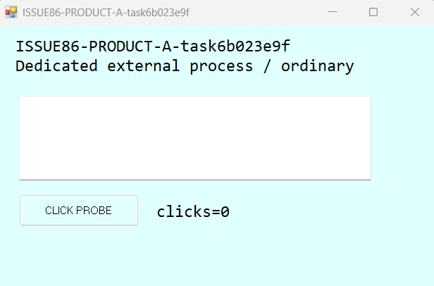
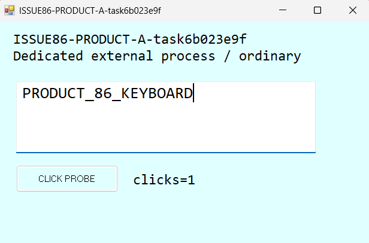
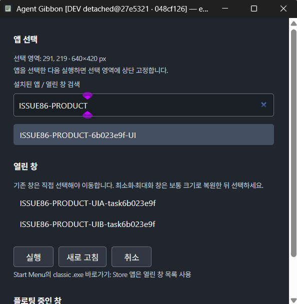

# #86 Windows 제품 검증

제품 소스는 변경하지 않았다. 이 폴더의 검증용 WinForms 앱, 실행 스크립트, 로그, 잘라낸 실제 캡처만 이번 작업의 산출물이다. UI 기준은 [디자인 시스템](../../design-system.md#Windows-외부-앱--86-2026-11-07), [제품 시안](../../design/external-apps.png)을 따른다. 시안 확인은 실행 검증으로 계산하지 않는다.

## 최종 결과: 27e5321

실제 제품 소스 SHA **`27e5321049ad42b2e75848221ac27f9990df3055`**를 detach 체크아웃하여 다시 빌드·실행했다. 아래 필수 네 관측은 이 SHA에서 모두 통과했다. 이전 실행을 최신 소스의 실행 증거로 대신하지 않았다. `3009e0b`와 외부 앱/캡처/Welcome의 Git blob이 같은 것은 [소스 대조](final-source-provenance.json)로 별도 기록했다.

| 범위 | 실제 결과 | 원본 증거 |
|---|---|---|
| 전체 검사 | Rustfmt·Rust 178개·check·Clippy `-D warnings`·개발 빌드 통과, UI 123통과/1 SKIP | [최종 검사](27e5321-gates/) |
| 필수 네 실기 + 최소 크기 + 종료 창 | 여섯 관측 모두 true, 실제 B 제목줄 클릭/foreground·겹침 hit-test·앱 문서/이벤트·캡처 확인 | [실기 요약](run-20261107-022338/summary.json), [원본 관측](run-20261107-022338/raw.jsonl) |
| Start Menu·CWD·기존 창·취소·timeout | 다섯 관측 모두 true | [실행 요약](run-20261107-022353/summary.json), [실제 시작 폴더](run-20261107-022353/Launch-events.tsv) |
| 저널 복구·guard 모의·정상 종료 복원 | 세 관측 모두 true, 각 재시작 뒤 inspect·실제 PID/경로 재확인 | [복구 요약](run-20261107-022543/summary.json), [원본 관측](run-20261107-022543/raw.jsonl) |
| 실제 Ctrl+Shift+4·overlay 취소/작은 영역·Welcome 선택/실행/해제/취소 | 아홉 관측 모두 true, 공식 Orca의 실제 입력 및 후속 상태로 확인 | [UI 요약](run-20261107-022602/summary.json), [원본 관측](run-20261107-022602/raw.jsonl) |

- 최종 최초 서버는 PID **23952**, UI 재확인 서버는 PID **26864**다. 둘 다 이 작업트리의 정확한 debug exe 경로를 확인했다. 최종 전용 UIA는 PID **34600**, HWND **2622518**, 제목 `ISSUE86-PRODUCT-UIA-task6b023e9f`다. overlay/Welcome HWND와 각 명령은 UI 원본 로그 및 `windows-*.json`에 연결된다. DEV 배지만으로 창을 식별하지 않았다.
- 최종 Welcome 버튼은 실제 UI Automation readback에서 너비 **80/97/81px**, 높이 **42px**, 동일 y로 관측됐다. 기존 세로 줄바꿈 결함은 최종 소스에서 해소됐고 실제 캡처를 열어 확인했다. 공통 디자인 기준은 변경하지 않았다.
- 10×10px 드래그 뒤 overlay가 유지되어 최소 영역 오류를 알렸고, 같은 선택 화면에서 정상 640×420 영역을 다시 선택할 수 있었다. 실제 Ctrl+Shift+4로 **자기 서버 PID의 overlay**가 생겨 단축키 소유를 확인했다. 이 최종 실행에는 단축키 충돌이 없었다.
- 화면 내 **해제**를 실제 클릭하고 세션 제거 및 외부 A의 위치·크기·topmost·가시성·WINDOWPLACEMENT 일치를 확인했다. 실제 Welcome **취소**와 overlay **Escape** 뒤 선택기가 사라지고 세션이 비어 있었다. 일부 release 직후 캡처는 복구된 **자기 시험 창**에 가려져 있으므로 전체 Welcome 외형의 증거로 사용하지 않는다.
- `ui-run-27e5321.log` 실행도 동작 아홉 항목은 true였지만 두 번째 Welcome 검색 입력 전달을 충분히 확인하지 않았다. 공개 전 관련 미필터 트리를 제거하고, `ui-run-27e5321-2.log`에서는 검색 필드 readback과 모든 행이 고유 시험 표식에 일치하는지 확인한 뒤 캡처했다. 일부 공식 도구의 `window_not_focused`는 안내대로 `--restore-window`를 한 번 사용했고 후속 실제 상태로 확인했다.
- `3009e0b`의 첫 topmost 실기는 B의 실제 활성화가 안 되어 false였다. 자기 B를 보통 창의 최상단으로 노출하고 입력 지점을 hit-test한 뒤 실제 제목줄 클릭을 확인한 두 번째 실행은 통과했다. 최신 SHA에서도 이 방식으로 다시 확인했으며 첫 실패는 지우지 않았다.
- 마지막 [상태 복구](final-cleanup.log)에서 foreground **1967202 → 1967202**, 포인터 **[1618,908] → [1618,908]**, 자기 시험 창 전부 닫힘을 확인했다. 전용 바로가기를 제거했고 자기 개발 앱 PID 26864에만 정상 종료 요청을 보냈다([종료 기록](final-shutdown.log)). 진단은 끝까지 비활성 상태였다([최종 진단](diagnostics-disabled-final.json)).
- 별도 기존 Gibbon 보존 대조 시점에는 자기 개발 앱 외 `gibbon/floatnote` 프로세스가 없었다. `existing-before.json`과 `existing-after.json`의 다른 Gibbon 프로세스/창 수는 **0 → 0**이다. **설치 앱이 실행 중인 상태를 보존했다는 검증으로 표현하지 않는다.** 다른 작업트리/설치 앱을 실행하거나 종료·대체하지 않았다.

실제 재활용 HWND, 의도적으로 겹친 직접 attach/선택기 닫기 경쟁, 트레이 UI 클릭, Medium/UAC·혼합 DPI는 아래 한계대로 미검증이다. 필수 네 제품 실증은 SKIP 없이 완료했다. 최종 `git diff`의 제품 소스 변경은 없고 증거 커밋에는 이 폴더만 포함한다.

## 실행 출처

- 작업 루트: `C:\Users\egoin\orca\workspaces\agent-gibbon\86-product-verification`
- 개발 인스턴스: `dev-048cf12677f7f889066b5597`
- 개발 바이너리: 위 루트의 `src-tauri\target\debug\agent-gibbon.exe`
- 모든 제품 명령은 위 루트의 `scripts\agent-gibbon-dev.cmd`로만 호출했다. 설치 앱, 다른 작업트리, release 바이너리를 대신 사용하지 않았다.
- 고유 메모: `issue86-product-6b023e9f`, 본문 `ISSUE86_PRODUCT_6b023e9f`. 실제 `inspect`의 `ok:true`, `instance`, 본문을 확인한 뒤 GUI를 사용했다. 네이티브 창 제목·HWND와 실행 파일 절대 경로·PID를 별도로 대조했다.
- OS: Windows `10.0.26200`, x64, 단일 화면 1920×1080, 시험 창 DPI 120(125%). Node 20.11.0, npm 10.2.4, Rust/Cargo 1.99.1, Python 3.10.11. 도구 버전은 직접 조회했다.
- 진단: `diagnostics-disabled.json`에서 `enabled:false`, `sharing_allowed:false`, `terms_accepted:false`, `terms_skipped:true`다. 진단 동의·업로드·probe를 수행하지 않았다.

## 소스별 검사 이력

| 실제 SHA | 결과 | 로그 |
|---|---|---|
| `0a4c154611b598495b9a88fce8b5b1f42cb888df` | npm ci, Rustfmt, Rust 177개, check, Clippy, UI 123통과/1건너뜀, dev:build 통과; 조정자 지시로 제품 실기는 다음 수정에 보류 | 최상위 `*.log`, `initial-gates.json` |
| `953778b81a0ee171853ed35e0aaa28ae471a9a26` | E0282: `windows.rs:208`의 `rows.iter().map` 타입 추론 실패; test/check/Clippy/build 실패 | `953778b-gates/` |
| `f6279d80ff2d2a89dbdb5bb27a641531eca747da` | Rust 178개/check/build/UI 통과; Clippy의 미사용 PeekMessageW, collapsible_if, GetMessageW ABI 중복 선언 실패 | `f6279d8-gates/` |
| `9f29ff3c7a87cd3ae268d7cac79039fd451323da` | Rustfmt, Rust 178개, check, Clippy, UI 123통과/1건너뜀, dev:build 통과; 아래 실제 제품 관측 수행 | `9f29ff3-gates/` |
| `b99570eaa9613ef9028c3d2cdfd051c833847ee3` | Rustfmt/test/check/UI/build 통과; Clippy items_after_test_module 실패 | `b99570e-gates/` |
| `2c1ad0a611484353c14a6549a2c7f5382b1a066f` | 동일 Clippy 오류 재현; Rustfmt/test/check/UI/build 통과 | `2c1ad0a-gates/` |
| `3009e0b619fdbfc5ed38f065ad7b5ef05ef9e7f7` | 모든 게이트 및 필수 네 실기 통과; 포커스 거절로 UI 자동화가 중단된 실행은 도구 실패로 보존 | `3009e0b-gates/`, `run-20261107-021958/`, `run-20261107-022155/` |
| `27e5321049ad42b2e75848221ac27f9990df3055` | 전체 게이트와 필수 네 실기, 실행/CWD/취소/timeout, 복구/종료 및 실제 Welcome 아홉 관측 통과 | 위 최종 결과 |

Windows 빌드 오류는 부모에게 정확한 진단을 전달했으며 제품 코드를 수정하거나 검사를 완화하지 않았다. 이전 실패 로그를 보존했다. 증거 폴더를 만들기 전 최초 `git status --short`는 비어 있었고 이후 변경은 이 폴더의 untracked 파일뿐이었다. `initial-status.txt`는 폴더 생성 후 기록이므로 해당 untracked 경로가 포함된다.

UI의 유일한 SKIP은 테스트 12, `development CLI rejects missing, old and foreign binaries without release fallback`이다. 원래 조건은 `POSIX executable fixtures; Windows uses native CLI smoke tests`로, POSIX 실행 파일 fixture를 사용하는 테스트가 Windows에서 건너뛰어진 것이다. 전체 통과로 바꾸어 기록하지 않는다.

실행 명령은 `npm ci`, `cargo fmt --manifest-path src-tauri/Cargo.toml --all -- --check`, `cargo test --locked --manifest-path src-tauri/Cargo.toml`, `cargo check --locked --manifest-path src-tauri/Cargo.toml`, `cargo clippy --locked --manifest-path src-tauri/Cargo.toml --all-targets -- -D warnings`, `npm run test:ui`, `npm run dev:build`였다. PowerShell에서는 `npm.cmd`/`cmd /d /c`로 실행했다.

## 9f29ff3 실제 제품 관측

아래는 **9f29ff3의 실행 증거**이며 이후 변경된 소스의 실행 증거로 재사용하지 않는다.

### 필수 네 관측

`run-20261107-015839/summary.json`의 여섯 항목은 모두 true다. 전용 WinForms A/B를 새로 컴파일·실행했고 창 제목에 `ISSUE86-PRODUCT-…-task6b023e9f`를 넣었다. 제품 `app windows` → `app attach --window HWND --region 220,180,640,420` → `app sessions` → `app release --session ID`를 실제 호출했다. 자세한 HWND/PID/exe/배치 값은 해당 실행의 `raw.jsonl`에 있다.

1. A가 실제 `[220,180,860,600]` 모서리로 이동하고 크기가 640×420으로 바뀌었다.
2. 공식 Orca 도구로 보통 창 B의 노출된 제목줄을 실제 클릭하여 foreground=B를 확인했다. 겹치는 점의 `WindowFromPoint → GetAncestor(GA_ROOT)`는 A였고 A.topmost=true, B.topmost=false였다. API 반환과 이 관측을 별도로 기록했다.
3. 공식 Orca 도구로 A의 CLICK PROBE와 편집기를 클릭하고 `PRODUCT_86_KEYBOARD`를 입력했다. 앱의 `A-document.txt`, `A-events.tsv`의 button-click, 실제 캡처에서 문자열과 clicks=1을 확인했다. Orca의 synthetic input 반환은 그 자체로 통과 처리하지 않았다.
4. 제품 release 후 위치·크기·topmost·가시성과 WINDOWPLACEMENT가 최초 값과 일치했다. 외부 앱을 종료하지 않았다.

추가로 180×140 영역은 제품의 160×120 검사보다 크지만 시험 앱의 최소 크기보다 작다. 제품이 오류를 반환하고 A의 원래 상태로 되돌렸으며 세션을 남기지 않았다. B를 닫은 뒤 이전 inventory의 HWND로 attach하면 선택 변경 오류로 거절했다.

첫 스크립트 실행(`015741`)은 출력 인코딩 때문에 테스트 도구가 중단됐다. 두 번째(`015758`)는 B를 활성화하려는 API 반환만으로 실제 활성화가 되지 않아 topmost_after_B=false였다. 이는 제품 topmost 실패로 단정하지 않으며, 세 번째에서는 **실제 제목줄 클릭과 foreground readback**을 추가해 동일 제품에서 확인했다. 실패 실행도 보존한다. 초기 스크립트의 종료 코드만으로 PASS를 판단하지 않았고 최종 스크립트는 누락/false가 있으면 종료 코드 1을 반환한다.

### 바로가기·실행·취소

`run-20261107-020209/`는 CWD 로깅을 추가한 재확인이다. 자기 사용자 Start Menu에 `ISSUE86-PRODUCT-6b023e9f-*.lnk`만 새로 만들고 그 바로가기만 삭제했다. 대상은 새 임시 폴더에 컴파일한 전용 exe이며 launch/cancel/timeout은 서로 다른 exe 경로를 사용했다.

- 실제 `app list`에서 새 classic exe 바로가기를 찾고 `app open`으로 새 프로세스를 실행·연결했다.
- 시험 앱의 `Launch-events.tsv`에 기록된 실제 `cwd`는 해당 바로가기의 시작 폴더와 일치했다.
- 같은 exe의 기존 창이 있으면 자동 이동하지 않고 `existing_windows`를 반환했다.
- 3.5초 뒤 창을 만드는 앱 시작을 취소한 뒤 늦은 연결이 없었다. 취소가 프로세스 생성보다 먼저 이기면 프로세스가 생기지 않을 수도 있어 두 경우를 구분했다.
- 14.5초 뒤 창을 만드는 앱은 12초 시점에 failed가 되고, 뒤늦게 나온 창은 topmost가 되지 않았다. 제품은 시작된 외부 앱을 강제 종료하지 않았다. 검증 종료 시 소유권을 다시 확인한 시험 창만 닫았다.

### 실제 Windows Welcome·영역 선택

`run-20261107-020038/`에서 서버 PID 19056의 exe 경로와 네이티브 제목/HWND를 확인했다. CLI `app select`의 overlay HWND 6751804를 공식 Orca 도구로 드래그하여 Welcome HWND 6817340을 만들었고, 화면/트리에서 선택 영역 `291,219 · 640×420 px`를 확인했다.

검색 입력에 `ISSUE86-PRODUCT`를 실제 입력하여 다른 앱·사용자 창은 캡처에서 제외했다. 새 바로가기를 선택했을 때 세션은 비어 있었고, 실행 뒤에는 이미 열린 전용 시험 창 두 개 중 다시 선택하라는 상태가 표시됐다. UIA 창 행을 실제 클릭한 뒤 실행하자 선택기가 닫히고 전용 A에만 제품 세션이 생겼다. `ui-before-run-sessions.json`, `ui-existing-disambiguation.json`, `ui-attached-sessions.json`이 이를 연결한다.

재시작 후 서버 PID 13752에서도 inspect의 인스턴스·본문, exe와 note native title을 재확인했다. 전용 시험 앱에 실제 **Ctrl+Shift+4**를 입력했을 때 이 PID 소유 overlay HWND 5243730이 생겨 단축키의 소유를 확인했다. Escape 취소 후 연결 세션이 없었고, 다시 단축키→실제 드래그하여 Welcome HWND 5374802를 확인했다. `shortcut-overlay-own-fixture-crop.png`는 이 overlay의 정지 화면 중 자기 시험 앱 내부만 잘라낸 실제 픽셀이다.

**발견한 UI 결함:** 기본 480×460 DIP Welcome(125%에서 관측 네이티브 크기 618×622)에서 `새로 고침`·`취소` 버튼 폭이 줄어 글자가 세로로 줄바꿈된다. `ui-filtered-client.png`에 있다. 동작 실증 통과와 이 외형 결함을 구분하여 부모에게 전달했다. Welcome 취소의 Alt+F4 시도는 닫힘을 입증하지 못했으므로 통과로 기록하지 않는다.

### 복구·종료

`run-20261107-020437/summary.json`의 세 항목이 true다. 각 재시작 뒤 고유 메모 inspect와 자기 바이너리 경로/PID를 다시 확인했다.

- 실제 제품 attach가 만든 `.external-recovery` JSON을 확인한 뒤 **정확한 자기 개발 앱 PID만** 비정상 종료했다. 외부 A는 살아 있었고 재시작한 제품이 원래 위치·크기·topmost·가시성·placement를 복구하고 기록을 지웠다.
- 자기 시험 창에만 붙은 해당 저널의 고유 property를 제거하여 식별 표식 불일치를 모의했다. 재시작한 제품은 그 창의 상태를 건드리지 않고 오래된 기록을 버렸다. 이는 **실제 HWND 재사용 성공 실험이 아닌 guard 불일치 모의 검증**이다.
- 자기 개발 앱의 검증된 GUI 스레드에 Win32 `WM_QUIT` 정상 종료 요청을 보냈다. 제품 종료 중 A가 원래 상태로 돌아오고 기록이 정리됐다. **실제 트레이 종료 UI를 클릭한 결과와 구분**한다.

첫 복구 스크립트(`020408`)는 테스트 도구의 저널 경로 계산 오류로 중단됐고, 자기 세션을 제품 CLI로 해제한 뒤 경로를 바로잡아 재실행했다. 제품 코드·동작을 변경하지 않았다.

## 보존·공개 범위와 한계

- 기존 메모 본문이나 사용자 창을 시험 대상으로 사용하지 않았다. 기존 창에 property를 쓰거나 이동·숨김·종료 명령을 보내지 않았다. 소유 창의 PID와 정확한 exe 경로를 확인한 뒤에만 닫았다.
- 원래 포커스·포인터 복구를 시도하고 readback을 기록했다. 일부 중간 복구에서 Windows가 foreground 전환을 거절했으므로 그 실행을 복구 성공으로 기록하지 않는다. 최종 복구에서는 자기 창의 실제 닫힘을 기다린 뒤 원래 포커스와 포인터의 정확한 일치를 확인했다.
- 공개 PNG는 시험 창 내부로만 잘랐다. 기존 사용자 화면을 담는 전체 화면이나 필터 전 Welcome 캡처를 커밋하지 않는다. 자르기만 수행하고 내용을 합성하거나 확대하지 않았다. 원본 해시·잘라낸 경계는 `screenshot-provenance.json`에 기록한다.
- 이 폴더의 `.gitattributes`는 원본 바이트/체크섬 보존을 위해 줄바꿈 변환을 끄고 CRLF를 허용한다. 원본 cargo stdout의 마지막 빈 줄과 `whoami.exe`의 공백 정렬은 보존했으며, 원본 로그·이벤트 출력에만 whitespace 검사를 제외한다. 이 설정 전 원본 출력의 whitespace 지적은 `whitespace-check.log`에 보존하고 설정 후 검증 코드·문서는 `git diff --cached --check`로 확인했다. 제품 게이트나 테스트 조건은 바꾸지 않았다.
- 공식 Orca Windows 도구는 tray/menus 지원을 false로 보고하고 explorer의 실제 taskbar HWND 지정은 windowNotFound로 거절했다. 따라서 **실제 트레이에서 해제/종료 클릭은 미검증**이다. API 또는 WM_QUIT 결과로 트레이 GUI 통과를 대신하지 않는다.
- 혼합 DPI·다중 모니터·음수 화면 원점·UAC·Medium 권한 앱·실제 재활용 HWND/PID와 무응답 타사 앱은 미검증이다. 단일 125% 화면, 현재 실행 토큰과 자체 시험 앱의 범위만 관측했다.
- 직접 attach와 선택기 닫기의 실제 경쟁을 의도적으로 겹친 테스트는 미검증이다. 일반 attach가 빨리 완료되어 공식 GUI 도구의 순차 입력으로 경쟁 구간을 확정할 수 없었다. 성공한 일반 attach/닫힘을 경쟁 통과로 대신하지 않는다. 지연 시험 fixture를 준비했지만 그 경쟁 실험은 수행하지 않았다.
- 설치·패키징·release workflow·태그·공개 배포는 이 작업에서 수행하지 않았다.
